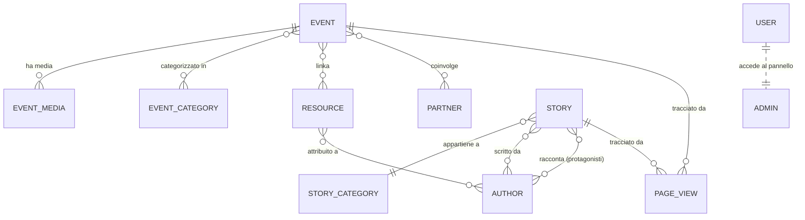

# 01 · Panoramica del progetto

## Cos'è salento.dev

**salento.dev** è una community di sviluppatori del Salento. Questo repository contiene il **sito web istituzionale** della community: il punto di ingresso pubblico verso eventi, contenuti e rete di partner, e al tempo stesso lo strumento operativo con cui lo staff cura quei contenuti.

Il sito assolve a quattro funzioni principali:

1. **Vetrina pubblica** — presenta la community, i suoi eventi, le risorse condivise, le storie dei membri e i partner. È la parte navigata dagli utenti anonimi.
2. **Gestione dei contenuti (CMS)** — un pannello di amministrazione costruito con **Filament** consente allo staff di creare e curare eventi, risorse, storie, autori, partner e categorie, senza toccare il codice.
3. **Analytics interne** — un middleware proprietario (`app/Http/Middleware/TrackPageView.php`) registra le visite alle pagine pubbliche, alimentando i widget statistici della dashboard admin, **senza** cookie né servizi di tracciamento di terze parti.
4. **Pagine legali** — informative GDPR/cookie. La presentazione delle attività vive nelle sezioni della home.

Il sito adotta un'estetica **dark/cyber-terminal** con animazioni curate (GSAP, Alpine.js, Motion One) ed è interamente in **lingua italiana** per i contenuti rivolti all'utenza. Il dominio di riferimento e le coordinate della community sono centralizzati in `config/community.php`.

> Documenti correlati: l'architettura tecnica è descritta in [Architettura](../02_architettura/01_architettura.md), il modello dati in [Database](../02_architettura/02_database.md) e [Modelli](../02_architettura/03_modelli.md), il dettaglio delle funzionalità in [Funzionalità](./02_funzionalita.md).

---

## Domini funzionali

Il sito ruota attorno a **cinque entità di dominio** principali, affiancate da entità di supporto. La tabella seguente è la mappa entità → pagina pubblica → gestione admin.

| Dominio | Descrizione | Pagina/route pubblica | Componente Livewire | Gestione admin |
|---------|-------------|-----------------------|---------------------|----------------|
| **Eventi** | Meet-up, workshop, talk, hackathon della community. Hanno date, luogo, categorie, media, risorse e partner collegati. | `/events`, `/events/{event:slug}` | `EventsPage`, `EventDetailPage` | `EventResource` |
| **Risorse** | Documenti e slide condivisi (link esterni o file caricati), attribuibili a uno o più autori e collegabili a eventi. | `/resources` | `ResourcesPage` | `ResourceResource` |
| **Storie** | Articoli/racconti della community (esperimenti, tutorial, riflessioni, case study) con autori e protagonisti. | `/stories`, `/stories/{story:slug}` | `StoriesPage`, `StoryDetailPage` | `StoryResource` |
| **Partner** | Aziende e community partner/sponsor, con logo, descrizione e sito. | `/partners` | `PartnersPage` | `PartnerResource` |
| **Autori** | Profili delle persone che firmano risorse e storie; arricchibili automaticamente dal profilo GitHub. | (incorporati nei dettagli di storie/risorse) | — | `AuthorResource` |

A supporto esistono le entità: **EventCategory** (`config` route `/events`), **StoryCategory**, **EventMedia** (immagini/video allegati agli eventi), **PageView** (record di analytics) e **User** (account admin Filament).

> Storico: la tabella delle route nel `CLAUDE.md` di progetto **non** include ancora Storie e Autori, e l'elenco modelli non cita `Story`, `StoryCategory`, `Author`, `PageView`. La presente `docs/` è la fonte aggiornata; la discrepanza è tracciata in [Note e debito tecnico](../04_sviluppo_e_qualita/04_note_e_debito_tecnico.md).

### Mappa delle relazioni (vista d'insieme)



> Il dettaglio campo-per-campo delle tabelle e dei vincoli è in [Database](../02_architettura/02_database.md); le relazioni Eloquent in [Modelli](../02_architettura/03_modelli.md).

---

## Glossario dei termini di dominio

| Termine | Significato nel progetto |
|---------|--------------------------|
| **Evento pubblicato** | Evento con `is_published = true`. Solo questi compaiono al pubblico. |
| **WIP (work in progress)** | Evento con `work_in_progress = true`: appare in lista con card dedicata, ma il suo dettaglio resta **404** finché non viene completato. |
| **Evento community** | Evento con `is_community_event = true`: organizzato direttamente da salento.dev, distinto da quelli solo segnalati (badge dedicato in admin). |
| **Risorsa link / file** | Una risorsa è un **link esterno** (`source_type = 'link'`, campo `external_url`) **oppure** un **file caricato** (`source_type = 'file'`, campo `file_path`). L'accessor `resource_url` restituisce l'URL corretto. |
| **Autore vs Protagonista** | In una storia, gli **autori** sono chi scrive, i **protagonisti** chi viene raccontato: due relazioni distinte verso `Author` (`author_story` e `protagonist_story`). |
| **Arricchimento GitHub** | Se un autore ha `github_username`, gli accessor `display_*` completano bio/ruolo/sito/Twitter dal profilo GitHub pubblico (cache 24h). I campi locali hanno sempre la precedenza. |
| **Read time** | Stima dei minuti di lettura calcolata a runtime dall'accessor `read_time_minutes` (≈ 250 parole/minuto sul corpo Markdown). Presente su `Event` e `Story`. |
| **PageView** | Record di una visita pubblica idonea (GET 200, no bot, deduplica 30 minuti). Può essere polimorficamente associato a un evento o a una storia (`viewable`). |
| **Slug** | Identificatore testuale univoco usato nelle route di dettaglio (`{event:slug}`, `{story:slug}`) al posto dell'ID numerico. |

---

## Stack tecnologico

| Layer | Tecnologia | Versione (da `composer.json` / `package.json`) |
|-------|------------|----------|
| Linguaggio | PHP | `^8.2` (ambiente di build/CI testato anche su 8.3/8.5) |
| Framework backend | Laravel | `^12.0` (struttura "slim": niente `Http/Kernel.php`, config in `bootstrap/app.php`) |
| Componenti reattivi | Livewire | 3 (con Alpine.js bundlato) |
| Pannello admin | Filament | `^5.0` |
| CSS | Tailwind CSS | `^4.0` (via `@tailwindcss/vite`) |
| Interattività | Alpine.js | `^3.15` |
| Animazioni | GSAP (`^3.14`), Motion One (`@motionone/dom`), AutoAnimate (`@formkit/auto-animate`) | — |
| Build tool | Vite | `^7.0` |
| Database | MySQL | 8.4 (via Docker/Sail; `.env.example` di default usa SQLite) |
| Ambiente locale | Laravel Sail (Docker) | `^1.53` |
| Test | PHPUnit | `^11.5` |
| Formatter | Laravel Pint | `^1.24` |
| Tooling AI/DevX | Laravel Boost (`^2.1`), Pail (`^1.2`) | — |
| Icone | `ublabs/blade-simple-icons` (social) + Heroicons (Filament) | `^0.196` |

### Dipendenze Composer dirette (`require`)

```
php                         ^8.2
filament/filament           ^5.0
laravel/framework           ^12.0
laravel/tinker              ^2.10.1
ublabs/blade-simple-icons   ^0.196.0
```

### Dipendenze di sviluppo principali (`require-dev`)

```
fakerphp/faker, laravel/boost, laravel/pail, laravel/pint,
laravel/sail, mockery/mockery, nunomaduro/collision, phpunit/phpunit
```

### Dipendenze npm principali

- **Runtime:** `alpinejs`, `gsap`, `@motionone/dom`, `@formkit/auto-animate`
- **Build/dev:** `tailwindcss ^4`, `@tailwindcss/vite`, `@tailwindcss/typography`, `laravel-vite-plugin`, `vite ^7`, `axios`, `concurrently`

> Gli entry-point di Vite sono `resources/css/app.css` e `resources/js/app.js` (`vite.config.js:8`).

---

## Pubblico e modalità di accesso

- **Pubblico (anonimo):** vetrina completa (home, eventi, risorse, storie, partner, pagine legali). Nessuna autenticazione richiesta; ogni visita idonea genera un `PageView`.
- **Staff/admin (autenticato):** pannello `/admin` per la gestione completa dei contenuti e per le analitiche. L'accesso è protetto da login Filament.

> ⚠️ **Nota di sicurezza:** allo stato attuale `User::canAccessPanel()` ritorna sempre `true` (`app/Models/User.php:51`): qualsiasi record nella tabella `users` ottiene accesso completo al pannello, senza ruoli o policy. Dettaglio e mitigazione proposta in [Note e debito tecnico](../04_sviluppo_e_qualita/04_note_e_debito_tecnico.md).

---

## Stato del progetto

Il progetto è **in sviluppo attivo** e in fase pre-produzione. Punti salienti dello stato corrente, utili a inquadrare la maturità di ciascuna area:

| Area | Stato | Note |
|------|-------|------|
| Vetrina pubblica | Funzionante | Tutte le route di `routes/web.php` sono implementate come componenti Livewire full-page. |
| CMS Filament | Funzionante | Resource per ogni entità di dominio + categorie e analytics. |
| Analytics | Funzionante | Middleware `TrackPageView` registrato nel gruppo `web` (`bootstrap/app.php:14`); 5 widget dashboard registrati. |
| Dati reali | Presenti | Il seeding usa seeder `Real*` (autori, partner, eventi, storie reali della community); vedi [Attività e strategia](../05_community_e_strategia/01_attivita_e_strategia.md). |
| Autorizzazione admin | **Da consolidare** | Nessun ruolo/policy: ogni utente = super-admin. |
| Copertura di test | **Minima** | Smoke test su `/` e `/partners`; ampi domini scoperti. Vedi [Testing](../04_sviluppo_e_qualita/02_testing.md). |
| CI/CD | **Assente** | Nessun workflow GitHub Actions per test/Pint sulle PR. |
| Documentazione storica | **Parzialmente datata** | `CLAUDE.md` e `.claude/design.md` non riflettono Storie/Autori e alcuni componenti; `docs/` è la fonte aggiornata. |

Per la roadmap di estensione e i punti di attenzione tecnici consultare [Note e debito tecnico](../04_sviluppo_e_qualita/04_note_e_debito_tecnico.md). Per i dettagli funzionali completi (flussi utente, stati, edge case) vedi [Funzionalità](./02_funzionalita.md).
