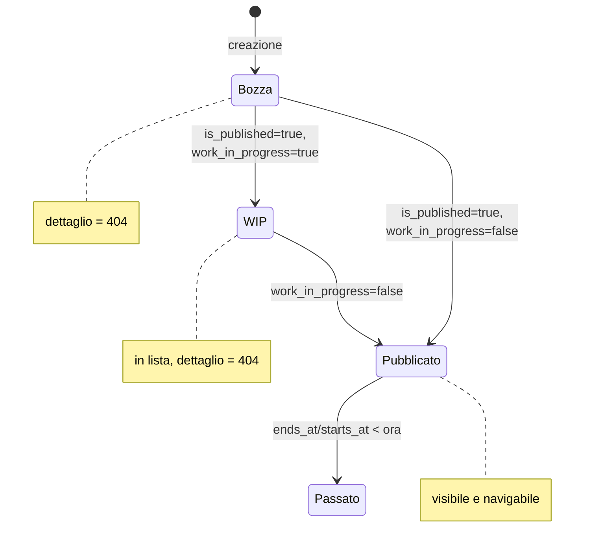
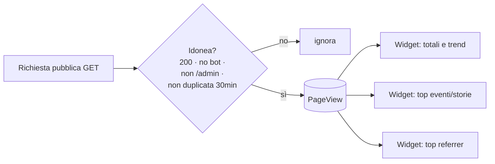

# 09 · Funzionalità (documentazione funzionale)

Questo documento descrive il comportamento del sito dal punto di vista funzionale, per dominio. Per i dettagli implementativi vedi [06 · Pagine pubbliche](../03_codice/01_pagine_pubbliche.md) e [07 · Pannello admin](../03_codice/02_pannello_admin.md).

---

## Eventi

**Scopo:** raccontare e calendarizzare gli appuntamenti della community (meet-up, workshop, talk, hackathon, ...).

### Stati di un evento
Un evento è governato da tre flag e dalle date:

| Flag / condizione | Effetto |
|-------------------|---------|
| `is_published = false` | Evento **non visibile** al pubblico; la pagina di dettaglio restituisce **404**. |
| `work_in_progress = true` | Evento "in preparazione": **mostrato in lista** (card dedicata) ma la pagina di dettaglio restituisce **404**. |
| `starts_at` futuro, non WIP | **Prossimo evento** (home + sezione "upcoming" in `/events`). |
| `starts_at`/`ends_at` passati | **Evento storico** (lista paginata in `/events`, con ricerca e ordinamento). |
| `is_community_event` | Distingue gli eventi organizzati dalla community da quelli solo segnalati (icona dedicata in admin). |

### Contenuti collegati
Un evento può avere: **categorie** (molti-a-molti), **media** (immagini/video, da file o URL YouTube/Vimeo embeddabili), **risorse** (documenti/slide condivisi) e **partner**. Le date sono mostrate in fuso `Europe/Rome`. Il corpo è in **Markdown** (reso con sanitizzazione HTML).

---

## Risorse

**Scopo:** raccogliere documenti e slide della community.

- Una risorsa è un **link esterno** (`source_type=link`) **oppure** un **file caricato** (`source_type=file`, es. PDF). L'accessor `resource_url` restituisce l'URL corretto in base al tipo.
- Può essere attribuita a uno o più **autori**.
- Può essere collegata a uno o più **eventi** (relazione gestita sia dalla risorsa che dall'evento in admin).
- In `/resources`: lista paginata (15/pagina) con **ricerca per titolo** e ordinamento.
- Solo le risorse con `is_published=true` sono pubbliche.

---

## Storie

**Scopo:** dare voce ai membri con articoli (esperimenti, tutorial, riflessioni, case study, ...).

- Ogni storia ha una **categoria** (opzionale), uno o più **autori** (chi scrive) e uno o più **protagonisti** (chi è raccontato) — due relazioni distinte verso `Author`.
- Pubblicazione governata da `is_published` + `published_at` (in admin, `published_at` compare solo se pubblicata).
- In `/stories`: storia in evidenza, lista paginata (12/pagina) con **ricerca**, **filtro per categoria** e ordinamento.
- La pagina di dettaglio mostra i minuti di lettura stimati (accessor `read_time_minutes`) e il conteggio visite.
- Storie non pubblicate → **404** sul dettaglio.

---

## Partner

**Scopo:** dare visibilità ad aziende e community partner/sponsor.

- Card con logo, nome e descrizione; link al sito.
- In `/partners`: griglia dei partner pubblicati (ordinati per nome), più una CTA "Vuoi diventare partner?" che apre una mail verso `config('community.email')`.
- ⚠️ Default `is_published=false`: un partner appena creato **non** è pubblico finché non viene pubblicato.

---

## Autori

**Scopo:** profili delle persone dietro risorse e storie.

- Un autore ha nome, ruolo, bio, avatar e link social (GitHub, LinkedIn, Twitter, sito).
- **Arricchimento da GitHub:** se è impostato `github_username`, il sistema può completare automaticamente avatar, bio, ruolo (company), sito (blog) e Twitter dal profilo GitHub pubblico (cache 24h). I campi locali hanno sempre la precedenza.
- Gli autori non hanno una pagina pubblica dedicata: compaiono nei dettagli di storie e risorse (chip/avatar).

---

## Analytics (visite)

**Scopo:** misurare il traffico senza strumenti di tracciamento di terze parti né cookie.

- Ogni visualizzazione di pagina pubblica idonea (GET 200, no bot, deduplica 30 minuti) genera un record `PageView`.
- Le visite a pagine di **evento** e **storia** sono associate polimorficamente al contenuto (`viewable`), abilitando i conteggi per-contenuto.
- Nel pannello admin, il gruppo **Analitiche** e i **widget** della dashboard mostrano: totali e trend a 30 giorni, top eventi, top storie, principali sorgenti di traffico.

---

## Pagine istituzionali e legali

- **`/cosa-facciamo`** — pagina statica di presentazione delle attività.
- **`/privacy-policy`** — informativa GDPR (Regolamento UE 2016/679).
- **`/cookie-policy`** — informativa cookie (solo cookie tecnici).

---

## Navigazione del sito

Le voci di menu sono guidate da `config/navigation.php`:

| Voce | Route | In header | In footer |
|------|-------|-----------|-----------|
| Home | `home` | sì | no |
| Eventi | `events` | sì | sì |
| Risorse | `resources` | sì | sì |
| Storie | `stories` | sì | sì |
| Partner | `partners` | sì | sì |

I dati della community (nome, email, social WhatsApp/Instagram/LinkedIn) sono in `config/community.php` e alimentano header e footer.
