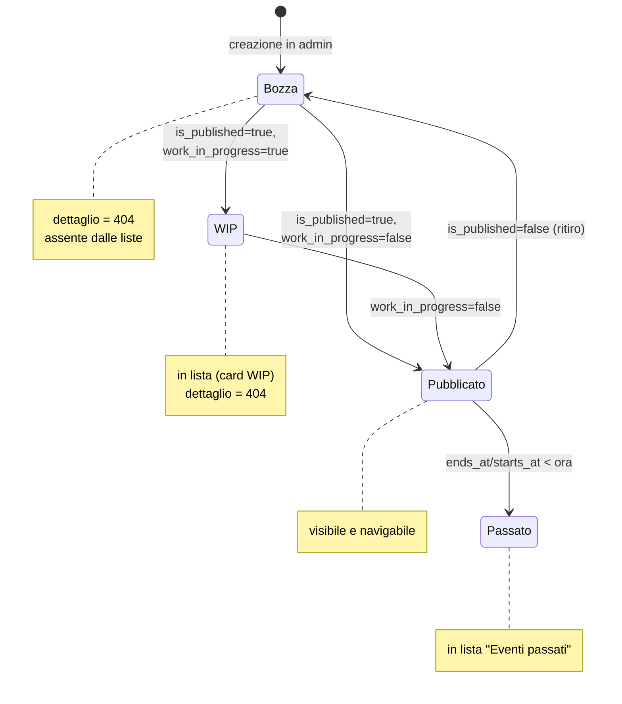
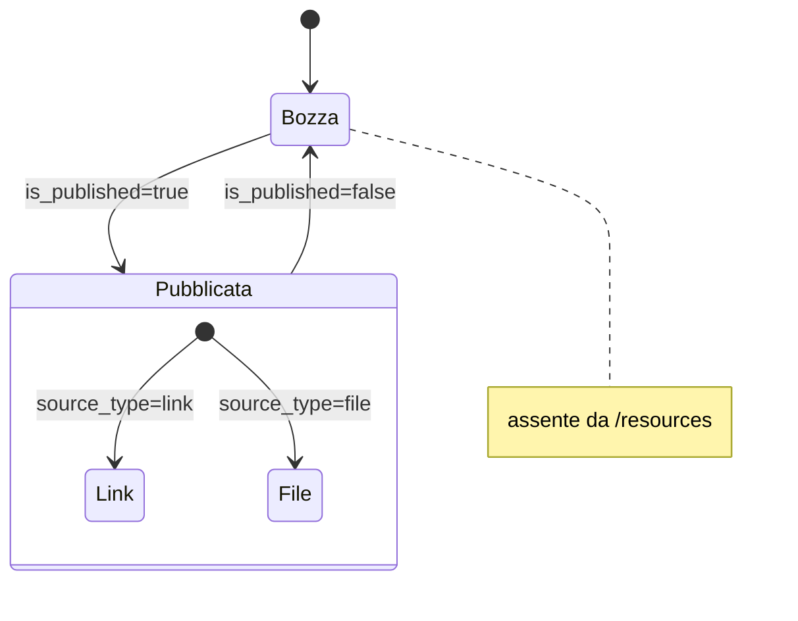
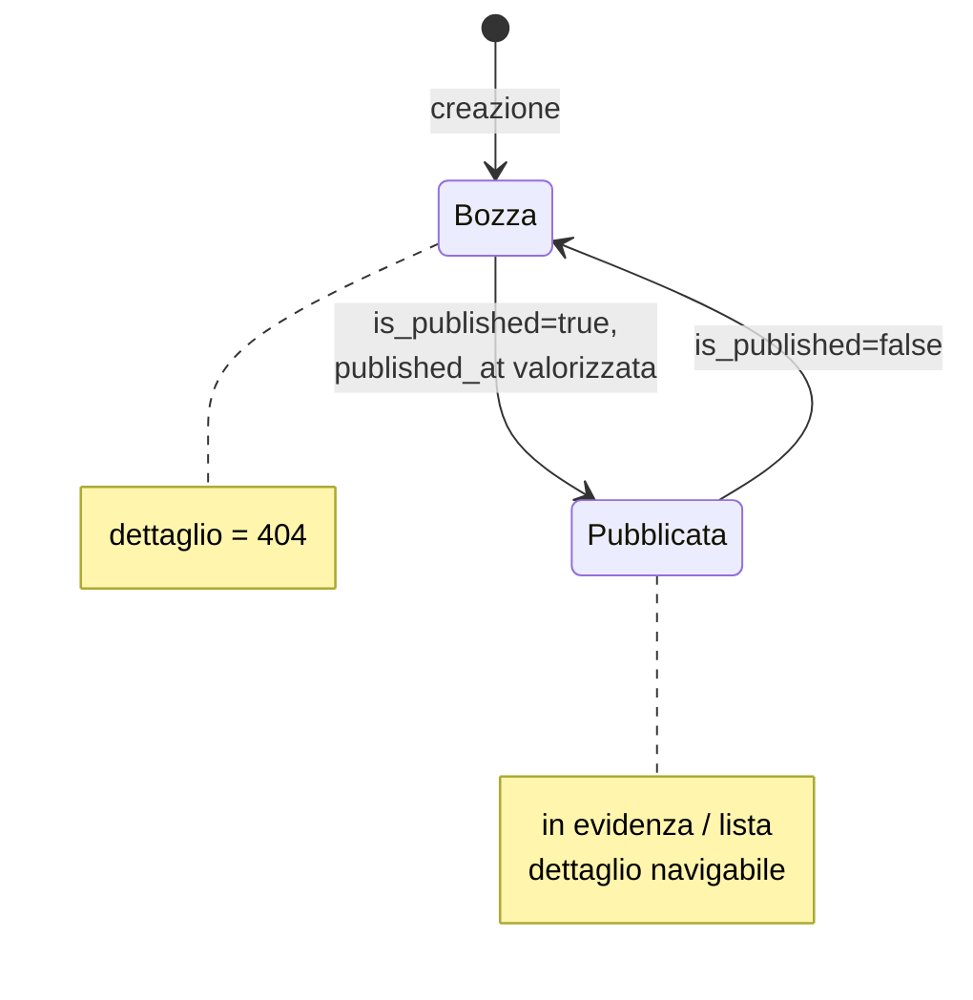
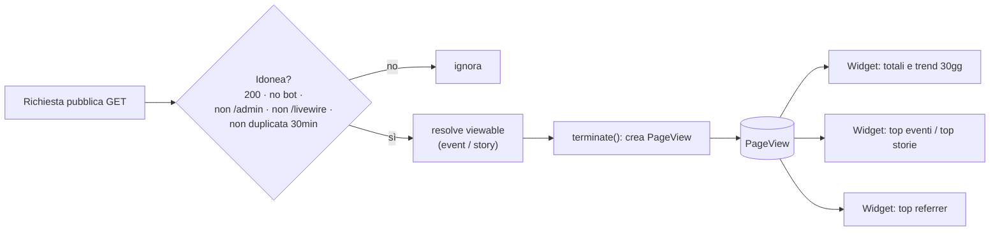
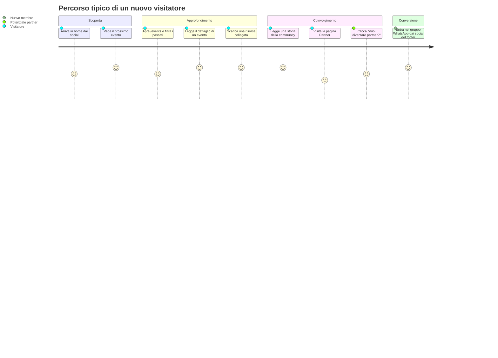

# 02 · Funzionalità

Questo documento descrive il comportamento del sito **dal punto di vista funzionale**, dominio per dominio: flussi utente passo-passo, stati e transizioni, regole di visibilità/pubblicazione, edge case (404, WIP) e come l'admin gestisce ciascuna entità. Per i dettagli implementativi vedi [Pagine pubbliche](../03_codice/01_pagine_pubbliche.md) e [Pannello admin](../03_codice/02_pannello_admin.md); per il modello dati vedi [Database](../02_architettura/02_database.md) e [Modelli](../02_architettura/03_modelli.md).

> Convenzione trasversale: ogni componente lista è protetto da una guardia `Schema::hasTable(...)` che, se la tabella non esiste ancora (es. prima delle migrazioni), restituisce una collezione vuota invece di andare in errore. È una scelta difensiva visibile in `HomePage`, `EventsPage`, `StoriesPage`, `ResourcesPage`, `PartnersPage`.

---

## Eventi

**Scopo:** raccontare e calendarizzare gli appuntamenti della community (meet-up, workshop, talk, hackathon, ...).

### Stati di un evento

Lo stato di un evento è determinato da tre flag booleani e dalle date `starts_at` / `ends_at`:

| Flag / condizione | Effetto |
|-------------------|---------|
| `is_published = false` | Evento **non visibile** al pubblico; la pagina di dettaglio restituisce **404** (`EventDetailPage::mount()` → `abort_unless($event->is_published, 404)`). |
| `work_in_progress = true` | Evento "in preparazione": **mostrato in lista** (card WIP dedicata) ma la pagina di dettaglio restituisce **404** (`abort_unless(! $event->work_in_progress, 404)`). |
| `starts_at` futuro, non WIP, pubblicato | **Prossimo evento** (home + sezione "upcoming" in `/events`). |
| `ends_at`/`starts_at` passati | **Evento storico** (lista paginata in `/events`, con ricerca e ordinamento). |
| `is_community_event` | Distingue gli eventi organizzati dalla community da quelli solo segnalati (badge dedicato in admin). Non incide sulla visibilità. |

### Flusso utente — scoperta e dettaglio

1. L'utente apre la **home** (`/`): vede il **prossimo evento** in evidenza (il primo non concluso in ordine di `starts_at`) e gli ultimi **2 eventi passati** (`HomePage::render()`).
2. Clicca su un evento o sulla voce **Eventi** del menu e arriva su `/events` (`EventsPage`):
   - In cima, gli **eventi futuri** (`is_published`, non WIP, `starts_at > now`, ordinati per data crescente);
   - poi gli **eventi WIP** (card dedicata, senza link al dettaglio);
   - infine la sezione **"Eventi passati"**: lista **paginata a 12**, con **ricerca testuale** e **ordinamento** (più recenti / meno recenti / titolo A-Z / Z-A).
3. Sull'evento desiderato l'utente apre il **dettaglio** `/events/{slug}` (`EventDetailPage`):
   - se l'evento non è pubblicato o è WIP → **404**;
   - altrimenti vede titolo, date in fuso **Europe/Rome**, luogo/indirizzo, corpo **Markdown** (sanitizzato), **media** (immagini e video YouTube/Vimeo embeddati), **risorse** collegate, **partner** coinvolti, il conteggio visite e fino a **2 eventi correlati**.

### Ricerca eventi passati

La ricerca su `/events` filtra per `title`, `location` e — nelle intenzioni — la descrizione testuale (`EventsPage::buildPastEventsQuery()`).

> ⚠️ **Bug noto:** la query di ricerca referenzia la colonna `description`, che è stata **rinominata in `body`** (migrazione `2026_04_10_162306_rename_description_to_body_on_events_table.php`). Una ricerca con testo non vuoto solleva quindi un errore SQL ("Unknown column 'description'"). Dettaglio e fix in [Note e debito tecnico](../04_sviluppo_e_qualita/04_note_e_debito_tecnico.md).

### Contenuti collegati

Un evento può avere: **categorie** (molti-a-molti, ordinate per `sort_order`), **media** (immagini/video da file o URL YouTube/Vimeo, convertiti in embed da `EventDetailPage::toEmbedUrl()`), **risorse** (documenti/slide) e **partner**. Le date sono mostrate in fuso `Europe/Rome` (accessor `local_starts_at` / `local_ends_at`). Il corpo è in **Markdown**, reso con sanitizzazione HTML.

### Gestione in admin

Lo staff crea/modifica gli eventi tramite `EventResource`. La tabella espone azioni inline **Edit** e **Delete**, più la **DeleteBulkAction**. I flag `is_published`, `work_in_progress`, `is_community_event` governano gli stati descritti sopra; categorie, media, risorse e partner si gestiscono nello schema del form / relation manager.

### Copertine degli eventi della community

Per gli eventi con `is_community_event` il form ha la sezione **Copertina** (titolo breve, edizione, sottotitolo, nota accanto all'orario) e la pagina di modifica ha l'azione **Copertine** (`/admin/events/{id}/covers`). La pagina mostra l'anteprima di tre formati, ripresi dai frame Figma della community:

| Formato | Misure | Uso |
|---|---|---|
| Sito | 1920×1080 (16:9) | immagine dell'evento sul sito |
| Post | 1080×1350 (4:5) | Instagram, LinkedIn, gruppi WhatsApp |
| Storia | 1080×1920 (9:16) | storie Instagram, stato WhatsApp |

Le copertine sono template Blade (`resources/views/covers/`) serviti da una route firmata (`events.cover`); il PNG lo genera il browser dell'admin con `modern-screenshot`, perché l'hosting non ha Node né Chromium. **Scarica PNG** salva il file, **Usa come immagine del sito** carica la 16:9 in `image_path` (sostituendo la copertina generata in precedenza, mai un'immagine caricata a mano). Lo sfondo è il pittogramma del logo con il gradiente del brand; il logo di un partner compare solo se ha il **Logo per copertine** (bianco, sfondo trasparente).

---

## Risorse

**Scopo:** raccogliere e condividere documenti e slide della community.

### Regole e stati

- Una risorsa è un **link esterno** (`source_type = 'link'`, campo `external_url`) **oppure** un **file caricato** (`source_type = 'file'`, campo `file_path`, es. PDF). L'accessor `resource_url` (`Resource::getResourceUrlAttribute()`) restituisce l'URL corretto: per i file verifica l'esistenza su disco `public`, per i link restituisce `external_url`.
- Può essere attribuita a **uno o più autori** (`authors()`).
- Può essere collegata a **uno o più eventi** (relazione `events()`, gestibile dai due lati in admin).
- Solo le risorse con `is_published = true` sono pubbliche.

### Flusso utente

1. L'utente apre **Risorse** (`/resources`, `ResourcesPage`).
2. Vede una **lista paginata a 15**, con **ricerca per titolo** e **ordinamento** (più recenti / meno recenti / titolo A-Z / Z-A).
3. Ogni riga mostra titolo, autori (chip/avatar) e un link che apre l'`resource_url` (file scaricabile o URL esterno).
4. In **home** sono mostrate le ultime **5 risorse pubblicate** (`HomePage::render()`).

### Edge case

- Risorsa `file` il cui `file_path` non esiste su disco → `resource_url` restituisce `null` (il link non viene reso). Difesa contro file mancanti.
- Risorsa non pubblicata → assente da `/resources` e dalla home.

### Gestione in admin

`ResourceResource` consente di scegliere il tipo (`link`/`file`), caricare il file o inserire l'URL, collegare autori ed eventi e impostare la pubblicazione. Diversi campi sono stati resi opzionali (`description` nullable, migrazione `2026_04_24_132100`).

> ⚠️ La `ResourceFactory` e il `ResourceSeeder` non sono allineati allo schema corrente (referenziano i campi rimossi `slug` e `image_path`): non sono nel percorso di seeding attivo ma fallirebbero se usati direttamente. Vedi [Note e debito tecnico](../04_sviluppo_e_qualita/04_note_e_debito_tecnico.md).

---

## Storie

**Scopo:** dare voce ai membri con articoli (esperimenti, tutorial, riflessioni, case study, ...).

### Regole e stati

- Ogni storia ha una **categoria** (opzionale, `story_category_id`), uno o più **autori** (`authors()`, chi scrive) e uno o più **protagonisti** (`protagonists()`, chi è raccontato) — due relazioni distinte verso `Author` (tabelle pivot `author_story` e `protagonist_story`).
- Pubblicazione governata da `is_published` + `published_at`.
- L'accessor `read_time_minutes` stima i minuti di lettura dal corpo Markdown.

### Flusso utente

1. L'utente apre **Storie** (`/stories`, `StoriesPage`):
   - in alto la **storia in evidenza** (la più recente pubblicata per `published_at`);
   - sotto, lista **paginata a 12** con **ricerca**, **filtro per categoria** (solo categorie attive con almeno una storia) e **ordinamento**.
2. Apre il **dettaglio** `/stories/{slug}` (`StoryDetailPage`):
   - se non pubblicata → **404** (`abort_unless($story->is_published, 404)`);
   - altrimenti vede titolo, categoria, autori e protagonisti, corpo Markdown, minuti di lettura stimati, conteggio visite e fino a **2 storie correlate** (preferibilmente della stessa categoria).

### Ricerca storie

La ricerca filtra per `title` ed `excerpt` e — nelle intenzioni — per autore (`StoriesPage::buildStoriesQuery()`).

> ⚠️ **Bug noto:** la query di ricerca referenzia la colonna `author`, **rimossa** dalla tabella `stories` (migrazione `2026_04_07_220415_remove_author_fields_from_stories_table.php`; gli autori sono ora una relazione molti-a-molti). Una ricerca con testo non vuoto solleva un errore SQL ("Unknown column 'author'"). Dettaglio e fix in [Note e debito tecnico](../04_sviluppo_e_qualita/04_note_e_debito_tecnico.md).

### Gestione in admin

`StoryResource` gestisce categoria, autori, protagonisti, corpo Markdown e pubblicazione. In coerenza con il modello, `published_at` ha senso solo quando la storia è pubblicata. L'`excerpt` è nullable (migrazione `2026_04_24_133300`).

---

## Partner

**Scopo:** dare visibilità ad aziende e community partner/sponsor.

### Regole

- Card con **logo** (accessor `logo_url`, fallback `null` se il file manca), **nome** e **descrizione**; link al **sito**.
- In `/partners` (`PartnersPage`): griglia dei **partner pubblicati** ordinati per nome, più una CTA **"Vuoi diventare partner?"** che apre una mail verso `config('community.email')`.
- ⚠️ La `PartnerFactory` imposta `is_published = true` di default, ma i partner reali sono creati esplicitamente pubblicati dal `RealPartnersSeeder`. In assenza di valore esplicito conta il default di colonna del DB: verificare la migrazione prima di assumere lo stato iniziale.

### Flusso utente

1. L'utente apre **Partner** (`/partners`): vede la griglia dei partner pubblicati (es. *Lecce Digital Community*, *Azure Meetup Puglia*, *GDG Lecce* dal seeder reale).
2. Clicca su un logo/card → si apre il sito del partner.
3. Clicca su **"Vuoi diventare partner?"** → si apre il client mail verso l'indirizzo della community.

### Gestione in admin

`PartnerResource` gestisce nome, descrizione (nullable, migrazione `make description nullable`), logo, sito e pubblicazione. La tabella espone **Edit** inline e **DeleteBulkAction** (la cancellazione singola inline non è presente; vedi [Note e debito tecnico](../04_sviluppo_e_qualita/04_note_e_debito_tecnico.md)).

---

## Autori

**Scopo:** rappresentare le persone dietro risorse e storie.

### Regole

- Un autore ha **nome**, **ruolo**, **bio**, **avatar** e **link social** (GitHub, LinkedIn, Twitter, sito).
- **Avatar a cascata** (`Author::getAvatarUrlAttribute()`): immagine caricata → avatar GitHub (`github.com/<user>.png`) → avatar generato da `ui-avatars.com` con i colori del brand → stringa vuota.
- **Arricchimento da GitHub:** se è impostato `github_username`, gli accessor `display_bio`, `display_role`, `display_website_url`, `display_twitter_url` completano i campi mancanti interrogando l'API GitHub pubblica (`Author::fetchGithubProfile()`, **cache 24h** via `Cache::remember`). I campi **locali hanno sempre la precedenza**.
- Gli autori **non hanno una pagina pubblica dedicata**: compaiono nei dettagli di storie e risorse (chip/avatar).

### Flusso (admin)

Lo staff crea un autore in `AuthorResource` indicando almeno il nome; impostando `github_username` ottiene il completamento automatico di avatar/bio/ruolo/sito/Twitter senza doverli ricopiare. Esempi reali nel `RealAuthorsSeeder` (Simone De Vittorio, Paolo Rizzello, Emanuele Paiano).

> ⚠️ Gli accessor `display_*` effettuano una **chiamata HTTP esterna** in fase di rendering/editing (mitigata dalla cache 24h). Impatto e mitigazione in [Note e debito tecnico](../04_sviluppo_e_qualita/04_note_e_debito_tecnico.md).

---

## Analytics (visite)

**Scopo:** misurare il traffico senza strumenti di tracciamento di terze parti né cookie.

### Regole di tracciamento

Il middleware `TrackPageView` (registrato nel gruppo `web` in `bootstrap/app.php:14`) registra una visita **solo se** la richiesta è idonea (`shouldTrack()`):

- metodo **GET**;
- risposta con status **200**;
- path **non** sotto `admin` né `livewire`;
- **user agent non riconosciuto come bot** (lista `BOT_PATTERNS`: googlebot, bingbot, facebookexternalhit, whatsapp, lighthouse, playwright, ...);
- **non già vista** dallo stesso utente negli ultimi **30 minuti** (deduplica per path via sessione, `DEDUP_MINUTES = 30`).

Il record viene effettivamente scritto nel metodo `terminate()` (dopo l'invio della risposta), così da non rallentare la richiesta. Le visite a pagine di **evento** e **storia** vengono associate **polimorficamente** al contenuto (`viewable_type` / `viewable_id`, mappa `VIEWABLE_PARAMS`), abilitando i conteggi per-contenuto.

### Dove si vedono i dati

Nel pannello admin la **dashboard** mostra i widget registrati in `AdminPanelProvider`: `PageViewStatsWidget` (totali e trend), `PageViewsChartWidget` (grafico), `TopEventsWidget`, `TopStoriesWidget`, `TopReferrersWidget`. Esiste anche una `PageViewResource` per ispezionare i record grezzi.

---

## Pagine istituzionali e legali

- **`/privacy-policy`** (`PrivacyPolicyPage`) — informativa GDPR (Regolamento UE 2016/679).
- **`/cookie-policy`** (`CookiePolicyPage`) — informativa cookie (solo cookie tecnici, coerente con l'assenza di tracciamento di terze parti).

---

## Navigazione del sito

Le voci di menu sono guidate da `config/navigation.php`:

| Voce | Route | In header | In footer |
|------|-------|-----------|-----------|
| Home | `home` | sì | no |
| Eventi | `events` | sì | sì |
| Risorse | `resources` | sì | sì |
| Storie | `stories` | sì | sì |
| Partner | `partners` | sì | sì |

I dati della community (nome, email `salento.dev@gmail.com`, descrizione, social WhatsApp/Instagram/LinkedIn) sono in `config/community.php` e alimentano header e footer.

---

## User journey di sintesi

Ogni passo del percorso (escluse le pagine admin e le richieste Livewire) genera, se idoneo, un `PageView` che alimenta le analitiche interne. Per i dettagli implementativi dei singoli componenti vedi [Pagine pubbliche](../03_codice/01_pagine_pubbliche.md).
