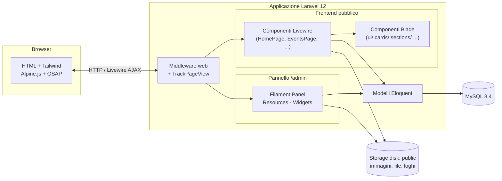
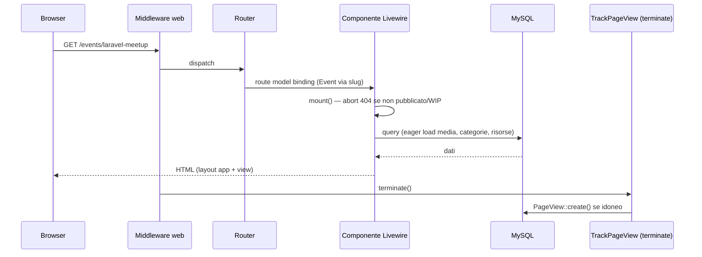

# 02 · Architettura

## Visione d'insieme

salento.dev è un'applicazione **Laravel monolitica server-rendered** con due "facce":

- **Frontend pubblico** costruito con **componenti Livewire** full-page (un componente = una pagina), arricchito da Tailwind, Alpine.js e GSAP.
- **Backend di amministrazione** costruito con **Filament 5**, un framework Server-Driven UI montato su `/admin`.

Non esiste una SPA separata né un'API REST pubblica: l'HTML è generato dal server e Livewire gestisce l'interattività (ricerca, filtri, paginazione) tramite richieste AJAX.



---

## Ciclo di vita di una richiesta pubblica

1. La richiesta entra da `public/index.php` e attraversa il **kernel HTTP** configurato in `bootstrap/app.php`.
2. Viene applicato il gruppo middleware **`web`**, a cui è **appeso `TrackPageView`** (`bootstrap/app.php:14`).
3. Il router (`routes/web.php`) risolve la rotta verso un **componente Livewire full-page** (es. `HomePage::class`) o una `Route::view`.
4. Per le rotte con **model binding via slug** (`/events/{event:slug}`, `/stories/{story:slug}`) Laravel carica automaticamente il modello dalla colonna `slug`.
5. Il componente Livewire esegue `mount()` (validazioni, eager-loading) e `render()` (query dei dati), restituendo una view Blade.
6. La view è incapsulata nel layout `resources/views/layouts/app.blade.php` (head, meta SEO, asset Vite, header, footer).
7. Dopo l'invio della risposta, **`TrackPageView::terminate()`** registra eventualmente una `PageView` (solo GET 200, no bot, deduplica 30 minuti).



---

## Ciclo di vita di una richiesta admin

Le richieste a `/admin/**` sono gestite interamente da **Filament**, che registra le proprie rotte e middleware tramite `AdminPanelProvider` (`app/Providers/Filament/AdminPanelProvider.php`). Filament effettua **auto-discovery** di:

- **Resources** in `app/Filament/Resources`
- **Pages** in `app/Filament/Pages` (oltre alla `Dashboard`)
- **Widgets** in `app/Filament/Widgets`

L'accesso è protetto dal middleware `Authenticate`; l'autorizzazione è demandata a `User::canAccessPanel()` (vedi [07 · Pannello admin](07-pannello-admin.md)).

---

## Struttura delle directory (rilevante)

```
app/
├── Filament/
│   ├── Resources/            # 9 risorse: Authors, EventCategories, Events, PageViews,
│   │   └── <Nome>/           #            Partners, Resources, Stories, StoryCategories, Users
│   │       ├── <Nome>Resource.php
│   │       ├── Pages/        # List/Create/Edit
│   │       ├── Schemas/      # definizione form
│   │       ├── Tables/       # definizione tabella
│   │       └── RelationManagers/  # (solo Events, Resources)
│   └── Widgets/              # widget dashboard (PageView stats, chart, top events/stories/referrers)
├── Http/
│   └── Middleware/
│       └── TrackPageView.php # tracciamento visite pubbliche
├── Livewire/                 # 9 componenti full-page (pagine pubbliche)
├── Models/                   # 10 modelli Eloquent
└── Providers/
    ├── AppServiceProvider.php
    └── Filament/AdminPanelProvider.php

config/
├── community.php             # dati community (nome, email, social) — frontend
├── navigation.php            # voci di menu header/footer — frontend
└── ...                       # config Laravel standard

database/
├── factories/                # factory per i test/seed
├── migrations/               # 32 migrazioni
└── seeders/                  # seeder "Real*" (dati reali) + factory seeder

resources/
├── css/app.css               # design system Tailwind v4 (@theme, utility)
├── js/app.js                 # GSAP, Motion, AutoAnimate, helper globali
└── views/
    ├── components/           # componenti Blade (ui/ cards/ events/ stories/ sections/ partials/)
    ├── layouts/app.blade.php # layout principale
    ├── livewire/             # view dei componenti Livewire
    └── pages/static.blade.php# pagina statica "Cosa facciamo"

routes/
└── web.php                   # rotte pubbliche

bootstrap/
└── app.php                   # bootstrap applicazione, middleware, health check /up
```

> Laravel 12 adotta la struttura "snella": niente `app/Http/Kernel.php`, middleware ed eccezioni si configurano in `bootstrap/app.php`; i provider applicativi sono in `bootstrap/providers.php`.

---

## Decisioni architetturali chiave

- **Una pagina = un componente Livewire full-page.** Nessun controller pubblico classico (esiste la cartella `app/Http/Controllers` ma non è usata per il dominio).
- **Slug come chiave di route** per eventi e storie (`{event:slug}`, `{story:slug}`), risolti via model binding. I link usano sempre i **nomi di route** (`route('events.show', $event)`).
- **Storage `public`** per tutti gli upload (immagini eventi/storie, loghi partner, avatar autori, file risorse). Gli accessor dei modelli (`*_url`) generano gli URL pubblici con fallback a placeholder.
- **Analytics in middleware** (non in JavaScript di terze parti): privacy-friendly, senza cookie di tracciamento.
- **Niente API/stato in query string** sulle pagine pubbliche: ricerca/filtri vivono nello stato Livewire lato server (vedi nota in [06](06-pagine-pubbliche.md)).
