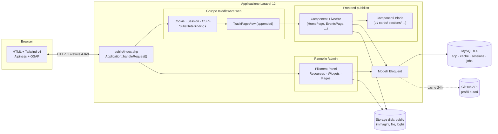
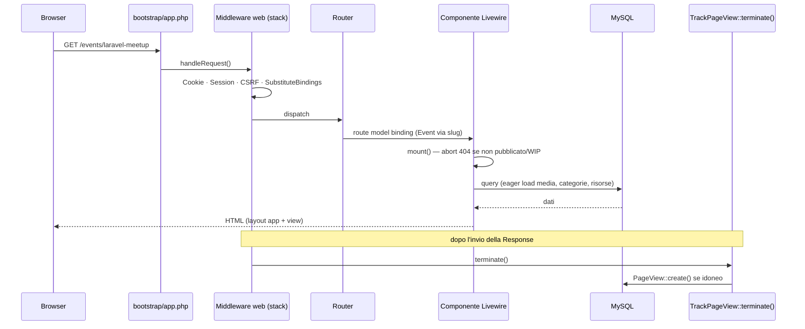
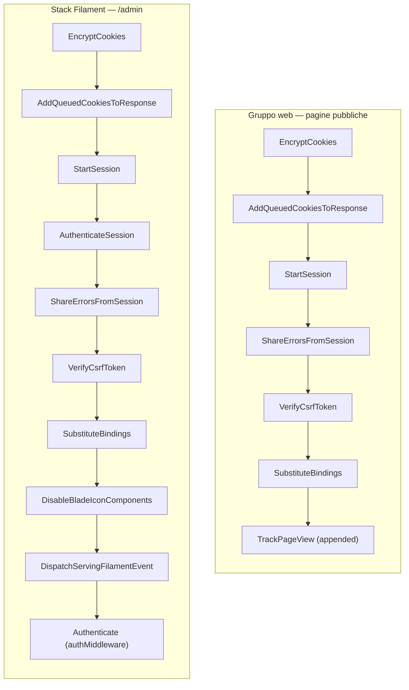

# 01 · Architettura

## Visione d'insieme

salento.dev è un'applicazione **Laravel 12 monolitica server-rendered** con due "facce" che condividono lo stesso codebase, lo stesso database e gli stessi modelli Eloquent:

- **Frontend pubblico** costruito con **componenti Livewire full-page** (un componente = una pagina), arricchito da Tailwind CSS v4, Alpine.js 3 e GSAP 3.
- **Backend di amministrazione** costruito con **Filament 5**, un framework Server-Driven UI (SDUI) montato su `/admin` e a sua volta basato su Livewire.

Non esiste una SPA separata né un'API REST pubblica: l'HTML è generato dal server e Livewire gestisce l'interattività (ricerca, filtri, paginazione) tramite richieste AJAX che ri-renderizzano il componente lato server. Le due "facce" sono isolate a livello di middleware: le pagine pubbliche montano `TrackPageView` (analytics privacy-friendly), mentre `/admin` usa lo stack middleware definito da Filament con autenticazione di sessione.



---

## Ciclo di vita di una richiesta

### Bootstrap dell'applicazione

Ogni richiesta entra da `public/index.php`. Il file è volutamente minimale: registra l'inizio del timing, controlla la modalità manutenzione, carica l'autoloader Composer, costruisce l'istanza `Application` da `bootstrap/app.php` e delega tutto a `handleRequest()` (`public/index.php:20`):

```php
define('LARAVEL_START', microtime(true));

if (file_exists($maintenance = __DIR__.'/../storage/framework/maintenance.php')) {
    require $maintenance;
}

require __DIR__.'/../vendor/autoload.php';

/** @var Application $app */
$app = require_once __DIR__.'/../bootstrap/app.php';

$app->handleRequest(Request::capture());
```

Il cuore della configurazione è `bootstrap/app.php`, che in Laravel 12 sostituisce il vecchio `app/Http/Kernel.php`. Qui si dichiarano **routing**, **middleware**, **gestione eccezioni** e l'**health check** con un'unica fluent API (`bootstrap/app.php:7-18`):

```php
return Application::configure(basePath: dirname(__DIR__))
    ->withRouting(
        web: __DIR__.'/../routes/web.php',
        commands: __DIR__.'/../routes/console.php',
        health: '/up',
    )
    ->withMiddleware(function (Middleware $middleware): void {
        $middleware->appendToGroup('web', \App\Http\Middleware\TrackPageView::class);
    })
    ->withExceptions(function (Exceptions $exceptions): void {
        //
    })->create();
```

Tre osservazioni sostanziali su questo file:

1. **Health check `/up`** — `withRouting(health: '/up')` registra automaticamente un endpoint leggero che restituisce `200` se il framework si avvia correttamente. È pensato per load balancer, container orchestrator e probe di Docker/Sail, senza dover scrivere un controller dedicato.
2. **`TrackPageView` appeso al gruppo `web`** — non sostituisce lo stack standard ma viene aggiunto in coda con `appendToGroup('web', ...)`, così da osservare la `Response` finale (vedi sotto). Essendo *appeso*, gira dopo `SubstituteBindings`, quindi ha già a disposizione i modelli risolti dal route model binding (necessario per associare la visita al contenuto polimorfico).
3. **Eccezioni non personalizzate** — la closure `withExceptions` è vuota: il progetto usa il rendering di errori standard di Laravel.

I service provider applicativi sono elencati in `bootstrap/providers.php` (`bootstrap/providers.php:3-6`):

```php
return [
    App\Providers\AppServiceProvider::class,
    App\Providers\Filament\AdminPanelProvider::class,
];
```

`AppServiceProvider` è attualmente uno **scheletro vuoto** (`register()` e `boot()` senza corpo, `app/Providers/AppServiceProvider.php:12-23`): nessun binding custom nel container, nessuna macro, nessun observer. Tutta la logica di bootstrap rilevante per il dominio vive nei modelli (accessor) e nel middleware. `AdminPanelProvider` è invece il provider di Filament, descritto più avanti.

### Richiesta pubblica (Livewire)

1. La richiesta attraversa il **gruppo middleware `web`** completo (vedi il diagramma dello stack più sotto), a cui è appeso `TrackPageView`.
2. Il router (`routes/web.php`) risolve la rotta verso un **componente Livewire full-page** (es. `HomePage::class`) oppure verso una `Route::view` statica.
3. Per le rotte con **model binding via slug** (`/events/{event:slug}`, `/stories/{story:slug}`) Laravel carica automaticamente il modello dalla colonna `slug`; `SubstituteBindings` esegue questa risoluzione prima che il componente venga istanziato.
4. Il componente Livewire esegue `mount()` (validazioni, eventuale `abort(404)` per contenuti non pubblicati o WIP, eager-loading) e poi `render()` (query dei dati), restituendo una view Blade.
5. La view è incapsulata nel layout `resources/views/layouts/app.blade.php` (head, meta SEO, asset Vite, header, footer).
6. Dopo l'invio della risposta, **`TrackPageView::terminate()`** registra eventualmente una `PageView` (vedi sezione dedicata).



### Richiesta admin (Filament)

Le richieste a `/admin/**` sono gestite interamente da **Filament**, che registra le proprie rotte, il proprio stack middleware e l'auto-discovery di componenti tramite `AdminPanelProvider` (`app/Providers/Filament/AdminPanelProvider.php`). Il pannello è configurato come `->default()` con `id('admin')`, path `admin`, `->login()` e `->passwordReset()` abilitati, e colore primario `Color::Amber` (`app/Providers/Filament/AdminPanelProvider.php:31-39`).

Filament effettua **auto-discovery** di tre tipi di componenti tramite i metodi `discover*` (`AdminPanelProvider.php:40-45`):

```php
->discoverResources(in: app_path('Filament/Resources'), for: 'App\Filament\Resources')
->discoverPages(in: app_path('Filament/Pages'), for: 'App\Filament\Pages')
->discoverWidgets(in: app_path('Filament/Widgets'), for: 'App\Filament\Widgets')
```

- **Resources** in `app/Filament/Resources`
- **Pages** in `app/Filament/Pages` (oltre alla `Dashboard` registrata esplicitamente)
- **Widgets** in `app/Filament/Widgets`, con un ordine esplicito sulla dashboard: `PageViewStatsWidget`, `PageViewsChartWidget`, `TopEventsWidget`, `TopStoriesWidget`, `TopReferrersWidget`, più gli `AccountWidget` di sistema (`AdminPanelProvider.php:46-53`).

L'accesso è protetto dal middleware `Authenticate` (registrato come `authMiddleware`, `AdminPanelProvider.php:65-67`); l'autorizzazione è demandata a `User::canAccessPanel()`, che oggi ritorna sempre `true` per qualunque utente autenticato (vedi [Pannello admin](../03_codice/02_pannello_admin.md) e [Modelli](03_modelli.md)).

---

## Middleware stack

Il sito ha **due stack middleware distinti** che non si sovrappongono: il gruppo `web` standard di Laravel (con `TrackPageView` appeso) per le pagine pubbliche, e lo stack dichiarato manualmente da Filament per `/admin`.



Lo stack Filament è dichiarato esplicitamente nel provider (`AdminPanelProvider.php:54-67`) e aggiunge, rispetto al gruppo `web`, alcuni middleware specifici: `AuthenticateSession` (invalidazione sessione su cambio password), `DisableBladeIconComponents` e `DispatchServingFilamentEvent` (hook interni del framework), oltre al gate finale `Authenticate`.

### `TrackPageView` in dettaglio

`TrackPageView` (`app/Http/Middleware/TrackPageView.php`) implementa analytics **privacy-friendly senza cookie di tracciamento né JavaScript di terze parti**. La sua logica si articola in due fasi:

- **`handle()`** gira sulla risposta già prodotta (`$response = $next($request)`) e decide se la visita va registrata; in caso affermativo stipa i dati nelle `attributes` della request con la chiave `_track_pv`.
- **`terminate()`** viene invocato *dopo* l'invio della risposta al browser (perché il middleware è registrato nel gruppo `web` e Laravel chiama `terminate()` sui middleware terminabili), quindi la scrittura su DB non rallenta la risposta percepita dall'utente.

I filtri applicati da `shouldTrack()` (`TrackPageView.php:106-133`) sono:

```php
private function shouldTrack(Request $request, Response $response): bool
{
    if (! $request->isMethod('GET')) { return false; }
    if ($response->getStatusCode() !== 200) { return false; }
    if (str_starts_with($request->path(), 'admin')) { return false; }
    if (str_starts_with($request->path(), 'livewire')) { return false; }

    $userAgent = strtolower($request->userAgent() ?? '');
    foreach (self::BOT_PATTERNS as $pattern) {
        if (str_contains($userAgent, $pattern)) { return false; }
    }
    return true;
}
```

Solo richieste **GET con esito 200**, **non** verso `/admin` o `/livewire`, e con user-agent che non corrisponde a uno dei pattern bot (`bot`, `crawl`, `spider`, `googlebot`, `lighthouse`, `headlesschrome`, `puppeteer`, `playwright`, ecc., `TrackPageView.php:27-32`) vengono considerate. C'è inoltre una **deduplica per sessione di 30 minuti** (`DEDUP_MINUTES = 30`): l'ultimo timestamp di visita per ciascun path è salvato in sessione sotto la chiave `pv_seen`, e una nuova visita allo stesso path entro la finestra non viene registrata (`recentlyVisited()`/`markVisited()`, `TrackPageView.php:91-104`).

L'associazione polimorfica al contenuto avviene in `resolveViewable()` (`TrackPageView.php:79-89`), che mappa i parametri di route `event` e `story` alle rispettive classi e usa `getMorphClass()`/`getKey()` per popolare `viewable_type`/`viewable_id` su `PageView`. Per i dettagli del modello vedi [Modelli](03_modelli.md).

---

## Configurazione: scelte rilevanti

Il progetto usa **MySQL come backend unico** non solo per i dati di dominio ma anche per cache, sessioni e coda. Questa è una scelta deliberata che semplifica l'infrastruttura locale (un solo container DB, nessun Redis) a scapito delle performance teoriche di store in-memory.

| Sottosistema | Driver di default | File config | Tabella/note |
|--------------|-------------------|-------------|--------------|
| Database | `mysql` (in produzione) | `config/database.php:19` | default config `sqlite`, sovrascritto da `DB_CONNECTION=mysql` via Sail |
| Cache | `database` | `config/cache.php:18` | tabella `cache` + `cache_locks` |
| Sessioni | `database` | `config/session.php:21` | tabella `sessions`, lifetime 120 min |
| Coda | `database` | `config/queue.php:16` | tabella `jobs`, failed su `failed_jobs` (`database-uuids`) |
| Storage | disk `public` | `config/filesystems.php:41-48` | `storage/app/public` → symlink `public/storage` |

**Perché `database` per cache/queue/session?** Lo store su database è la scelta "great default" suggerita dallo stesso commento di Laravel in `config/session.php:14`. Per un sito a traffico contenuto come quello di una community locale, evita la dipendenza operativa da Redis/Memcached: tutto vive in MySQL, il backup è unico e l'ambiente Sail resta leggero. Le tabelle relative (`cache`, `sessions`, `jobs`, `job_batches`, `failed_jobs`) sono create dalle migrazioni di sistema `0001_01_01_*` (vedi [Database](02_database.md)).

**Cache come dipendenza del dominio.** La cache non è solo infrastruttura: il modello `Author` la usa per memorizzare per 24 ore i profili GitHub recuperati via HTTP (`Cache::remember('github_profile_{username}', now()->addHours(24), ...)`). Con lo store su database, queste voci finiscono nella tabella `cache`. Vedi [Modelli](03_modelli.md) per l'algoritmo completo.

**Database default `sqlite`.** Vale la pena notare che `config/database.php:19` ha come default `sqlite`: serve a far girare la suite di test in memoria o su file senza un MySQL attivo. In sviluppo e produzione la connessione effettiva è `mysql`, impostata via `.env` (Sail). Vedi [Ambiente locale](../04_sviluppo_e_qualita/01_ambiente_locale.md).

### Timezone: UTC nel DB, Europe/Rome in vista

`config/app.php:68` fissa la timezone applicativa a **`UTC`**: tutte le date sono persistite e manipolate in UTC. La conversione al fuso italiano avviene **solo in fase di presentazione**, tramite gli accessor `local_starts_at` / `local_ends_at` del modello `Event`, che applicano `->tz('Europe/Rome')`. Questa separazione (storage in UTC, display localizzato) evita ambiguità su ora legale/solare nel database. Vedi [Modelli](03_modelli.md).

### Storage e URL pubblici

Tutti gli upload del dominio (immagini eventi/storie, loghi partner, avatar autori, file risorse) vivono sul disk **`public`** (`config/filesystems.php:41-48`):

```php
'public' => [
    'driver' => 'local',
    'root' => storage_path('app/public'),
    'url' => rtrim(env('APP_URL', 'http://localhost'), '/').'/storage',
    'visibility' => 'public',
    'throw' => false,
    'report' => false,
],
```

Il disk fa root su `storage/app/public` ed è esposto al web tramite il symlink `public/storage → storage/app/public`, dichiarato in `config/filesystems.php:76-78` e creato con `artisan storage:link`. Gli accessor `*_url` dei modelli costruiscono gli URL pubblici con `Storage::disk('public')->url($path)` e implementano sempre un controllo `exists()` con **fallback**: `Event::getImageUrlAttribute()` ricade su un placeholder, mentre gli altri modelli ricadono su `null`. Questo rende le viste resilienti a record con path mancanti o file non ancora caricati. Vedi [Modelli](03_modelli.md) per la logica esatta.

> ⚠️ `visibility` è `public`: i file sono serviti direttamente senza autenticazione. È coerente con la natura del contenuto (immagini di eventi pubblici, PDF di slide), ma va tenuto presente per eventuali contenuti sensibili futuri. Vedi [Note e debito tecnico](../04_sviluppo_e_qualita/04_note_e_debito_tecnico.md).

---

## Struttura delle directory (rilevante)

```
app/
├── Filament/
│   ├── Resources/            # risorse admin: Authors, EventCategories, Events, PageViews,
│   │   └── <Nome>/           #   Partners, Resources, Stories, StoryCategories, Users
│   │       ├── <Nome>Resource.php
│   │       ├── Pages/        # List/Create/Edit
│   │       ├── Schemas/      # definizione form
│   │       ├── Tables/       # definizione tabella
│   │       └── RelationManagers/  # (es. Events, Resources)
│   └── Widgets/              # widget dashboard (PageView stats, chart, top events/stories/referrers)
├── Http/
│   └── Middleware/
│       └── TrackPageView.php # tracciamento visite pubbliche (handle + terminate)
├── Livewire/                 # componenti full-page (pagine pubbliche)
├── Models/                   # 10 modelli Eloquent
└── Providers/
    ├── AppServiceProvider.php          # scheletro vuoto
    └── Filament/AdminPanelProvider.php # pannello /admin

config/
├── app.php                  # timezone UTC, locale, env
├── database.php             # connessioni (default sqlite, prod mysql)
├── cache.php                # store database
├── session.php              # driver database, lifetime 120
├── queue.php                # connection database
├── filesystems.php          # disk public + symlink
├── community.php            # dati community (nome, email, social) — frontend
├── navigation.php           # voci di menu header/footer — frontend
└── ...                      # config Laravel standard

database/
├── factories/               # factory per i test/seed
├── migrations/              # 32 migrazioni
└── seeders/                 # seeder "Real*" (dati reali) + factory seeder + asset (events/ partners/ stories/)

resources/
├── css/app.css              # design system Tailwind v4 (@theme, utility)
├── js/app.js                # GSAP, Motion, AutoAnimate, helper globali
└── views/
    ├── components/          # componenti Blade (ui/ cards/ events/ stories/ sections/ partials/)
    ├── layouts/app.blade.php # layout principale
    ├── livewire/            # view dei componenti Livewire
    └── pages/static.blade.php# pagina statica "Cosa facciamo"

routes/
├── web.php                  # rotte pubbliche (nomate)
└── console.php              # comandi/schedulazione

bootstrap/
├── app.php                  # bootstrap applicazione, middleware, health check /up
└── providers.php            # provider applicativi
```

> Laravel 12 adotta la struttura "snella": niente `app/Http/Kernel.php` né `app/Console/Kernel.php`; middleware ed eccezioni si configurano in `bootstrap/app.php`, i provider applicativi in `bootstrap/providers.php`, i comandi console in `routes/console.php`.

### Configurazione frontend dedicata

Due file di config sono specifici del dominio frontend e non fanno parte dello standard Laravel:

- **`config/community.php`** — fonte unica di verità per nome, email e canali social della community (`config/community.php:4-29`): WhatsApp, Instagram, LinkedIn. È letto da footer e sezioni di contatto. Centralizzare questi dati evita hardcoding sparso nelle view.
- **`config/navigation.php`** — definisce le voci di menu di header e footer come array dichiarativo (`config/navigation.php:4-11`), ciascuna con `route`, `label` e flag `footer`. Le voci usano i **nomi di route** (`home`, `events`, `resources`, `stories`, `partners`), coerentemente con la convenzione del progetto.

---

## Rotte pubbliche

Le rotte sono dichiarate in `routes/web.php` e usano sempre componenti Livewire full-page, mai controller di dominio. Tutte sono **nomate** (`routes/web.php:14-32`):

| Route | Nome | Componente / vista |
|-------|------|--------------------|
| `/` | `home` | `HomePage` |
| `/events` | `events` | `EventsPage` |
| `/events/{event:slug}` | `events.show` | `EventDetailPage` |
| `/resources` | `resources` | `ResourcesPage` |
| `/partners` | `partners` | `PartnersPage` |
| `/stories` | `stories` | `StoriesPage` |
| `/stories/{story:slug}` | `stories.show` | `StoryDetailPage` |
| `/privacy-policy` | `privacy-policy` | `PrivacyPolicyPage` |
| `/cookie-policy` | `cookie-policy` | `CookiePolicyPage` |

Per il dettaglio dei singoli componenti vedi [Pagine pubbliche](../03_codice/01_pagine_pubbliche.md).

---

## Decisioni architetturali chiave

- **Una pagina = un componente Livewire full-page.** Nessun controller pubblico classico (esiste la cartella `app/Http/Controllers` ma non è usata per il dominio). L'interattività (search/filtri/paginazione) vive nello stato Livewire lato server.
- **Slug come chiave di route** per eventi e storie (`{event:slug}`, `{story:slug}`), risolti via model binding prima dell'esecuzione del componente. I link usano sempre i **nomi di route** (`route('events.show', $event)`).
- **MySQL come backend unico** per dati, cache, sessioni e coda: infrastruttura minima, niente Redis in sviluppo.
- **Storage `public`** per tutti gli upload; gli accessor `*_url` dei modelli generano gli URL pubblici con `exists()` + fallback a placeholder/`null`.
- **Analytics in middleware** (non in JavaScript di terze parti): privacy-friendly, senza cookie di tracciamento, con scrittura differita in `terminate()`.
- **Timezone UTC nel DB, conversione `Europe/Rome` solo in vista.**
- **Integrazione GitHub lato modello** (`Author`) con cache 24h: arricchisce i profili autori senza un servizio esterno dedicato.
- **Niente API/stato in query string** sulle pagine pubbliche: ricerca/filtri vivono nello stato Livewire lato server (vedi nota in [Pagine pubbliche](../03_codice/01_pagine_pubbliche.md)).
</content>
</invoke>
