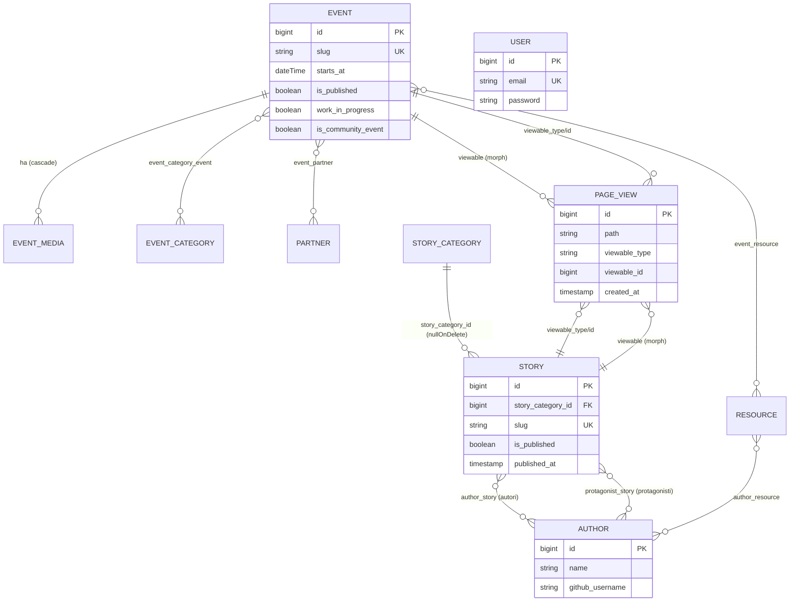

# 02 · Database

Lo schema è descritto nel suo **stato finale consolidato**, cioè l'effetto cumulativo di tutte le 32 migrazioni in `database/migrations/`. Le colonne aggiunte, rinominate o rimosse da migrazioni successive sono annotate con la migrazione responsabile, perché lo storico è importante per capire eventuali disallineamenti con factory e seeder.

Tutte le migrazioni seguono la convenzione Laravel `id()` (bigint unsigned auto-increment) come chiave primaria e `timestamps()` (`created_at`/`updated_at` nullable) salvo dove esplicitamente diverso. Le foreign key usano `foreignId(...)->constrained()` con `cascadeOnDelete()` o `nullOnDelete()`.

---

## Diagramma ER (dominio)



> Le due relazioni **STORY–AUTHOR** sono distinte e indipendenti: `author_story` (chi firma il pezzo) e `protagonist_story` (chi è raccontato). `USER` è isolato dal grafo di dominio: serve solo all'autenticazione dell'admin Filament.

---

## Tabelle di dominio

### `events`
Creata in `2026_02_15_195547`, modificata da 6 migrazioni successive. Lo stato iniziale (`create_events_table`) definiva `description` (not null) e `location` (not null); l'evoluzione ha aggiunto excerpt e flag e reso opzionali diversi campi.

| Colonna | Tipo | Null | Default | Note |
|---------|------|------|---------|------|
| `id` | bigint UN PK AI | no | | |
| `title` | string | no | | |
| `slug` | string | no | | **unique** |
| `location` | string | sì | | reso nullable da `2026_04_24_132400` |
| `address` | string | sì | null | |
| `starts_at` | dateTime | no | | |
| `ends_at` | dateTime | sì | null | |
| `body` | text | sì | | originariamente `description` (not null) → rinominata `body` (`2026_04_10_162306`) → resa nullable (`2026_04_24_132600`) |
| `excerpt` | text | sì | null | aggiunta `2026_04_10_161743` |
| `image_path` | string | sì | null | path relativo sul disk `public`; può contenere la copertina 16:9 generata (`events/covers/…`) |
| `cover_title` | string | sì | null | aggiunta `2026_10_24_233451` — titolo breve delle copertine (es. «Meetup»); se vuoto si usa `title` |
| `edition` | unsigned smallint | sì | null | aggiunta `2026_10_24_233451` — numero dell'edizione mostrato come `#N` |
| `subtitle` | string | sì | null | aggiunta `2026_10_24_233451` — sottotitolo delle copertine, gli a capo sono mantenuti |
| `cover_note` | string | sì | null | aggiunta `2026_10_24_233451` — nota accanto all'orario (es. «Gradita conferma») |
| `is_published` | boolean | no | `true` | |
| `work_in_progress` | boolean | no | `false` | aggiunta `2026_04_04_094620` |
| `is_community_event` | boolean | no | `true` | aggiunta `2026_04_21_185948` — distingue eventi organizzati dalla community vs. promossi |
| `created_at` / `updated_at` | timestamps | sì | | |

Snippet della migrazione iniziale (`2026_02_15_195547_create_events_table.php:14-26`):

```php
Schema::create('events', function (Blueprint $table) {
    $table->id();
    $table->string('title');
    $table->string('slug')->unique();
    $table->string('location');
    $table->string('address')->nullable();
    $table->dateTime('starts_at');
    $table->dateTime('ends_at')->nullable();
    $table->text('description');   // poi rinominata in body
    $table->string('image_path')->nullable();
    $table->boolean('is_published')->default(true);
    $table->timestamps();
});
```

La rinomina `description → body` è una migrazione di sola struttura che usa `renameColumn` in entrambe le direzioni (`2026_04_10_162306_rename_description_to_body_on_events_table.php:14-26`), così la rollback è perfettamente reversibile.

> **Indici:** unique su `slug` (usato dal route model binding `{event:slug}`). Nessun altro indice esplicito; le query per data/pubblicazione sfruttano la scansione filtrata.

### `resources`
Creata in `2026_02_15_195550`, modificata da 3 migrazioni. Lo stato iniziale aveva anche `slug` (unique) e `image_path`, **entrambi poi rimossi**.

| Colonna | Tipo | Null | Default | Note |
|---------|------|------|---------|------|
| `id` | bigint UN PK AI | no | | |
| `title` | string | no | | |
| `description` | text | sì | | reso nullable da `2026_04_24_132100` |
| `source_type` | string | no | `'link'` | valori usati: `link` / `file` |
| `external_url` | string | sì | null | usato quando `source_type = link` |
| `file_path` | string | sì | null | usato quando `source_type = file` |
| `is_published` | boolean | no | `true` | |
| `created_at` / `updated_at` | timestamps | sì | | |

> Le colonne `image_path` (`2026_04_20_122802`) e `slug` (`2026_04_20_123158`) sono state **rimosse** con migrazioni `drop`. ⚠️ `ResourceFactory` referenzia ancora `slug` e `image_path` (`database/factories/ResourceFactory.php:25-27`): la factory è quindi disallineata rispetto allo schema, ma non è nel percorso di seeding attivo. Vedi [Note e debito tecnico](../04_sviluppo_e_qualita/04_note_e_debito_tecnico.md).

### `event_media`
Creata in `2026_02_15_232721`. Galleria di media (immagini/video) collegata a un evento.

| Colonna | Tipo | Null | Default | Note |
|---------|------|------|---------|------|
| `id` | bigint UN PK AI | no | | |
| `event_id` | bigint UN | no | | **FK → `events.id`, cascadeOnDelete** |
| `media_type` | string | no | `'image'` | `image` / `video` |
| `source_type` | string | no | `'file'` | `file` / `url` |
| `file_path` | string | sì | null | |
| `external_url` | string | sì | null | |
| `caption` | string | sì | null | |
| `sort_order` | unsignedInteger | no | `0` | ordinamento galleria |
| `created_at` / `updated_at` | timestamps | sì | | |

La FK con cascade è dichiarata in forma compatta (`2026_02_15_232721_create_event_media_table.php:16`):

```php
$table->foreignId('event_id')->constrained()->cascadeOnDelete();
```

`constrained()` deduce automaticamente la tabella `events` e la colonna `id` dal nome `event_id`. La galleria è ordinata lato modello con `orderBy('sort_order')->orderBy('id')` (vedi [Modelli](03_modelli.md)).

### `event_categories`
Creata in `2026_02_16_204706`.

| Colonna | Tipo | Null | Default | Note |
|---------|------|------|---------|------|
| `id` | bigint UN PK AI | no | | |
| `name` | string | no | | |
| `slug` | string | no | | **unique** |
| `description` | text | sì | null | |
| `sort_order` | unsignedInteger | no | `0` | |
| `is_active` | boolean | no | `true` | |
| `created_at` / `updated_at` | timestamps | sì | | |

### `partners`
Creata in `2026_04_04_170844`, modificata in `2026_04_24_094600` (description nullable).

| Colonna | Tipo | Null | Default | Note |
|---------|------|------|---------|------|
| `id` | bigint UN PK AI | no | | |
| `name` | string | no | | |
| `description` | text | sì | | inizialmente not null → reso nullable |
| `logo_path` | string | sì | null | |
| `cover_logo_path` | string | sì | null | aggiunta `2026_10_25_095339` — logo bianco su sfondo trasparente per le copertine degli eventi |
| `website_url` | string | sì | null | |
| `is_published` | boolean | no | **`false`** | unico modello di dominio con default `false`: i partner sono bozze finché non pubblicati esplicitamente |
| `created_at` / `updated_at` | timestamps | sì | | |

> Il default `is_published = false` (`2026_04_04_170844_create_partners_table.php:20`) è una scelta diversa rispetto a `events`/`resources` (default `true`): un partner appena creato resta nascosto al pubblico finché non viene approvato.

### `story_categories`
Creata in `2026_04_07_214123`.

| Colonna | Tipo | Null | Default | Note |
|---------|------|------|---------|------|
| `id` | bigint UN PK AI | no | | |
| `name` | string | no | | |
| `slug` | string | no | | **unique** |
| `is_active` | boolean | no | `true` | |
| `sort_order` | unsignedSmallInteger | no | `0` | smallint, basta per poche categorie |
| `created_at` / `updated_at` | timestamps | sì | | |

### `stories`
Creata in `2026_04_07_214124`, modificata da 3 migrazioni. Lo stato iniziale aveva colonne `author`/`author_role` (stringhe) e `read_time_minutes` (smallint), **tutte poi rimosse**.

| Colonna | Tipo | Null | Default | Note |
|---------|------|------|---------|------|
| `id` | bigint UN PK AI | no | | |
| `story_category_id` | bigint UN | sì | null | **FK → `story_categories.id`, nullOnDelete** |
| `title` | string | no | | |
| `slug` | string | no | | **unique** |
| `excerpt` | text | sì | | reso nullable `2026_04_24_133300` |
| `body` | longText | sì | | reso nullable `2026_04_24_133300` |
| `image_path` | string | sì | null | |
| `is_published` | boolean | no | `false` | |
| `published_at` | timestamp | sì | null | |
| `created_at` / `updated_at` | timestamps | sì | | |

La FK usa `nullOnDelete()`: cancellando una categoria, le storie collegate sopravvivono con `story_category_id = null` (`2026_04_07_214124_create_stories_table.php:16`):

```php
$table->foreignId('story_category_id')->nullable()->constrained()->nullOnDelete();
```

> **Rimozioni significative:**
> - `author`/`author_role` rimosse in `2026_04_07_220415`, sostituite dalle relazioni many-to-many con `authors` (autori) e `protagonist_story` (protagonisti).
> - `read_time_minutes` rimossa in `2026_04_08_110015`: il tempo di lettura è ora un **accessor calcolato** a runtime sul modello `Story` (≈250 parole/minuto), non più una colonna persistita. Vedi [Modelli](03_modelli.md).

### `authors`
Creata in `2026_04_07_220413`. Tutti i campi oltre `name` sono opzionali, perché molti possono essere derivati dal profilo GitHub.

| Colonna | Tipo | Null | Default |
|---------|------|------|---------|
| `id` | bigint UN PK AI | no | |
| `name` | string | no | |
| `role` | string | sì | null |
| `bio` | text | sì | null |
| `avatar_path` | string | sì | null |
| `github_username` | string | sì | null |
| `linkedin_url` | string | sì | null |
| `twitter_url` | string | sì | null |
| `website_url` | string | sì | null |
| `created_at` / `updated_at` | timestamps | sì | |

> `github_username` è la chiave dell'integrazione esterna: quando valorizzato, il modello `Author` recupera avatar, bio, company, blog e twitter dal profilo GitHub (con cache 24h) come fallback ai campi locali. Vedi [Modelli](03_modelli.md).

### `page_views`
Creata in `2026_04_20_163719`, estesa in `2026_04_20_171806` con i campi polimorfici.

| Colonna | Tipo | Null | Default | Note |
|---------|------|------|---------|------|
| `id` | bigint UN PK AI | no | | |
| `path` | string | no | | **index** |
| `url` | text | no | | URL completo |
| `referrer` | string | sì | null | |
| `user_agent` | string | sì | null | |
| `created_at` | timestamp | no | CURRENT | **index** — `useCurrent()`, nessun `updated_at` |
| `viewable_type` | string | sì | null | `nullableMorphs('viewable')` |
| `viewable_id` | bigint UN | sì | null | indice composito `(viewable_type, viewable_id)` |

La migrazione base crea già due indici espliciti, su `path` e su `created_at` (`2026_04_20_163719_create_page_views_table.php:11-18`):

```php
Schema::create('page_views', function (Blueprint $table) {
    $table->id();
    $table->string('path')->index();
    $table->text('url');
    $table->string('referrer')->nullable();
    $table->string('user_agent')->nullable();
    $table->timestamp('created_at')->useCurrent()->index();
});
```

L'estensione polimorfica aggiunge `viewable_type` + `viewable_id` **con il loro indice composito** in una sola chiamata (`2026_04_20_171806_add_viewable_to_page_views_table.php:13`):

```php
$table->nullableMorphs('viewable');
```

`nullableMorphs` è scelto al posto di `morphs` perché molte pagine tracciate (home, lista eventi, partner) **non** hanno un contenuto associato: per quelle, `viewable_type`/`viewable_id` restano `null`. La presenza dell'indice composito e dell'indice su `created_at` è funzionale ai widget della dashboard (top events/stories/referrers, conteggi per periodo). Il modello disabilita `updated_at` (`const UPDATED_AT = null`) perché una visita è immutabile: vedi [Modelli](03_modelli.md).

---

## Tabelle pivot

| Pivot | Migrazione | Colonne | Chiave / Unique | Foreign key |
|-------|------------|---------|-----------------|-------------|
| `event_category_event` | `2026_02_16_204706` | id, event_id, event_category_id, timestamps | **unique(event_id, event_category_id)** | event_id→events (cascade); event_category_id→event_categories (cascade) |
| `event_resource` | `2026_02_17_230639` | id, event_id, resource_id, timestamps | **unique(event_id, resource_id)** | event_id→events (cascade); resource_id→resources (cascade) |
| `event_partner` | `2026_04_04_173042` | event_id, partner_id | **primary(event_id, partner_id)** — no timestamps | event_id→events (cascade); partner_id→partners (cascade) |
| `author_story` | `2026_04_07_220414` | author_id, story_id | **primary(author_id, story_id)** — no timestamps | author_id→authors (cascade); story_id→stories (cascade) |
| `author_resource` | `2026_04_20_122037` | author_id, resource_id | **primary(author_id, resource_id)** — no timestamps | author_id→authors (cascade); resource_id→resources (cascade) |
| `protagonist_story` | `2026_04_21_165634` | author_id, story_id | **primary(author_id, story_id)** — no timestamps | author_id→authors (cascade); story_id→stories (cascade) |

Due stili di pivot coesistono nel progetto:

- **Pivot "ricche"** (`event_category_event`, `event_resource`): hanno `id()` auto-increment, `timestamps()` e un vincolo `unique` composito che impedisce duplicati. Esempio (`2026_02_17_230639_create_event_resource_table.php:14-21`):

```php
Schema::create('event_resource', function (Blueprint $table) {
    $table->id();
    $table->foreignId('event_id')->constrained()->cascadeOnDelete();
    $table->foreignId('resource_id')->constrained()->cascadeOnDelete();
    $table->timestamps();
    $table->unique(['event_id', 'resource_id']);
});
```

- **Pivot "pure"** (`event_partner`, `author_story`, `author_resource`, `protagonist_story`): nessun `id`, nessun timestamp, la **chiave primaria composita** garantisce l'unicità ed è di per sé l'indice. Esempio (`2026_04_21_165634_create_protagonist_story_table.php:14-18`):

```php
Schema::create('protagonist_story', function (Blueprint $table) {
    $table->foreignId('author_id')->constrained()->cascadeOnDelete();
    $table->foreignId('story_id')->constrained()->cascadeOnDelete();
    $table->primary(['author_id', 'story_id']);
});
```

> `protagonist_story` è un **secondo** legame `authors`↔`stories` parallelo ad `author_story`: la stessa tabella `authors` può comparire in una storia sia come autore (chi scrive) sia come protagonista (chi è raccontato), tramite pivot distinte. Vedi le relazioni `Story::authors()` e `Story::protagonists()` in [Modelli](03_modelli.md).

---

## Tabelle di sistema

Standard Laravel, create dalle migrazioni `0001_01_01_*`. Sono il backend fisico delle scelte di config descritte in [Architettura](01_architettura.md):

- **`users`** — `id`, `name`, `email` (unique), `email_verified_at`, `password`, `remember_token`, timestamps.
- **`password_reset_tokens`** — `email` PK, `token`, `created_at`.
- **`sessions`** — `id` PK, `user_id` (index), `ip_address`, `user_agent`, `payload`, `last_activity` (index). Backend del driver di sessione `database`.
- **`cache`** / **`cache_locks`** — store cache su database (`CACHE_STORE=database`). Ospita anche le voci `github_profile_*` (TTL 24h) generate dal modello `Author`.
- **`jobs`** / **`job_batches`** / **`failed_jobs`** — coda su database (`QUEUE_CONNECTION=database`); i job falliti usano `database-uuids`.

---

## Interrogare lo schema: eager loading ed evitare N+1

Lo schema è fortemente relazionale, quindi il rischio principale di performance è il problema **N+1**. Le scelte adottate dal codice:

- **Eager loading "di default" su relazioni che si renderizzano sempre insieme.** La relazione `Event::resources()` carica già gli autori delle risorse con `->with('authors')` (`app/Models/Event.php:73-74`), perché ogni risorsa mostrata accanto a un evento espone i suoi autori. Allo stesso modo, un componente che lista eventi dovrebbe usare `Event::with(['media', 'categories', 'partners'])` per non emettere una query per ogni card.
- **Ordinamento nelle relazioni, non nelle view.** `media()` ordina per `sort_order` poi `id`, `categories()` per `sort_order` poi `name`, `partners()` per `name`: l'ordine è parte della definizione della relazione, così il dato arriva già ordinato dalla query e le view restano dichiarative.
- **Indici a supporto delle query analitiche.** Gli indici su `page_views.path`, `page_views.created_at` e l'indice composito `(viewable_type, viewable_id)` servono i widget della dashboard che aggregano visite per path, per periodo e per contenuto.
- **`limit()` nativo sulle relazioni eager** (Laravel 12) per le sezioni "ultimi N" senza pacchetti esterni: es. `->latest()->limit(3)`.

Per i metodi di relazione esatti, i casts e gli accessor che derivano da queste tabelle, vedi [Modelli](03_modelli.md).

---

## Migrazioni: convenzioni e storico

- **Mai ridefinire una colonna in una migrazione di modifica senza riportarne tutti gli attributi:** in Laravel 12 gli attributi omessi vengono **persi**. Le migrazioni "make nullable" del `2026_04_24` rispettano questa regola riportando il tipo completo della colonna.
- Le numerose migrazioni di "make nullable" del `2026_04_24` riflettono una scelta di prodotto: rendere molti campi opzionali nel pannello admin, per abbassare l'attrito nella creazione di bozze (vedi [Pannello admin](../03_codice/02_pannello_admin.md)).
- Lo **storico delle rinomine** (`description`→`body` su `events`) e delle **rimozioni** (`slug`/`image_path` su `resources`; `author`/`author_role`/`read_time_minutes` su `stories`) è la chiave per leggere i disallineamenti residui di factory/seeder elencati in [Note e debito tecnico](../04_sviluppo_e_qualita/04_note_e_debito_tecnico.md).
</content>
