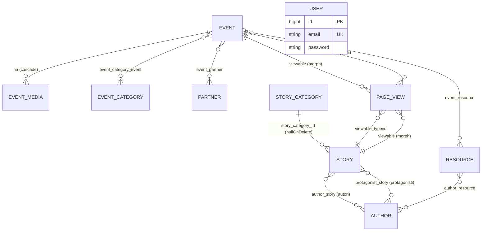

# 04 · Database

Lo schema è descritto nel suo **stato finale consolidato** (effetto di tutte le 32 migrazioni in `database/migrations/`). Le colonne aggiunte, rinominate o rimosse da migrazioni successive sono annotate.

---

## Diagramma ER (dominio)

> Le due relazioni **STORY–AUTHOR** sono distinte: `author_story` (autori che firmano) e `protagonist_story` (protagonisti raccontati). `USER` è isolato (serve solo all'autenticazione admin).

---

## Tabelle di dominio

### `events`
Creata in `2026_02_15_195547`, modificata da 6 migrazioni successive.

| Colonna | Tipo | Null | Default | Note |
|---------|------|------|---------|------|
| `id` | bigint UN PK AI | no | | |
| `title` | string | no | | |
| `slug` | string | no | | **unique** |
| `location` | string | sì | | reso nullable da `2026_04_24_132400` |
| `address` | string | sì | null | |
| `starts_at` | dateTime | no | | |
| `ends_at` | dateTime | sì | null | |
| `body` | text | sì | | originariamente `description` (not null) → rinominata `body` (`2026_04_10_162306`) → resa nullable (`2026_04_24_132600`) |
| `excerpt` | text | sì | null | aggiunta `2026_04_10_161743` |
| `image_path` | string | sì | null | |
| `is_published` | boolean | no | `true` | |
| `work_in_progress` | boolean | no | `false` | aggiunta `2026_04_04_094620` |
| `is_community_event` | boolean | no | `true` | aggiunta `2026_04_21_185948` |
| `created_at` / `updated_at` | timestamps | sì | | |

### `resources`
Creata in `2026_02_15_195550`, modificata da 3 migrazioni.

| Colonna | Tipo | Null | Default | Note |
|---------|------|------|---------|------|
| `id` | bigint UN PK AI | no | | |
| `title` | string | no | | |
| `description` | text | sì | | reso nullable da `2026_04_24_132100` |
| `source_type` | string | no | `'link'` | valori usati: `link` / `file` |
| `external_url` | string | sì | null | |
| `file_path` | string | sì | null | |
| `is_published` | boolean | no | `true` | |
| `created_at` / `updated_at` | timestamps | sì | | |

> Le colonne `slug` (`2026_04_20_123158`) e `image_path` (`2026_04_20_122802`) sono state **rimosse**. ⚠️ `ResourceFactory`/`ResourceSeeder` le referenziano ancora (vedi [12](../04_sviluppo_e_qualita/04_note_e_debito_tecnico.md)).

### `event_media`
Creata in `2026_02_15_232721`.

| Colonna | Tipo | Null | Default | Note |
|---------|------|------|---------|------|
| `id` | bigint UN PK AI | no | | |
| `event_id` | bigint UN | no | | **FK → `events.id`, cascadeOnDelete** |
| `media_type` | string | no | `'image'` | `image` / `video` |
| `source_type` | string | no | `'file'` | `file` / `url` |
| `file_path` | string | sì | null | |
| `external_url` | string | sì | null | |
| `caption` | string | sì | null | |
| `sort_order` | unsignedInteger | no | `0` | |
| `created_at` / `updated_at` | timestamps | sì | | |

### `event_categories`
Creata in `2026_02_16_204706`.

| Colonna | Tipo | Null | Default | Note |
|---------|------|------|---------|------|
| `id` | bigint UN PK AI | no | | |
| `name` | string | no | | |
| `slug` | string | no | | **unique** |
| `description` | text | sì | null | |
| `sort_order` | unsignedInteger | no | `0` | |
| `is_active` | boolean | no | `true` | |
| `created_at` / `updated_at` | timestamps | sì | | |

### `partners`
Creata in `2026_04_04_170844`, modificata in `2026_04_24_094600`.

| Colonna | Tipo | Null | Default | Note |
|---------|------|------|---------|------|
| `id` | bigint UN PK AI | no | | |
| `name` | string | no | | |
| `description` | text | sì | | reso nullable |
| `logo_path` | string | sì | null | |
| `website_url` | string | sì | null | |
| `is_published` | boolean | no | **`false`** | |
| `created_at` / `updated_at` | timestamps | sì | | |

### `story_categories`
Creata in `2026_04_07_214123`.

| Colonna | Tipo | Null | Default | Note |
|---------|------|------|---------|------|
| `id` | bigint UN PK AI | no | | |
| `name` | string | no | | |
| `slug` | string | no | | **unique** |
| `is_active` | boolean | no | `true` | |
| `sort_order` | unsignedSmallInteger | no | `0` | |
| `created_at` / `updated_at` | timestamps | sì | | |

### `stories`
Creata in `2026_04_07_214124`, modificata da 3 migrazioni.

| Colonna | Tipo | Null | Default | Note |
|---------|------|------|---------|------|
| `id` | bigint UN PK AI | no | | |
| `story_category_id` | bigint UN | sì | null | **FK → `story_categories.id`, nullOnDelete** |
| `title` | string | no | | |
| `slug` | string | no | | **unique** |
| `excerpt` | text | sì | | reso nullable `2026_04_24_133300` |
| `body` | longText | sì | | reso nullable `2026_04_24_133300` |
| `image_path` | string | sì | null | |
| `is_published` | boolean | no | `false` | |
| `published_at` | timestamp | sì | null | |
| `created_at` / `updated_at` | timestamps | sì | | |

> Rimosse: `author`/`author_role` (`2026_04_07_220415`, sostituite dalla relazione con `authors`) e `read_time_minutes` (`2026_04_08_110015`, ora **accessor calcolato** sul modello).

### `authors`
Creata in `2026_04_07_220413`.

| Colonna | Tipo | Null | Default |
|---------|------|------|---------|
| `id` | bigint UN PK AI | no | |
| `name` | string | no | |
| `role` | string | sì | null |
| `bio` | text | sì | null |
| `avatar_path` | string | sì | null |
| `github_username` | string | sì | null |
| `linkedin_url` | string | sì | null |
| `twitter_url` | string | sì | null |
| `website_url` | string | sì | null |
| `created_at` / `updated_at` | timestamps | sì | |

### `page_views`
Creata in `2026_04_20_163719`, modificata in `2026_04_20_171806`.

| Colonna | Tipo | Null | Default | Note |
|---------|------|------|---------|------|
| `id` | bigint UN PK AI | no | | |
| `path` | string | no | | **index** |
| `url` | text | no | | |
| `referrer` | string | sì | null | |
| `user_agent` | string | sì | null | |
| `created_at` | timestamp | no | CURRENT | **index** — nessun `updated_at` (disabilitato nel modello) |
| `viewable_type` | string | sì | null | `nullableMorphs('viewable')` |
| `viewable_id` | bigint UN | sì | null | indice composito `(viewable_type, viewable_id)` |

---

## Tabelle pivot

| Pivot | Migrazione | Colonne | Chiave / Unique | Foreign key |
|-------|------------|---------|-----------------|-------------|
| `event_category_event` | `2026_02_16_204706` | id, event_id, event_category_id, timestamps | **unique(event_id, event_category_id)** | event_id→events (cascade); event_category_id→event_categories (cascade) |
| `event_resource` | `2026_02_17_230639` | id, event_id, resource_id, timestamps | **unique(event_id, resource_id)** | event_id→events (cascade); resource_id→resources (cascade) |
| `event_partner` | `2026_04_04_173042` | event_id, partner_id | **primary(event_id, partner_id)** — no timestamps | event_id→events (cascade); partner_id→partners (cascade) |
| `author_story` | `2026_04_07_220414` | author_id, story_id | **primary(author_id, story_id)** — no timestamps | author_id→authors (cascade); story_id→stories (cascade) |
| `author_resource` | `2026_04_20_122037` | author_id, resource_id | **primary(author_id, resource_id)** — no timestamps | author_id→authors (cascade); resource_id→resources (cascade) |
| `protagonist_story` | `2026_04_21_165634` | author_id, story_id | **primary(author_id, story_id)** — no timestamps | author_id→authors (cascade); story_id→stories (cascade) |

> `event_category_event` ed `event_resource` hanno `id` + timestamps; le pivot author/partner sono "pure" (solo chiavi). `protagonist_story` è un **secondo** legame `authors`↔`stories` oltre ad `author_story`.

---

## Tabelle di sistema

Standard Laravel, create dalle migrazioni `0001_01_01_*`:

- **`users`** — `id`, `name`, `email` (unique), `email_verified_at`, `password`, `remember_token`, timestamps.
- **`password_reset_tokens`** — `email` PK, `token`, `created_at`.
- **`sessions`** — `id` PK, `user_id` (index), `ip_address`, `user_agent`, `payload`, `last_activity` (index).
- **`cache`** / **`cache_locks`** — store cache su database (`CACHE_STORE=database`).
- **`jobs`** / **`job_batches`** / **`failed_jobs`** — coda su database (`QUEUE_CONNECTION=database`).

---

## Migrazioni: convenzioni

- **Mai** ridefinire una colonna in una migrazione di modifica senza riportarne tutti gli attributi: in Laravel 12 gli attributi omessi vengono **persi**.
- Le migrazioni di "make nullable" del `2026_04_24` riflettono la scelta di rendere molti campi opzionali nel pannello admin (vedi [07 · Pannello admin](../03_codice/02_pannello_admin.md)).
- Lo storico delle rinomine (`description`→`body`) e delle rimozioni (`slug`/`image_path` su `resources`) è importante per capire eventuali disallineamenti factory/seeder.
