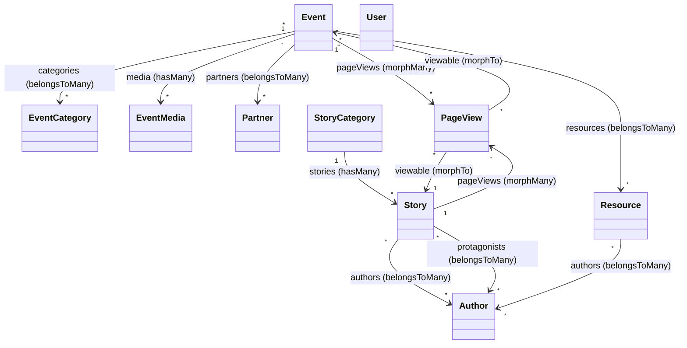

# 05 · Modelli Eloquent

I modelli sono in `app/Models/`. Nessun PHP `enum` è presente nel progetto: i campi "enum-like" (`source_type`, `media_type`) sono stringhe con default.

---

## Mappa delle relazioni

---

## `Event`

- **Trait:** `HasFactory`.
- **`$fillable`:** `title, slug, location, address, starts_at, ends_at, body, excerpt, image_path, is_published, work_in_progress, is_community_event`.
- **`casts()`:** `starts_at`→datetime, `ends_at`→datetime, `is_published`→boolean, `work_in_progress`→boolean, `is_community_event`→boolean.

**Relazioni**

| Metodo | Tipo | Target | Note |
|--------|------|--------|------|
| `pageViews()` | morphMany | `PageView` | via `viewable` |
| `media()` | hasMany | `EventMedia` | ordinata `sort_order`, poi `id` |
| `categories()` | belongsToMany | `EventCategory` | pivot `event_category_event`, ordinata `sort_order`/`name` |
| `resources()` | belongsToMany | `Resource` | `withTimestamps()`, eager `with('authors')` |
| `partners()` | belongsToMany | `Partner` | ordinata `name` |

**Accessor / metodi**

- `isPast(): bool` → `ends_at <= now()`.
- `getImageUrlAttribute(): string` → URL immagine dal disk `public`; fallback `placeholders/events/event-placeholder.jpg`.
- `getLocalStartsAtAttribute()` / `getLocalEndsAtAttribute(): ?Carbon` → convertite a timezone **`Europe/Rome`**.
- `getReadTimeMinutesAttribute(): float` → minuti di lettura stimati su `body` (≈250 parole/minuto).

---

## `EventCategory`

- **Trait:** `HasFactory`.
- **`$fillable`:** `name, slug, description, sort_order, is_active`.
- **`casts()`:** `sort_order`→integer, `is_active`→boolean.
- **Relazioni:** `events()` → belongsToMany `Event` (pivot `event_category_event`).

---

## `EventMedia`

- **Trait:** `HasFactory`.
- **`$fillable`:** `event_id, media_type, source_type, file_path, external_url, caption, sort_order`.
- **`casts()`:** `sort_order`→integer.
- **Relazioni:** `event()` → belongsTo `Event`.
- **Accessor:** `getFileUrlAttribute(): ?string` → URL del file dal disk `public` se esiste, altrimenti `null`.

---

## `Resource`

- **Trait:** `HasFactory`.
- **`$fillable`:** `title, description, source_type, external_url, file_path, is_published` (niente `slug`/`image_path`: rimossi dallo schema).
- **`casts()`:** `is_published`→boolean.

**Relazioni**

| Metodo | Tipo | Target | Note |
|--------|------|--------|------|
| `events()` | belongsToMany | `Event` | `withTimestamps()` |
| `authors()` | belongsToMany | `Author` | pivot `author_resource` |

**Accessor**

- `getResourceUrlAttribute(): ?string` → se `source_type === 'file'` e il file esiste sul disk `public`, restituisce l'URL del file; altrimenti `external_url`.

---

## `Partner`

- **Trait:** `HasFactory`.
- **`$fillable`:** `name, description, logo_path, website_url, is_published`.
- **`casts()`:** `is_published`→boolean.
- **Relazioni:** `events()` → belongsToMany `Event`.
- **Accessor:** `getLogoUrlAttribute(): ?string` → URL del logo dal disk `public` o `null`.

---

## `Author`

- **Trait:** `HasFactory`.
- **`$appends`:** `['avatar_url', 'github_url']` (sempre serializzati).
- **`$fillable`:** `name, role, bio, avatar_path, github_username, linkedin_url, twitter_url, website_url`.
- Nessun `casts()`.

**Relazioni**

| Metodo | Tipo | Target | Note |
|--------|------|--------|------|
| `stories()` | belongsToMany | `Story` | `withTimestamps()`, pivot `author_story` |
| `resources()` | belongsToMany | `Resource` | pivot `author_resource` |

> La relazione "protagonista" (`protagonist_story`) è definita **lato `Story`** (`protagonists()`), non qui.

**Integrazione GitHub** — funzionalità distintiva del modello:

- `getAvatarUrlAttribute()` → priorità: `avatar_path` (disk public) → avatar GitHub (`github.com/{user}.png?size=200`) → `ui-avatars.com` → `''`.
- `getGithubUrlAttribute()` → `https://github.com/{username}` o `null`.
- `getDisplayBioAttribute()`, `getDisplayRoleAttribute()`, `getDisplayWebsiteUrlAttribute()`, `getDisplayTwitterUrlAttribute()` → usano il valore locale e, se assente, ricadono sui dati del **profilo GitHub**.
- `static fetchGithubProfile(string $username): array` → recupera il profilo via `Http::get` all'API GitHub, con **cache 24h** (`Cache::remember`, chiave `github_profile_{username}`).

> ⚠️ Gli accessor `display_*` e gli helperText del form admin innescano chiamate HTTP esterne (mitigate da cache). Vedi [12 · Note e debito tecnico](../04_sviluppo_e_qualita/04_note_e_debito_tecnico.md).

---

## `Story`

- **Trait:** `HasFactory`.
- **`$fillable`:** `story_category_id, title, slug, excerpt, body, image_path, is_published, published_at`.
- **`casts()`:** `is_published`→boolean, `published_at`→datetime.

**Relazioni**

| Metodo | Tipo | Target | Note |
|--------|------|--------|------|
| `pageViews()` | morphMany | `PageView` | via `viewable` |
| `category()` | belongsTo | `StoryCategory` | FK `story_category_id` |
| `authors()` | belongsToMany | `Author` | pivot `author_story` |
| `protagonists()` | belongsToMany | `Author` | pivot `protagonist_story` |

**Accessor**

- `getImageUrlAttribute(): ?string` → URL immagine dal disk `public` o `null`.
- `getReadTimeMinutesAttribute(): float` → minuti di lettura su `body` (≈250 parole/minuto).

---

## `StoryCategory`

- **Trait:** `HasFactory`.
- **`$fillable`:** `name, slug, is_active, sort_order`.
- **`casts()`:** `is_active`→boolean.
- **Relazioni:** `stories()` → hasMany `Story`.

---

## `PageView`

- `declare(strict_types=1)`. **Nessun** `HasFactory`.
- **`const UPDATED_AT = null`** → disabilita `updated_at` (la tabella ha solo `created_at`).
- **`$fillable`:** `path, url, referrer, user_agent, viewable_type, viewable_id`.
- **Relazioni:** `viewable()` → morphTo (polimorfica verso `Event` e `Story`).

---

## `User`

- Estende `Illuminate\Foundation\Auth\User` e implementa **`Filament\Models\Contracts\FilamentUser`**.
- **Trait:** `HasFactory`, `Notifiable`.
- **`$fillable`:** `name, email, password`.
- **`$hidden`:** `password, remember_token`.
- **`casts()`:** `email_verified_at`→datetime, `password`→**hashed**.
- **`canAccessPanel(Panel $panel): bool`** → ritorna **`true`** per qualunque utente autenticato.

> ⚠️ Nessun sistema di ruoli/policy: ogni record in `users` ha accesso completo all'admin. Vedi [12 · Note e debito tecnico](../04_sviluppo_e_qualita/04_note_e_debito_tecnico.md).

---

## Seeder e factory

### Seeder

`DatabaseSeeder` invoca in ordine: `RealAuthorsSeeder`, `EventCategorySeeder`, `RealPartnersSeeder`, `RealEventsSeeder`, `StoryCategorySeeder`, `RealStoriesSeeder`; poi crea l'utente `admin@salento.dev` / `password123`. `ResourceSeeder` ed `EventSeeder` (basati su factory) **non** sono invocati.

| Seeder | Cosa popola |
|--------|-------------|
| `EventCategorySeeder` | 7 categorie (Meet-up, Live Coding, Networking, Workshop, Talk, Hackathon, Mentorship), `updateOrCreate`. |
| `StoryCategorySeeder` | 8 categorie (Esperimento, Tutorial, Riflessione, Case Study, Open Source, DevOps, Frontend, Backend). |
| `RealAuthorsSeeder` | 3 autori reali con `github_username`, `linkedin_url`, `website_url`. |
| `RealPartnersSeeder` | 3 partner reali; copia i loghi da `database/seeders/partners/` sul disk public; `is_published=true`. |
| `RealEventsSeeder` | 7 eventi reali; copia immagini; sincronizza categorie/partner/risorse (un evento ha 3 risorse, una di tipo `file` con PDF). |
| `RealStoriesSeeder` | 1 storia reale; sincronizza `protagonists` e `authors`. |

### Factory (stati custom rilevanti)

- **`UserFactory`** — stato `unverified()` (imposta `email_verified_at = null`); password di default `password`.
- **`EventFactory`** — genera `body` markdown, slug univoco, `is_published` 85%, `work_in_progress` 20% solo su eventi futuri.
- **`StoryFactory`** — crea anche la `StoryCategory` collegata, `is_published` 80%.
- **`AuthorFactory`** — `github_username` opzionale da una lista reale.

> ⚠️ `ResourceFactory` genera ancora i campi `slug`/`image_path` **non più presenti** in `resources`: factory disallineata (non nel percorso di seeding attivo). Vedi [12](../04_sviluppo_e_qualita/04_note_e_debito_tecnico.md).
