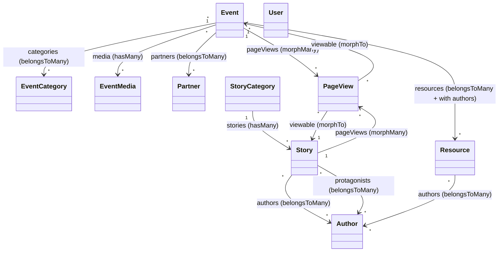

# 03 · Modelli Eloquent

I modelli sono in `app/Models/`. Nessun PHP `enum` è presente nel progetto: i campi "enum-like" (`source_type`, `media_type`) sono stringhe con default a livello di migrazione. Tutti i modelli di dominio usano il trait `HasFactory`; i casts sono dichiarati con il metodo `casts()` (convenzione Laravel 12) anziché con la proprietà `$casts`.

---

## Mappa delle relazioni



---

## `Event`

- **Trait:** `HasFactory`.
- **`$fillable`** (`app/Models/Event.php:20-33`): `title, slug, location, address, starts_at, ends_at, body, excerpt, image_path, is_published, work_in_progress, is_community_event`.
- **`casts()`** (`Event.php:38-47`): `starts_at`→datetime, `ends_at`→datetime, `is_published`→boolean, `work_in_progress`→boolean, `is_community_event`→boolean.

**Relazioni**

| Metodo | Tipo | Target | Note |
|--------|------|--------|------|
| `pageViews()` | morphMany | `PageView` | via `viewable` |
| `media()` | hasMany | `EventMedia` | ordinata `sort_order`, poi `id` |
| `categories()` | belongsToMany | `EventCategory` | pivot `event_category_event`, ordinata `sort_order`/`name` |
| `resources()` | belongsToMany | `Resource` | `withTimestamps()`, **eager `with('authors')`** |
| `partners()` | belongsToMany | `Partner` | ordinata `name` |

L'eager-loading degli autori è incorporato nella relazione (`Event.php:71-75`), così ogni risorsa mostrata accanto a un evento porta con sé i suoi autori senza N+1:

```php
public function resources(): BelongsToMany
{
    return $this->belongsToMany(Resource::class)->withTimestamps()
        ->with('authors');
}
```

**Accessor / metodi non banali**

- `isPast(): bool` → `ends_at <= now()`. Usato dalla card evento per distinguere passato/futuro.
- `getImageUrlAttribute(): string` — unico accessor immagine del progetto con **fallback a placeholder** anziché `null` (`Event.php:82-95`):

```php
public function getImageUrlAttribute(): string
{
    $storage = Storage::disk('public');

    if (filled($this->image_path)) {
        $path = ltrim((string) $this->image_path, '/');
        if ($storage->exists($path)) {
            return $storage->url($path);
        }
    }

    return $storage->url('placeholders/events/event-placeholder.jpg');
}
```

La logica: se `image_path` è valorizzato **e** il file esiste davvero sul disk `public`, restituisce il suo URL; altrimenti ricade sul placeholder. Il doppio controllo (`filled` + `exists`) rende la view robusta sia a record senza immagine sia a path "orfani".

- `getLocalStartsAtAttribute()` / `getLocalEndsAtAttribute(): ?Carbon` — convertono le date (persistite in UTC) al fuso **`Europe/Rome`** solo in presentazione (`Event.php:97-105`):

```php
public function getLocalStartsAtAttribute(): ?Carbon
{
    return $this->starts_at?->tz('Europe/Rome');
}
```

L'operatore `?->` propaga il `null` quando la data non c'è (es. `ends_at` opzionale), evitando errori a runtime.

- `getReadTimeMinutesAttribute(): float` — tempo di lettura stimato sul `body` (`Event.php:112-121`):

```php
public function getReadTimeMinutesAttribute(): float
{
    $texts = $this->body;
    $words = str_word_count(strip_tags($texts));
    return ceil($words / 250);
}
```

L'algoritmo: rimuove i tag HTML con `strip_tags`, conta le parole con `str_word_count`, divide per **250 parole/minuto** (velocità media di lettura tecnica) e arrotonda per eccesso con `ceil`. È identico a quello di `Story`. Questo valore era una colonna persistita (`read_time_minutes`), poi rimossa e sostituita dal calcolo a runtime (vedi [Database](02_database.md)).

> **Caso limite:** se `body` è `null` (campo reso nullable), `strip_tags(null)`/`str_word_count('')` producono `0`, quindi `read_time_minutes` vale `0`. La view deve gestire il caso "0 minuti".

---

## `EventCategory`

- **Trait:** `HasFactory`.
- **`$fillable`:** `name, slug, description, sort_order, is_active`.
- **`casts()`:** `sort_order`→integer, `is_active`→boolean.
- **Relazione** (`app/Models/EventCategory.php:35-38`): `events()` → `belongsToMany(Event::class, 'event_category_event', 'event_category_id', 'event_id')`. È il lato inverso di `Event::categories()`; le chiavi pivot sono dichiarate esplicitamente per chiarezza. A differenza del lato `Event`, qui **non** c'è ordinamento applicato.

---

## `EventMedia`

- **Trait:** `HasFactory`.
- **`$fillable`:** `event_id, media_type, source_type, file_path, external_url, caption, sort_order`.
- **`casts()`:** `sort_order`→integer.
- **Relazione:** `event()` → `belongsTo(Event::class)`.
- **Accessor:** `getFileUrlAttribute(): ?string` (`EventMedia.php:42-54`) → se `file_path` è valorizzato e il file esiste sul disk `public`, restituisce l'URL; altrimenti `null`. Per i media `source_type = 'url'` la view usa direttamente `external_url`.

---

## `Resource`

- **Trait:** `HasFactory`.
- **`$fillable`:** `title, description, source_type, external_url, file_path, is_published` (niente `slug`/`image_path`: rimossi dallo schema, vedi [Database](02_database.md)).
- **`casts()`:** `is_published`→boolean.

**Relazioni**

| Metodo | Tipo | Target | Note |
|--------|------|--------|------|
| `events()` | belongsToMany | `Event` | `withTimestamps()` |
| `authors()` | belongsToMany | `Author` | pivot `author_resource` |

**Accessor** — `getResourceUrlAttribute(): ?string` incapsula la dualità link/file (`Resource.php:46-60`):

```php
public function getResourceUrlAttribute(): ?string
{
    if ($this->source_type === 'file' && filled($this->file_path)) {
        $path = ltrim((string) $this->file_path, '/');
        $storage = Storage::disk('public');
        if ($storage->exists($path)) {
            return $storage->url($path);
        }
        return null;
    }

    return filled($this->external_url) ? (string) $this->external_url : null;
}
```

Logica: se la risorsa è di tipo `file` e il file esiste, restituisce l'URL del file (altrimenti `null`, segnalando un file mancante); per tutte le risorse `link` restituisce `external_url`. Così la view può chiamare un solo accessor indipendentemente dal tipo di risorsa.

---

## `Partner`

- **Trait:** `HasFactory`.
- **`$fillable`:** `name, description, logo_path, website_url, is_published`.
- **`casts()`:** `is_published`→boolean.
- **Relazione:** `events()` → `belongsToMany(Event::class)`.
- **Accessor:** `getLogoUrlAttribute(): ?string` (`Partner.php:40-52`) → URL del logo dal disk `public` se esiste, altrimenti `null`.

> Ricorda che `partners.is_published` ha default `false` a livello di DB: un partner è una bozza nascosta finché non viene pubblicato. La pagina pubblica filtra su `is_published = true`.

---

## `Author`

- **Trait:** `HasFactory`.
- **`$appends`** (`app/Models/Author.php:20`): `['avatar_url', 'github_url']` — sempre inclusi nella serializzazione del modello, così avatar e link GitHub sono disponibili anche quando il modello è passato a una view o serializzato.
- **`$fillable`:** `name, role, bio, avatar_path, github_username, linkedin_url, twitter_url, website_url`.
- Nessun `casts()` (tutti string/text).

**Relazioni**

| Metodo | Tipo | Target | Note |
|--------|------|--------|------|
| `stories()` | belongsToMany | `Story` | `withTimestamps()`, pivot `author_story` |
| `resources()` | belongsToMany | `Resource` | pivot `author_resource` |

> La relazione "protagonista" (`protagonist_story`) è definita **lato `Story`** (`protagonists()`), non qui. `Author` "vede" solo le storie che ha firmato come autore.

### Integrazione GitHub — funzionalità distintiva

`Author` arricchisce i profili con dati presi da GitHub quando i campi locali sono vuoti. Il meccanismo si articola in tre livelli.

**1. Recupero con cache (24h).** `fetchGithubProfile()` è statico e memorizza la risposta dell'API GitHub per 24 ore (`Author.php:127-138`):

```php
public static function fetchGithubProfile(string $username): array
{
    return Cache::remember(
        'github_profile_'.$username,
        now()->addHours(24),
        function () use ($username): array {
            $response = Http::get('https://api.github.com/users/'.urlencode($username));
            return $response->ok() ? $response->json() : [];
        }
    );
}
```

In caso di risposta non OK (rate limit, utente inesistente, rete giù) restituisce un array vuoto, che viene comunque cacheato: questo evita di martellare l'API a ogni render. La voce di cache finisce nella tabella `cache` (store `database`). Il metodo privato `githubProfile()` (`Author.php:143-150`) fa da guardia: ritorna `[]` se non c'è `github_username`, altrimenti delega allo statico.

**2. Avatar con catena di fallback.** `getAvatarUrlAttribute()` prova in ordine quattro fonti (`Author.php:50-69`):

```php
public function getAvatarUrlAttribute(): ?string
{
    if (filled($this->avatar_path)) {
        $path = ltrim((string) $this->avatar_path, '/');
        $storage = Storage::disk('public');
        if ($storage->exists($path)) {
            return $storage->url($path);
        }
    }

    if (filled($this->github_username)) {
        return 'https://github.com/'.urlencode((string) $this->github_username).'.png?size=200';
    }

    if (filled($this->name)) {
        return 'https://ui-avatars.com/api/?name='.urlencode((string) $this->name).'&background=0a0a0a&color=06b6d4';
    }

    return '';
}
```

Priorità: **(a)** avatar caricato localmente se il file esiste → **(b)** avatar GitHub (`github.com/{user}.png?size=200`) → **(c)** avatar generato da `ui-avatars.com` con i colori del design system (`#0a0a0a` sfondo, cyan `#06b6d4` testo) → **(d)** stringa vuota. Notare che per l'avatar GitHub viene usato l'URL diretto `.png` (nessuna chiamata API, nessuna cache necessaria).

**3. Campi "display_*" con fallback al profilo GitHub.** Quattro accessor restituiscono il valore locale se presente, altrimenti pescano dal profilo GitHub cacheato:

- `getDisplayBioAttribute()` → `bio` locale, altrimenti `bio` GitHub (`Author.php:80-87`).
- `getDisplayRoleAttribute()` → `role` locale, altrimenti `company` GitHub, ripulita dall'eventuale `@` iniziale con `ltrim($company, '@')` (`Author.php:89-98`).
- `getDisplayWebsiteUrlAttribute()` → `website_url` locale, altrimenti `blog` GitHub (`Author.php:100-109`).
- `getDisplayTwitterUrlAttribute()` → `twitter_url` locale, altrimenti `twitter_username` GitHub trasformato in URL `https://twitter.com/{username}` (`Author.php:111-120`).

`getGithubUrlAttribute()` (`Author.php:71-78`) restituisce semplicemente `https://github.com/{username}` o `null`.

> ⚠️ Gli accessor `display_*` innescano (alla prima invocazione non in cache) una chiamata HTTP esterna verso l'API GitHub. La cache 24h mitiga il problema, ma un render che usa `display_bio` su molti autori non ancora cacheati può accumulare latenza. Gli stessi accessor sono usati come `helperText` nei form admin. Vedi [Note e debito tecnico](../04_sviluppo_e_qualita/04_note_e_debito_tecnico.md).

---

## `Story`

- **Trait:** `HasFactory`.
- **`$fillable`:** `story_category_id, title, slug, excerpt, body, image_path, is_published, published_at`.
- **`casts()`:** `is_published`→boolean, `published_at`→datetime.

**Relazioni**

| Metodo | Tipo | Target | Note |
|--------|------|--------|------|
| `pageViews()` | morphMany | `PageView` | via `viewable` |
| `category()` | belongsTo | `StoryCategory` | FK `story_category_id` |
| `authors()` | belongsToMany | `Author` | pivot `author_story` |
| `protagonists()` | belongsToMany | `Author` | pivot `protagonist_story` |

`authors()` e `protagonists()` puntano alla **stessa** tabella `authors` ma tramite pivot diverse (`Story.php:52-60`):

```php
public function authors(): BelongsToMany
{
    return $this->belongsToMany(Author::class);                    // pivot author_story
}

public function protagonists(): BelongsToMany
{
    return $this->belongsToMany(Author::class, 'protagonist_story'); // pivot protagonist_story
}
```

`authors()` usa la pivot di default dedotta dai nomi (`author_story`), mentre `protagonists()` la forza esplicitamente a `protagonist_story`. Questo permette a una storia di avere autori (chi scrive) e protagonisti (chi è raccontato) come insiemi distinti.

**Accessor**

- `getImageUrlAttribute(): ?string` (`Story.php:62-74`) → URL immagine dal disk `public` se esiste, altrimenti `null` (nessun placeholder, a differenza di `Event`).
- `getReadTimeMinutesAttribute(): float` → identico a `Event`: `ceil(str_word_count(strip_tags($body)) / 250)`.

---

## `StoryCategory`

- **Trait:** `HasFactory`.
- **`$fillable`:** `name, slug, is_active, sort_order`.
- **`casts()`:** `is_active`→boolean.
- **Relazione:** `stories()` → `hasMany(Story::class)`.

---

## `PageView`

- `declare(strict_types=1)`. **Nessun** `HasFactory`: i record sono creati solo dal middleware, non dai test/factory.
- **`const UPDATED_AT = null`** (`app/Models/PageView.php:12`) → disabilita `updated_at`; la tabella ha solo `created_at` (`useCurrent()`), perché una visita è un evento immutabile.
- **`$fillable`:** `path, url, referrer, user_agent, viewable_type, viewable_id`.
- **Relazione:** `viewable()` → `morphTo()` (polimorfica verso `Event` e `Story`).

I record sono scritti da `TrackPageView::terminate()`, che popola `viewable_type`/`viewable_id` con `getMorphClass()`/`getKey()` del modello risolto dalla route (o `null` per le pagine senza contenuto associato). Vedi [Architettura](01_architettura.md). I widget della dashboard aggregano questa tabella per costruire statistiche e top-list (vedi [Pannello admin](../03_codice/02_pannello_admin.md)).

---

## `User`

- Estende `Illuminate\Foundation\Auth\User` e implementa **`Filament\Models\Contracts\FilamentUser`**.
- **Trait:** `HasFactory`, `Notifiable`.
- **`$fillable`:** `name, email, password`.
- **`$hidden`:** `password, remember_token`.
- **`casts()`:** `email_verified_at`→datetime, `password`→**hashed** (hashing automatico in scrittura).
- **`canAccessPanel(Panel $panel): bool`** (`app/Models/User.php:51-54`) → ritorna **`true`** per qualunque utente autenticato:

```php
public function canAccessPanel(Panel $panel): bool
{
    return true;
}
```

> ⚠️ Nessun sistema di ruoli o policy: ogni record in `users` ha accesso completo all'admin. Per un sito a singolo amministratore è accettabile, ma è un punto da rivedere se il team cresce. Vedi [Note e debito tecnico](../04_sviluppo_e_qualita/04_note_e_debito_tecnico.md).

---

## Come i modelli sono usati

- **Pagine pubbliche (Livewire):** i componenti caricano i modelli via query con eager-loading e li passano alle card Blade. Gli accessor `*_url`, `local_*` e `read_time_minutes` permettono alle view di restare dichiarative. Vedi [Pagine pubbliche](../03_codice/01_pagine_pubbliche.md).
- **Admin (Filament):** ogni modello di dominio ha una Resource con form, tabella ed eventuali RelationManager. Gli accessor `display_*` di `Author` compaiono come `helperText` nei form. Vedi [Pannello admin](../03_codice/02_pannello_admin.md).
- **Analytics:** `Event` e `Story` espongono `pageViews()` (morphMany) per collegare le visite ai contenuti; i widget dashboard ne aggregano i dati.

---

## Seeder e factory

### Seeder

`DatabaseSeeder` (`database/seeders/DatabaseSeeder.php:21-37`) invoca in ordine: `RealAuthorsSeeder`, `EventCategorySeeder`, `RealPartnersSeeder`, `RealEventsSeeder`, `StoryCategorySeeder`, `RealStoriesSeeder`; poi crea l'utente admin via comando Filament:

```php
$this->call([
    RealAuthorsSeeder::class,
    EventCategorySeeder::class,
    RealPartnersSeeder::class,
    RealEventsSeeder::class,
    // ResourceSeeder::class,   // disattivato
    StoryCategorySeeder::class,
    RealStoriesSeeder::class,
    AdminUserSeeder::class,     // admin da ADMIN_* nel .env, mai in produzione
]);
```

L'ordine è significativo: autori, categorie e partner vanno seminati **prima** degli eventi/storie, perché i seeder degli eventi e delle storie sincronizzano le pivot cercando i record per nome/slug. `ResourceSeeder` ed `EventSeeder` (basati su factory) sono **commentati** e non vengono eseguiti. `DatabaseSeeder` usa il trait `WithoutModelEvents` per evitare side-effect durante il seeding.

| Seeder | Cosa popola |
|--------|-------------|
| `RealAuthorsSeeder` | 3 autori reali (Simone De Vittorio, Paolo Rizzello, Emanuele Paiano) con `role`, `bio`, `github_username`, `linkedin_url`, `website_url`; idempotente via `updateOrCreate` su `name`. |
| `EventCategorySeeder` | 7 categorie (Meet-up, Live Coding, Networking, Workshop, Talk, Hackathon, Mentorship) con `description` e `sort_order` progressivo, `updateOrCreate` su `slug`. |
| `RealPartnersSeeder` | 3 partner reali (Lecce Digital Community, Azure Meetup Puglia, GDG Lecce); copia i loghi da `database/seeders/partners/` sul disk `public` (destinazione `events/`), `description` vuota, `is_published=true`. |
| `RealEventsSeeder` | 7 eventi reali; copia le immagini su `public`, sincronizza categorie/partner/risorse. L'evento "Lightning Night @ Ruffano" ha 3 risorse, una di tipo `file` con PDF (`droni-e-modellismo.pdf`) collegata a un autore. |
| `StoryCategorySeeder` | 8 categorie (Esperimento, Tutorial, Riflessione, Case Study, Open Source, DevOps, Frontend, Backend), `updateOrCreate` su `slug`. |
| `RealStoriesSeeder` | 1 storia reale ("Il Duomo di Lecce in 3D..."), categoria "Esperimento"; sincronizza `protagonists` (Simone De Vittorio) e `authors` (Paolo Rizzello), copia l'immagine. |

I seeder "Real*" sono **idempotenti** (`updateOrCreate`/`firstOrFail`) e auto-contenuti: incorporano i dati reali come array PHP inline e copiano gli asset binari dalla cartella `database/seeders/{events,partners,stories}/` allo storage pubblico tramite un helper `copyToStorage`/`copyImage`. Esempio della sincronizzazione pivot in `RealEventsSeeder` (`database/seeders/RealEventsSeeder.php:50-71`): l'evento viene creato per `slug`, poi categorie/partner/risorse vengono risolti per nome e collegati con `sync()` / `syncWithoutDetaching()`.

### Factory (stati custom rilevanti)

- **`UserFactory`** (`database/factories/UserFactory.php`) — stato `unverified()` (imposta `email_verified_at = null`); password di default `password` (cacheata in `static::$password` per riuso tra istanze).
- **`EventFactory`** — genera un `body` markdown ricco (intro, sezioni H2, lista puntata, blockquote, code block scelto a caso), slug univoco, `excerpt`, `is_published` all'85%, e `work_in_progress` al 20% **solo** su eventi futuri (`EventFactory.php:20-22`):

```php
$startsAt = fake()->dateTimeBetween('-6 months', '+2 months');
$work_in_progress = ($startsAt > now()) ? fake()->boolean(20) : false;
```

- **`StoryFactory`** — crea anche la `StoryCategory` collegata via `StoryCategory::factory()`, `body` markdown, `is_published` all'80%, `published_at` casuale negli ultimi 2 anni.
- **`AuthorFactory`** — `github_username` opzionale (60%) pescato da una lista reale (`taylorotwell`, `themsaid`, `jessarcher`, `nunomaduro`, `timacdonald`), `bio`/`linkedin_url`/`website_url` opzionali.
- **`PartnerFactory`** / **`StoryCategoryFactory`** — stati di default standard per i test.

> ⚠️ `ResourceFactory` genera ancora i campi `slug`/`image_path` **non più presenti** nello schema `resources` (`ResourceFactory.php:25-27`): la factory è disallineata, ma non è nel percorso di seeding attivo (è usata solo se chiamata esplicitamente nei test). Vedi [Note e debito tecnico](../04_sviluppo_e_qualita/04_note_e_debito_tecnico.md).
</content>
