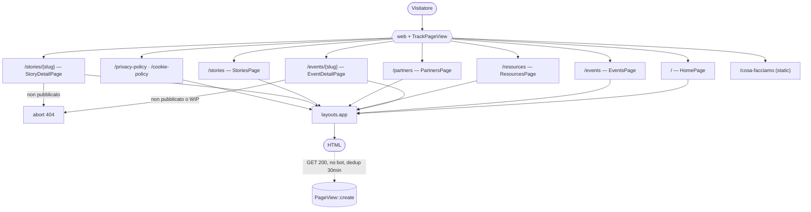

# 06 · Pagine pubbliche (Livewire)

Le pagine pubbliche sono **componenti Livewire full-page** (un componente = una rotta). Le view risiedono in `resources/views/livewire/`.

---

## Routing pubblico (`routes/web.php`)

| # | Metodo | URI | Target | Nome route | Model binding |
|---|--------|-----|--------|------------|---------------|
| 1 | GET | `/` | `HomePage` | `home` | — |
| 2 | GET | `/cosa-facciamo` | `Route::view` → `pages.static` | `services` | — (vista statica) |
| 3 | GET | `/events` | `EventsPage` | `events` | — |
| 4 | GET | `/events/{event:slug}` | `EventDetailPage` | `events.show` | `Event` via `slug` |
| 5 | GET | `/resources` | `ResourcesPage` | `resources` | — |
| 6 | GET | `/partners` | `PartnersPage` | `partners` | — |
| 7 | GET | `/stories` | `StoriesPage` | `stories` | — |
| 8 | GET | `/stories/{story:slug}` | `StoryDetailPage` | `stories.show` | `Story` via `slug` |
| 9 | GET | `/privacy-policy` | `PrivacyPolicyPage` | `privacy-policy` | — |
| 10 | GET | `/cookie-policy` | `CookiePolicyPage` | `cookie-policy` | — |

Inoltre: health check `/up` (`bootstrap/app.php`). Tutte le rotte web passano per il gruppo middleware `web` con in coda **`TrackPageView`**.

> `/cosa-facciamo` è l'unica pagina che **non** è un componente Livewire e **non** usa il layout `layouts.app`: è una `Route::view` verso `resources/views/pages/static.blade.php`.

---

## Layout principale (`resources/views/layouts/app.blade.php`)

- `<html class="dark scrollbar-thin">` — **dark theme forzato**.
- `<head>`: `<meta name="description">` da `$metaDescription`; `<title>` con pattern `"{pageTitle} - {app.name}"`; preconnect + 3 Google Fonts (**Outfit, Albert Sans, Roboto Mono**); `@vite([...])` condizionato a esistenza di `manifest.json`/`public/hot`; `@livewireStyles`.
- `<body>`: sfondo `bg-dots-pattern bg-black`, stato Alpine globale `showMobileMenu` (gestione menu mobile con media-query su `--breakpoint-nav`).
- `<main>`: `<x-partials.header />`, sezione hero (`@yield('hero')` / `@yield('hero-footer')`), `{{ $slot }}`, `<footer>` con `<x-partials.footer />`; chiude con `@livewireScripts` (che include **Alpine**).

Le pagine iniettano l'hero con `@section('hero')` (es. `<x-sections.page-hero>` o `<x-sections.home-hero>`).

---

## Tracking visite — `TrackPageView` (`app/Http/Middleware/TrackPageView.php`)

Il tracciamento è **server-side**, senza cookie di terze parti.

- Eseguito in **`terminate()`** (dopo l'invio della risposta), così non rallenta la richiesta.
- **Condizioni** (`shouldTrack()`): metodo `GET`, status `200`, path che **non** inizia con `admin`/`livewire`, user-agent **non** bot (lista: `bot, crawl, spider, slurp, facebookexternalhit, twitterbot, ..., headlesschrome, puppeteer, playwright`).
- **Deduplica:** 30 minuti per `path`, memorizzata in sessione (`pv_seen`).
- **Polimorfismo:** se la rotta ha il parametro `event`/`story`, associa il `viewable` al modello `Event`/`Story`.
- Salva: `path, url, referrer, user_agent, viewable_type, viewable_id`.

Il conteggio mostrato nelle pagine di dettaglio proviene invece da `->loadCount('pageViews')` sul modello, reso da `<x-ui.read-stats>`.

---

## Componenti Livewire

> **Nota trasversale:** nessun componente usa `#[Url]` o `$queryString`. Le proprietà `search`/`sortBy`/`categoryId` sono `public` semplici → **lo stato di ricerca/filtro/ordinamento NON è sincronizzato con la query string** (non bookmarkabile/condivisibile via URL). Tutti i componenti lista applicano un pattern difensivo `Schema::hasTable(...)` che restituisce collection vuote se le tabelle non esistono (utile durante le migrazioni).

### `HomePage` — `/`
- Nessuna proprietà/azione. Solo `render()`.
- Dati: `$nextEvent` (prossimo evento pubblicato non-WIP non passato, ordinato per `starts_at`), `$pastEvents` (2 eventi passati), `$resources` (5 risorse pubblicate più recenti, `with('authors')`).
- SEO: title `Home`; description sulla community.
- Componenti: `home-hero`, `skills-loop`, `featured-event`, `section-header`, `event variant="simple"`, `terminal` + `resource-row`, sezioni `principles/activities/scopes/code-of-conduct`.

### `EventsPage` — `/events`
- Trait `WithPagination`. Proprietà: `search=''`, `sortBy='newest'`.
- Azioni: `updatedSearch()`/`updatedSortBy()` → `resetPage()`. Opzioni sort: `newest | oldest | title-asc | title-desc`.
- Dati: `$upcomingEvents` (futuri non-WIP), `$wipEvents` (work in progress), `$pastEvents` (`paginate(12)`). `buildPastEventsQuery()` filtra i passati pubblicati non-WIP; la ricerca usa `LIKE` su `title`/`location`/`description` in OR.
- SEO: title `Eventi`.
- Componenti: `page-hero`, `slideshow` + `featured-event` (upcoming), `wip-event`, `input-search`, `sort-select`, `paginator`, `event` (storico con `autoAnimate`), `empty-state`.

### `EventDetailPage` — `/events/{event:slug}`
- Proprietà: `public Event $event` (binding via slug).
- **`mount()`**: `abort_unless($event->is_published, 404)` **e** `abort_unless(!$event->work_in_progress, 404)` → eventi non pubblicati **o** WIP danno 404. Eager-load condizionato da `Schema::hasTable`: `media`, `categories`, `resources`; poi `loadCount('pageViews')`.
- `toEmbedUrl(?string $url): ?string`: converte URL YouTube/Vimeo in URL embeddabili.
- `render()`: `$relatedEvents` = 2 altri eventi pubblicati ordinati per `starts_at`.
- SEO: title = `$event->title`; description = `$event->excerpt ?? $event->body`.
- Markdown del corpo reso con `Str::markdown(..., ['html_input' => 'strip', 'allow_unsafe_links' => false])` (mitigazione XSS).
- ⚠️ La view usa `$event->partners` ma `mount()` non lo eager-load né lo guarda con `Schema::hasTable` → lazy-load non protetto (vedi [12](../04_sviluppo_e_qualita/04_note_e_debito_tecnico.md)).

### `ResourcesPage` — `/resources`
- Trait `WithPagination`. Proprietà: `sortBy='newest'`, `search=''`.
- Dati: `Resource` pubblicate; ricerca `LIKE` solo su `title`; `with('authors')->paginate(15)`.
- SEO: title `Documenti & Slide`.
- Componenti: `page-hero`, `input-search`, `sort-select`, `item-count`, `paginator`, `terminal` + `resource-row`.

### `PartnersPage` — `/partners`
- Nessuna proprietà/azione. Dati: `Partner` pubblicati ordinati per `name` (nessuna paginazione).
- SEO: title `Partner`.
- Componenti: `page-hero`, griglia di `partner`, CTA "Vuoi diventare partner?" con `mailto:{{ config('community.email') }}`.

### `StoriesPage` — `/stories`
- Trait `WithPagination`. Proprietà: `search=''`, `sortBy='newest'`, `categoryId=null`.
- Azioni: `updatedSearch()`/`updatedSortBy()`/`updatedCategoryId()` → `resetPage()`; filtro categoria via `wire:click="$set('categoryId', ...)"`.
- Dati: `$featuredStory` (ultima pubblicata), `$stories` (`paginate(12)`), `$categories` (categorie attive con almeno una storia). `buildStoriesQuery()` filtra per pubblicazione, ricerca `LIKE` su `title`/`excerpt`, filtro categoria, ordinamento.
- SEO: title `Stories`.
- Componenti: `page-hero`, `featured-story`, `input-search`, bottoni filtro categoria, `sort-select`, `paginator`, griglia `story` con `autoAnimate`, `empty-state`.

### `StoryDetailPage` — `/stories/{story:slug}`
- Proprietà: `public Story $story` (binding via slug).
- **`mount()`**: `abort_unless($story->is_published, 404)`; `load(['category','authors','protagonists'])->loadCount('pageViews')`.
- `render()`: `$relatedStories` = 2 storie correlate (stessa categoria se presente).
- SEO: title = `$story->title`; description = `$story->excerpt`.
- Componenti: `detail-layout`, markdown corpo, `author-chips`, `lightbox`, blocco protagonisti `cards/author`, partial `story-meta-card`, related `story variant="simple"`.

### `PrivacyPolicyPage` — `/privacy-policy` · `CookiePolicyPage` — `/cookie-policy`
- Classi `final`, `declare(strict_types=1)`. Solo `render()`, contenuto statico (GDPR / cookie tecnici, "ultimo aggiornamento: 10 aprile 2026").
- Hero `page-hero` con badge "Legal // ...".

---

## Riepilogo proprietà / paginazione

| Componente | Proprietà pubbliche | Sync query-string | Paginazione | Modelli interrogati |
|------------|---------------------|-------------------|-------------|---------------------|
| HomePage | — | — | no | Event, Resource |
| EventsPage | `search`, `sortBy` | **No** | `paginate(12)` (storico) | Event |
| EventDetailPage | `event` | — | no | Event, PageView (count) |
| ResourcesPage | `sortBy`, `search` | **No** | `paginate(15)` | Resource |
| PartnersPage | — | — | no | Partner |
| StoriesPage | `search`, `sortBy`, `categoryId` | **No** | `paginate(12)` | Story, StoryCategory |
| StoryDetailPage | `story` | — | no | Story, PageView (count) |
| Privacy/Cookie | — | — | no | — (statico) |
