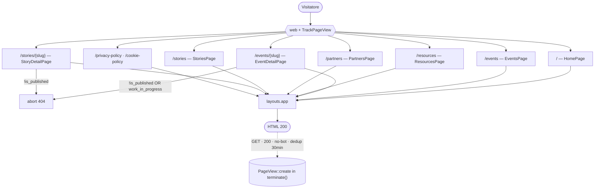

# 01 · Pagine pubbliche (Livewire)

Le pagine pubbliche di salento.dev sono **componenti Livewire full‑page**: una rotta = un componente. Non esistono controller classici per il frontend. Ogni componente vive in `app/Livewire/`, espone la propria logica in `render()` (e in `mount()` per le pagine di dettaglio) e dichiara il layout con `->layout('layouts.app', [...])`. Le view corrispondenti risiedono in `resources/views/livewire/`.

> Vedi anche: [Architettura](../02_architettura/01_architettura.md) · [Modelli](../02_architettura/03_modelli.md) · [Design system & frontend](03_design_system_frontend.md) · [Note e debito tecnico](../04_sviluppo_e_qualita/04_note_e_debito_tecnico.md).

---

## Routing pubblico (`routes/web.php`)

Tutte le rotte sono registrate in `routes/web.php` e mappano direttamente la classe Livewire come action (`Route::get('/...', Componente::class)`).

| # | Metodo | URI | Target | Nome route | Model binding |
|---|--------|-----|--------|------------|---------------|
| 1 | GET | `/` | `HomePage` | `home` | — |
| 2 | GET | `/events` | `EventsPage` | `events` | — |
| 3 | GET | `/events/{event:slug}` | `EventDetailPage` | `events.show` | `Event` via `slug` |
| 4 | GET | `/resources` | `ResourcesPage` | `resources` | — |
| 5 | GET | `/partners` | `PartnersPage` | `partners` | — |
| 6 | GET | `/stories` | `StoriesPage` | `stories` | — |
| 7 | GET | `/stories/{story:slug}` | `StoryDetailPage` | `stories.show` | `Story` via `slug` |
| 8 | GET | `/privacy-policy` | `PrivacyPolicyPage` | `privacy-policy` | — |
| 9 | GET | `/cookie-policy` | `CookiePolicyPage` | `cookie-policy` | — |

Le rotte di dettaglio usano l'**implicit model binding con chiave personalizzata** (`{event:slug}`, `{story:slug}` — `routes/web.php:22` e `:29`): Laravel risolve il modello cercando per colonna `slug` invece che per `id`, in linea con la convenzione di progetto «le route usano sempre lo slug per gli eventi».

Oltre alle rotte applicative:

- **Health check** `/up` — configurato in `bootstrap/app.php:11` (`health: '/up'`).

### Middleware globale di gruppo

Tutte le rotte web passano per il gruppo middleware `web`, a cui `bootstrap/app.php:13-15` **appende in coda** `TrackPageView`:

```php
->withMiddleware(function (Middleware $middleware): void {
    $middleware->appendToGroup('web', \App\Http\Middleware\TrackPageView::class);
})
```

Essendo in coda al gruppo, vede sia la `Request` sia la `Response` finale (necessario per filtrare per status code 200). Vedi la sezione dedicata più sotto.



---

## Layout principale (`resources/views/layouts/app.blade.php`)

Il layout è il guscio condiviso da tutte le pagine pubbliche.

### `<head>` (righe 4‑23)

- `<html class="dark scrollbar-thin">` (riga 2): **dark theme forzato**, nessuna modalità light. La classe `dark` è statica nel markup.
- `<meta name="description" content="{{ $metaDescription ?? '' }}">` (riga 7): la description SEO arriva dalla variabile `$metaDescription` iniettata dal componente via `->layout(...)`.
- `<title>{{ $pageTitle ?? config('app.name') }} - {{ config('app.name') }}</title>` (riga 9): pattern `"{pageTitle} - {app.name}"`. Se manca `pageTitle` si ripiega su `config('app.name')`.
- Tre Google Fonts caricati con `preconnect` (righe 11‑17): **Outfit** (`100..900`), **Albert Sans** (italico + pesi) e **Roboto Mono**.
- `@vite([...])` (righe 19‑21) è **condizionato**: viene emesso solo se esiste `public/build/manifest.json` **oppure** `public/hot`. Questo evita la `ViteException` quando gli asset non sono ancora compilati (utile in CI/migrazioni).
- `@livewireStyles` (riga 22).

### `<body>` (righe 25‑67)

- Stato Alpine globale `x-data` (righe 25‑34): `showMobileMenu` (boolean) più una `navMediaQuery` costruita leggendo a runtime il custom property CSS `--breakpoint-nav` (default `50rem`). Un handler `x-resize` (righe 35‑39) chiude automaticamente il menu mobile quando si supera il breakpoint desktop; `:class` (righe 40‑42) blocca lo scroll del body (`overflow-hidden`) mentre il menu mobile è aperto.
- Background del body: `bg-dots-pattern bg-black` (riga 43) — pattern a puntini su nero, con il `<main>` centrato (`max-w-350`) e bordato.
- `<main>` (righe 45‑64): contiene `<x-partials.header />`, una **sezione hero** (`@yield('hero')` + `@yield('hero-footer')`, righe 51‑54), poi `{{ $slot }}` con il contenuto della pagina e infine il `<footer>` con `<x-partials.footer />`. Le `<section>` hero e footer portano l'attributo decorativo `data-triangle-decoration` (triangolini d'angolo definiti nel CSS).
- `@livewireScripts` (riga 66) chiude il body: **include Alpine** (Livewire 3/4 lo bundle-izza), motivo per cui i componenti usano `x-data`/`x-init`/`x-show` senza che Alpine sia importato in `app.js`.

Le pagine iniettano l'hero con `@section('hero')`; in pratica i componenti hero (`<x-sections.page-hero>` / `<x-sections.home-hero>`) sono dichiarati direttamente nelle view Livewire dentro `@section('hero') ... @endsection`.

---

## Tracking visite — `TrackPageView` (`app/Http/Middleware/TrackPageView.php`)

Il tracciamento delle visite è **server‑side, senza cookie di terze parti** e senza JavaScript: è un middleware applicato a tutto il gruppo `web`. Alimenta i widget analytics dell'admin (vedi [Pannello admin](02_pannello_admin.md)) e i contatori `pageViews` delle pagine di dettaglio.

### Costanti (righe 15‑32)

```php
private const DEDUP_MINUTES = 30;          // finestra di deduplica per path
private const SESSION_KEY  = 'pv_seen';    // chiave in sessione per la dedup
private const REQUEST_KEY  = '_track_pv';  // chiave attributo request passata a terminate()

/** @var array<string, class-string<Model>> */
private const VIEWABLE_PARAMS = [
    'event' => \App\Models\Event::class,
    'story' => \App\Models\Story::class,
];

private const BOT_PATTERNS = [
    'bot', 'crawl', 'spider', 'slurp', 'facebookexternalhit',
    'twitterbot', 'linkedinbot', 'whatsapp', 'telegrambot',
    'googlebot', 'bingbot', 'yandexbot', 'duckduckbot',
    'lighthouse', 'headlesschrome', 'puppeteer', 'playwright',
];
```

### Flusso `handle()` (righe 34‑56)

1. Esegue `$next($request)` per ottenere la `Response`.
2. Se `shouldTrack()` è `false`, restituisce la risposta senza fare nulla.
3. Normalizza il `path`: la home diventa `'/'`, gli altri path vengono prefissati con `/` (riga 42).
4. Se `recentlyVisited()` (dedup) è `true`, esce.
5. Altrimenti registra il path come visitato (`markVisited()`) e **memorizza i dati nell'attributo della request** (`REQUEST_KEY`) per il successivo `terminate()`. La risoluzione del modello viewable avviene già qui.

### Persistenza differita `terminate()` (righe 58‑77)

La `PageView` viene **creata in `terminate()`**, ovvero **dopo** che la risposta è stata inviata al client: la scrittura su DB non rallenta il time‑to‑first‑byte.

```php
public function terminate(Request $request, Response $_response): void
{
    $data = $request->attributes->get(self::REQUEST_KEY);
    if ($data === null) { return; }

    /** @var Model|null $viewable */
    $viewable = $data['viewable'];

    PageView::create([
        'path'          => $data['path'],
        'url'           => $request->fullUrl(),
        'referrer'      => $request->headers->get('referer'),
        'user_agent'    => $request->userAgent(),
        'viewable_type' => $viewable ? $viewable->getMorphClass() : null,
        'viewable_id'   => $viewable?->getKey(),
    ]);
}
```

### Condizioni di tracciamento `shouldTrack()` (righe 106‑133)

Una visita viene tracciata **solo se** tutte le condizioni sono vere:

- metodo HTTP `GET` (`$request->isMethod('GET')`);
- status della risposta **esattamente** `200` (esclude redirect, 404 ed errori);
- il path **non** inizia con `admin` (esclude tutto il pannello Filament);
- il path **non** inizia con `livewire` (esclude le chiamate AJAX dei componenti, es. ricerca/paginazione);
- lo user‑agent (lowercased) **non** contiene nessuno dei `BOT_PATTERNS` (filtro bot/crawler/anteprime social/tool headless).

### Deduplica per sessione `recentlyVisited()` / `markVisited()` (righe 91‑104)

La deduplica è **per path e per sessione**, con finestra di **30 minuti**. La mappa `path => timestamp` è salvata in sessione sotto `pv_seen`:

```php
private function recentlyVisited(Request $request, string $path): bool
{
    $seen = $request->session()->get(self::SESSION_KEY, []);
    $lastSeen = $seen[$path] ?? null;

    return $lastSeen !== null && (time() - $lastSeen) < self::DEDUP_MINUTES * 60;
}
```

Una stessa persona che ricarica la stessa pagina entro 30 minuti genera **una sola** `PageView`.

### Polimorfismo `resolveViewable()` (righe 79‑89)

Il middleware associa la visita a un modello concreto sfruttando il binding di rotta: se la rotta corrente espone un parametro `event` o `story` (vedi `VIEWABLE_PARAMS`) e quel parametro è un'istanza del modello atteso, lo restituisce come `viewable`. In `terminate()` vengono salvati `viewable_type` (via `getMorphClass()`) e `viewable_id` (via `getKey()`). Le pagine non‑dettaglio salvano `viewable_*` a `null`.

> Il contatore mostrato nelle pagine di dettaglio **non** rilegge la tabella `page_views` con una query dedicata: usa `->loadCount('pageViews')` sul modello (vedi sotto), reso dal componente `<x-ui.read-stats>`.

---

## Componenti Livewire

> **Nota trasversale (stato non sincronizzato con la URL).** Nessun componente usa `#[Url]` o `$queryString`: le proprietà `search` / `sortBy` / `categoryId` sono `public` semplici. Di conseguenza **lo stato di ricerca/filtro/ordinamento NON finisce nella query string** e non è bookmarkabile né condivisibile via link. Vedi [Note e debito tecnico](../04_sviluppo_e_qualita/04_note_e_debito_tecnico.md).
>
> **Nota trasversale (resilienza alle migrazioni).** Quasi tutti i componenti lista applicano un pattern difensivo `Schema::hasTable(...)`: se la tabella non esiste ancora (es. durante un deploy o un `migrate:fresh`), restituiscono collection vuote invece di andare in errore.

### `HomePage` — `/` (`app/Livewire/HomePage.php`)

- **Proprietà / azioni:** nessuna. Solo `render()`.
- **Dati calcolati in `render()`** (tutti protetti da `Schema::hasTable`):
  - `$nextEvent` — il prossimo evento "vivo": pubblicato, non WIP, e con una logica di data che tiene conto di `ends_at` nullable. Un evento è considerato futuro/in corso se ha `ends_at >= now()` **oppure**, in mancanza di `ends_at`, se `starts_at >= now()->startOfDay()`. Ordinato per `starts_at` ascendente, `->first()` (righe 16‑30):

    ```php
    Event::query()
        ->where('is_published', true)
        ->where('work_in_progress', false)
        ->where(function ($query): void {
            $query->whereNotNull('ends_at')->where('ends_at', '>=', now())
                ->orWhere(function ($query): void {
                    $query->whereNull('ends_at')
                        ->where('starts_at', '>=', now()->startOfDay());
                });
        })
        ->orderBy('starts_at')
        ->first()
    ```

  - `$pastEvents` — i 2 eventi **passati** più recenti (logica simmetrica: `ends_at < now()` oppure, se nullo, `starts_at < now()->startOfDay()`), ordinati per `starts_at` discendente, `->limit(2)` (righe 32‑47).
  - `$resources` — le 5 risorse pubblicate più recenti, con eager‑load `with('authors')`, `->latest()->limit(5)` (righe 49‑56).
- **SEO:** `pageTitle = 'Home'`, description sulla community (righe 62‑65).
- **View:** `livewire.home-page` (52 righe). Composta da `home-hero`, `skills-loop`, blocco "prossimo evento" con `featured-event` + `event variant="simple"` per i passati, `terminal` + `resource-row` per le risorse, e le sezioni statiche `principles` / `activities` / `scopes` / `code-of-conduct`, intervallate da `section-header`.

### `EventsPage` — `/events` (`app/Livewire/EventsPage.php`)

- **Trait:** `WithPagination`.
- **Proprietà:** `public string $search = ''`, `public string $sortBy = 'newest'`.
- **Opzioni di ordinamento** (`sortOptions()`, righe 24‑32): `newest | oldest | title-asc | title-desc`.
- **Azioni:** `updatedSearch()` e `updatedSortBy()` (righe 34‑42) chiamano entrambe `resetPage()` per tornare a pagina 1 a ogni cambio di filtro.
- **Resilienza:** se la tabella `events` non esiste, `render()` ritorna subito con tre collection vuote (righe 46‑56).
- **Dati in `render()`:**
  - `$upcomingEvents` — futuri pubblicati non‑WIP (`starts_at > now()`), `orderBy('starts_at')`, `with(['categories'])` (righe 58‑64).
  - `$wipEvents` — eventi pubblicati **work in progress** (`work_in_progress = true`), `orderBy('starts_at')` (righe 66‑71).
  - `$pastEvents` — costruiti da `buildPastEventsQuery()` con `->paginate(12)` (riga 73).
- **`buildPastEventsQuery()` (righe 86‑109):** filtra i passati pubblicati non‑WIP (`starts_at <= now()`); se `search` è valorizzato applica un gruppo `LIKE` in OR su `title`, `location`, `description`; l'ordinamento è scelto con un `match($this->sortBy)`:

    ```php
    return match ($this->sortBy) {
        'oldest'     => $query->orderBy('starts_at'),
        'title-asc'  => $query->orderBy('title'),
        'title-desc' => $query->orderByDesc('title'),
        default      => $query->orderByDesc('starts_at'),
    };
    ```

- **SEO:** `pageTitle = 'Eventi'`.
- **View:** `livewire.events-page`. Hero `page-hero`; `slideshow` + `slideshow-slide` con `featured-event` per gli upcoming; `wip-event` per i WIP; barra filtri `input-search` + `sort-select`; lista storica con `event` (in un contenitore con `autoAnimate`), `paginator` (×2) ed `empty-state` quando non ci sono risultati.

### `EventDetailPage` — `/events/{event:slug}` (`app/Livewire/EventDetailPage.php`)

- **Proprietà:** `public Event $event` (risolto via binding sullo `slug`).
- **`mount(Event $event)` (righe 15‑47):** doppia guardia 404:

    ```php
    abort_unless($event->is_published, 404);
    abort_unless(! $event->work_in_progress, 404);
    ```

  Un evento **non pubblicato** *oppure* **work in progress** restituisce **404**. L'eager‑load è **condizionato dall'esistenza delle tabelle**: si caricano `media`, `categories`, `resources` solo se le rispettive tabelle (`event_media`, `event_categories` + pivot `event_category_event`, `event_resource`) esistono; poi `->loadCount('pageViews')`. Per le relazioni non caricate viene impostata una `Collection` vuota con `setRelation(...)` così la view non innesca lazy‑load accidentali.
- **`toEmbedUrl(?string $url): ?string` (righe 49‑70):** converte un URL YouTube/Vimeo in URL embeddabile via regex; ritorna `null` se l'input è vuoto o non riconosciuto. Pattern supportati: `youtube.com/watch?v=…`, `youtu.be/…` → `youtube.com/embed/…`; `vimeo.com/<id>` → `player.vimeo.com/video/<id>`.
- **`render()` (righe 72‑89):** calcola `$relatedEvents` = 2 altri eventi pubblicati (esclude quello corrente con `whereKeyNot`), con `with('categories:id,name,slug')`, `orderBy('starts_at')`, `limit(2)`.
- **SEO:** `pageTitle = $event->title`; `metaDescription = $event->excerpt ?? $event->body`.
- **Rendering markdown:** il corpo è reso in `event-detail-page.blade.php:93` con `Str::markdown($event->body, ['html_input' => 'strip', 'allow_unsafe_links' => false])` dentro un contenitore `prose prose-invert` — l'HTML inline viene rimosso e i link non sicuri bloccati (mitigazione XSS).
- **View:** `livewire.event-detail-page` (205 righe). Usa `detail-layout` (article + sidebar via `<x-slot:article>` / `<x-slot:sidebar>`), `read-stats`, `lightbox` per l'immagine, `terminal` + `resource-row` per le risorse collegate, `event` per i correlati, più icone Heroicon per i meta (data, luogo, ecc.).
- **Edge case:** la view itera `$event->partners` (`event-detail-page.blade.php:105-108`) ma `mount()` **non** eager‑carica `partners` né lo protegge con `Schema::hasTable` → lazy‑load non difeso. Annotato in [Note e debito tecnico](../04_sviluppo_e_qualita/04_note_e_debito_tecnico.md).

### `ResourcesPage` — `/resources` (`app/Livewire/ResourcesPage.php`)

- **Trait:** `WithPagination`.
- **Proprietà:** `public string $sortBy = 'newest'`, `public string $search = ''`.
- **Opzioni sort:** identiche a `EventsPage` (`sortOptions()`, righe 23‑31). Azioni `updatedSearch()`/`updatedSortBy()` → `resetPage()`.
- **`render()` (righe 43‑71):** parte da `Resource::query()->where('is_published', true)`; se `search` è valorizzato applica `LIKE` **solo su `title`**. L'ordinamento usa un `match` con `latest()`/`oldest()`/`orderBy(title)`/`orderByDesc(title)`. La paginazione è `with('authors')->paginate(15)`, sempre protetta da `Schema::hasTable('resources')`.
- **SEO:** `pageTitle = 'Documenti & Slide'`.
- **View:** `livewire.resources-page` (29 righe). Hero `page-hero`; barra `input-search` + `sort-select` + `item-count`; lista `terminal` + `resource-row`; `paginator`.

### `PartnersPage` — `/partners` (`app/Livewire/PartnersPage.php`)

- **Proprietà / azioni:** nessuna. Solo `render()`.
- **Dati:** `$partners` = partner pubblicati (`is_published = true`) ordinati per `name`, **senza paginazione** (`->get()`), protetto da `Schema::hasTable('partners')` (righe 15‑20).
- **SEO:** `pageTitle = 'Partner'`.
- **View:** `livewire.partners-page` (42 righe). Hero `page-hero`, griglia di `<x-cards.partner>`, e una CTA finale "diventa partner" con `mailto:` verso `config('community.email')` (icone Heroicon `at-symbol` / `arrow-right`).

### `StoriesPage` — `/stories` (`app/Livewire/StoriesPage.php`)

- **Trait:** `WithPagination`.
- **Proprietà:** `public string $search = ''`, `public string $sortBy = 'newest'`, `public ?int $categoryId = null`.
- **Azioni:** `updatedSearch()`, `updatedSortBy()`, `updatedCategoryId()` → tutte `resetPage()` (righe 37‑50). Il filtro categoria nella view è guidato da `wire:click="$set('categoryId', ...)"` (`stories-page.blade.php:32,37`).
- **Resilienza:** se `stories` non esiste, ritorna un `LengthAwarePaginator` vuoto e categorie vuote (righe 54‑64).
- **Dati in `render()`:**
  - `$featuredStory` — l'ultima storia pubblicata per `published_at`, `with(['category','authors'])`, `->first()` (righe 66‑70).
  - `$stories` — `buildStoriesQuery(null)->paginate(12)` (riga 72).
  - `$categories` — categorie **attive con almeno una storia**: `where('is_active', true)->whereHas('stories')->orderBy('sort_order')->orderBy('name')` (righe 74‑76).
- **`buildStoriesQuery(?int $excludeId)` (righe 89‑114):** filtra per `is_published`, eager‑load `category`+`authors`, esclusione opzionale (`whereKeyNot`), ricerca `LIKE` in OR su `title` / `excerpt` / `author`, filtro per `story_category_id` quando `categoryId` è impostato; ordinamento via `match` su `published_at` / `title`.
- **SEO:** `pageTitle = 'Stories'`.
- **View:** `livewire.stories-page` (71 righe). Hero `page-hero`; `featured-story`; `input-search`; bottoni filtro categoria; `sort-select`; griglia `story` (con `autoAnimate`); `paginator` (×2); `empty-state`.

### `StoryDetailPage` — `/stories/{story:slug}` (`app/Livewire/StoryDetailPage.php`)

- **Proprietà:** `public Story $story` (binding via `slug`).
- **`mount(Story $story)` (righe 13‑18):** `abort_unless($story->is_published, 404)` (singola guardia: le storie non hanno il concetto di WIP). Poi `->load(['category', 'authors', 'protagonists'])->loadCount('pageViews')`.
- **`render()` (righe 20‑41):** `$relatedStories` = 2 storie pubblicate diverse dalla corrente (`whereKeyNot`); se la storia ha una categoria, le correlate vengono **filtrate sulla stessa categoria** (`when($story->story_category_id !== null, ...)`); ordinate per `published_at` desc, `limit(2)`.
- **SEO:** `pageTitle = $story->title`; `metaDescription = $story->excerpt`.
- **Rendering markdown:** come per gli eventi, `Str::markdown(..., ['html_input' => 'strip', 'allow_unsafe_links' => false])` in `story-detail-page.blade.php:32`.
- **View:** `livewire.story-detail-page` (88 righe). Usa `detail-layout`, `read-stats`, `author-chips` ("Storia a cura di"), `lightbox`, il blocco protagonisti con `cards/author`, `section-header` per i correlati e `story variant="simple"`.

### `PrivacyPolicyPage` — `/privacy-policy` · `CookiePolicyPage` — `/cookie-policy`

- Entrambe classi `final` con `declare(strict_types=1)` (`app/Livewire/PrivacyPolicyPage.php`, `app/Livewire/CookiePolicyPage.php`). Espongono solo `render()` e renderizzano contenuto **statico** GDPR / cookie tecnici (view di 233 e 149 righe).
- Hero `page-hero` con badge "Legal // …"; description SEO specifica per ciascuna informativa (es. riferimento al "Regolamento UE 2016/679 (GDPR)").

---

## Riepilogo proprietà / paginazione

| Componente | Proprietà pubbliche | Sync query‑string | Paginazione | Guardia 404 | Modelli interrogati |
|------------|---------------------|-------------------|-------------|-------------|---------------------|
| `HomePage` | — | — | no | — | Event, Resource |
| `EventsPage` | `search`, `sortBy` | **No** | `paginate(12)` (storico) | — | Event |
| `EventDetailPage` | `event` | — | no | `!is_published` **o** `work_in_progress` | Event, PageView (count) |
| `ResourcesPage` | `sortBy`, `search` | **No** | `paginate(15)` | — | Resource |
| `PartnersPage` | — | — | no | — | Partner |
| `StoriesPage` | `search`, `sortBy`, `categoryId` | **No** | `paginate(12)` | — | Story, StoryCategory |
| `StoryDetailPage` | `story` | — | no | `!is_published` | Story, PageView (count) |
| `Privacy/Cookie` | — | — | no | — | — (statico) |

---

## Riferimenti incrociati

- I componenti Blade usati nelle view (`page-hero`, `event`, `resource-row`, `detail-layout`, `read-stats`, ecc.) sono documentati in [Design system & frontend](03_design_system_frontend.md).
- I modelli interrogati (accessor `image_url`, `read_time_minutes`, relazioni `authors`/`protagonists`/`pageViews`) sono descritti in [Modelli](../02_architettura/03_modelli.md).
- Le criticità note (stato non in URL, lazy‑load `partners`, pagina statica placeholder) sono raccolte in [Note e debito tecnico](../04_sviluppo_e_qualita/04_note_e_debito_tecnico.md).
