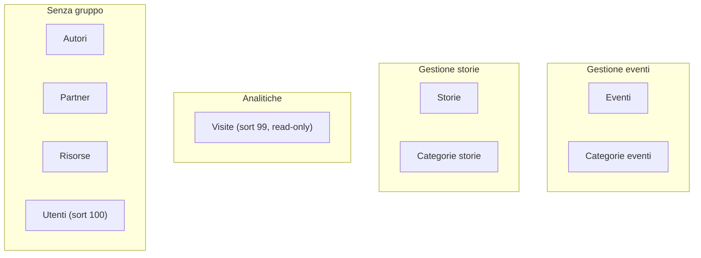

# 02 · Pannello admin (Filament)

Il pannello di amministrazione è costruito con **Filament 5** ed è montato su `/admin`. Gestisce eventi, categorie, storie, risorse, partner, autori, utenti e analytics. La configurazione del panel vive in `app/Providers/Filament/AdminPanelProvider.php`; le risorse, gli schemi dei form, le tabelle, le pagine e i widget sono organizzati sotto `app/Filament/`.

> Vedi anche: [Architettura](../02_architettura/01_architettura.md) · [Modelli](../02_architettura/03_modelli.md) · [Pagine pubbliche](01_pagine_pubbliche.md) · [Note e debito tecnico](../04_sviluppo_e_qualita/04_note_e_debito_tecnico.md).

---

## Configurazione del Panel (`AdminPanelProvider.php`)

Il metodo `panel(Panel $panel): Panel` (righe 29‑68) configura l'unico panel dell'applicazione:

| Aspetto | Valore | Riga |
|---------|--------|------|
| Panel di default | sì (`->default()`) | 32 |
| ID | `admin` | 33 |
| Path URL | `/admin` | 34 |
| Login | abilitato (`->login()`) | 35 |
| Reset password | abilitato (`->passwordReset()`) | 36 |
| Colore primario | `Color::Amber` | 37‑39 |
| Discovery Resources | `app/Filament/Resources` (namespace `App\Filament\Resources`) | 40 |
| Discovery Pages | `app/Filament/Pages` + `Dashboard::class` esplicita | 41‑44 |
| Discovery Widgets | `app/Filament/Widgets` | 45 |
| Widget registrati | `PageViewStatsWidget`, `PageViewsChartWidget`, `TopEventsWidget`, `TopStoriesWidget`, `TopReferrersWidget`, `AccountWidget` | 46‑53 |
| Brand/logo/favicon/dark mode | non impostati (default Filament) | — |
| Plugin | nessuno | — |

I middleware web standard sono elencati esplicitamente in `->middleware([...])` (righe 54‑64): `EncryptCookies`, `AddQueuedCookiesToResponse`, `StartSession`, `AuthenticateSession`, `ShareErrorsFromSession`, `VerifyCsrfToken`, `SubstituteBindings`, `DisableBladeIconComponents`, `DispatchServingFilamentEvent`. L'unico auth middleware è `Authenticate` (`->authMiddleware([Authenticate::class])`, righe 65‑67).

> `FilamentInfoWidget` è importato nel provider (riga 19) ma **non** è registrato nell'array `widgets([...])`: di fatto non compare nella dashboard.

---

## Autenticazione e accesso

- Il modello `User` implementa `FilamentUser` e **`canAccessPanel()` ritorna sempre `true`**: ogni utente autenticato accede all'intero pannello. **Non esistono ruoli, policy o gate.**
- Guard `web` (default Laravel). Login e reset password sono forniti da Filament.
- La password usa il cast `hashed`.
- **L'unico override di autorizzazione in tutto il pannello** è `PageViewResource::canCreate(): false` (la risorsa Visite è sola lettura). Nessuna risorsa definisce una policy o un override di `getEloquentQuery()`.

**Creare un utente admin**

```bash
./vendor/bin/sail artisan make:filament-user
```

In alternativa: via seeder (`admin@salento.dev` / `password123`), oppure dalla risorsa **Utenti** nel pannello.

> ⚠️ L'assenza di autorizzazione granulare (ogni utente è di fatto super‑admin) è un punto di attenzione: vedi [Note e debito tecnico](../04_sviluppo_e_qualita/04_note_e_debito_tecnico.md).

---

## Convenzione delle risorse

Filament 5 separa ogni risorsa in più file. Lo schema standard di progetto è:

```
app/Filament/Resources/<Nome>/
├── <Nome>Resource.php        # modello, icona, navigation, label, getPages(), getRelations()
├── Schemas/<Nome>Form.php    # definizione del form (campi, validazioni, logica live)
├── Tables/<Nome>Table.php    # definizione della tabella (colonne, filtri, azioni)
├── Pages/                    # ListRecords / CreateRecord / EditRecord
└── RelationManagers/         # (solo Events e Resources)
```

**Comportamenti comuni** delle pagine:

- Le pagine **Create** estendono `CreateRecord` senza header action.
- Le pagine **List** estendono `ListRecords` e dichiarano `getHeaderActions(): [CreateAction::make()]` — **eccetto PageViews** (nessun pulsante "Crea").
- Le pagine **Edit** estendono `EditRecord` e dichiarano `getHeaderActions(): [DeleteAction::make()]`.
- **Nessuna** risorsa ha una pagina **View** dedicata.

Tutte le azioni provengono dal namespace `Filament\Actions\` (non dal legacy `Filament\Tables\Actions\`): `EditAction`, `DeleteAction`, `CreateAction`, `AttachAction`, `DetachAction`, `BulkActionGroup`, `DeleteBulkAction`, `DetachBulkAction`. Gli `$navigationIcon` usano l'enum `Filament\Support\Icons\Heroicon`.

---

## Risorse

### Eventi (`Resources/Events/`)

`EventResource` — modello `Event`, gruppo **Gestione eventi**, icona `OutlinedRectangleStack`, label `Evento`/`Eventi`. `getRelations()` registra `ResourcesRelationManager`. È la risorsa più ricca del pannello.

**Form (`Schemas/EventForm.php`, layout `->columns(2)`):**

| Campo | Tipo | Validazione / comportamento |
|-------|------|-----------------------------|
| `title` | TextInput | required, maxLength(255) |
| `slug` | TextInput | required, maxLength(255), `unique(ignoreRecord: true)` |
| `location` | TextInput | maxLength(255) |
| `address` | TextInput | maxLength(255) |
| `starts_at` | DateTimePicker | required, `timezone('Europe/Rome')`, `seconds(false)` |
| `ends_at` | DateTimePicker | timezone Rome, seconds(false), `afterOrEqual('starts_at')` |
| `excerpt` | Textarea | rows(3), maxLength(500), columnSpanFull, helperText (fallback anteprima) |
| `body` | MarkdownEditor | columnSpanFull |
| `image_path` | FileUpload | `image()`, `disk('public')`, `directory('events')`, `visibility('public')`, columnSpanFull |
| `is_published` | Toggle | default(true) |
| `work_in_progress` | Toggle | default(false), helperText |
| `is_community_event` | Toggle | default(true), helperText |
| `categories` | Select | `relationship('categories','name', ...)` (solo categorie attive ordinate per `sort_order`,`name`), multiple, preload, searchable |
| `partners` | Select | `relationship('partners','name')`, multiple, preload, searchable |
| `media` | **Repeater** | `relationship('media')`, `orderColumn('sort_order')`, collapsed, cloneable, `itemLabel` dalla caption |

Il **Repeater `media`** (relazione hasMany `media`, riordinabile via drag e clonabile) contiene per ciascun elemento:

```php
Select::make('source_type')
    ->options(['file' => 'File caricato', 'url' => 'URL esterno'])
    ->default('file')->required()->native(false)
    ->live(),                                   // pilota la visibilità sotto

FileUpload::make('file_path')
    ->disk('public')->directory('events/media')
    ->acceptedFileTypes(['image/jpeg','image/png','image/webp','image/gif','video/mp4','video/webm'])
    ->visible(fn ($get) => $get('source_type') === 'file')
    ->required(fn ($get) => $get('source_type') === 'file'),

TextInput::make('external_url')->url()
    ->visible(fn ($get) => $get('source_type') === 'url')
    ->required(fn ($get) => $get('source_type') === 'url'),
```

Oltre a `media_type` (image/video) e `caption`. Il `->live()` su `source_type` rende reattiva la coppia `file_path`/`external_url`: solo il campo pertinente è visibile e obbligatorio.

**Tabella (`Tables/EventsTable.php`):**

- Colonne: `image_path` (ImageColumn, `square()`); `title` (searchable, sortable); `location`; `categories.name` (`badge()`, `separator(', ')`, toggleable); `starts_at` / `ends_at` (`dateTime('d/m/Y H:i')`); `is_published` (IconColumn boolean); `work_in_progress` (IconColumn con icone custom wrench/check, colori warning/gray); `is_community_event` (IconColumn star/user-group, success/gray); `updated_at` (`since()`, toggleable nascosto).
- Filtri: TernaryFilter su `is_published`, `work_in_progress`, `is_community_event`; SelectFilter `categories` via relazione.
- `defaultSort('starts_at', 'desc')`; azioni di riga Edit + Delete; bulk `DeleteBulkAction`.

**RelationManager `Resources` (`RelationManagers/ResourcesRelationManager.php`):** gestisce l'associazione molti‑a‑molti Eventi↔Risorse (`$relationship = 'resources'`, `recordTitleAttribute = 'title'`). Colonne `title`, `source_type` (badge File/Link via `formatStateUsing`), `is_published`, `created_at` (`since()`). Header action `AttachAction->preloadRecordSelect()`, azione di riga `DetachAction`, bulk `DetachBulkAction`.

### Categorie eventi (`Resources/EventCategories/`)

`EventCategoryResource` — modello `EventCategory`, gruppo **Gestione eventi**, icona `OutlinedTag`.

- **Form (`->columns(2)`):** `name` (required, max 255), `slug` (required, unique ignoreRecord), `sort_order` ('Ordine', numeric, default 0, required), `is_active` (Toggle default true), `description` (Textarea rows 4, columnSpanFull).
- **Tabella:** `name`, `slug`, `is_active` (icona), `events_count` (`counts('events')`, badge, sortable). Nessun filtro. `defaultSort('sort_order')` e **`reorderable('sort_order')`** (drag & drop). Edit + Delete; bulk delete.

### Storie (`Resources/Stories/`)

`StoryResource` — modello `Story`, gruppo **Gestione storie**, icona `OutlinedBookOpen`.

- **Form (`->columns(2)`):** `title` (required, max 255); `slug` (required, unique ignoreRecord); `story_category_id` (Select `relationship('category','name', ...)` solo attive, single, preload, searchable); `authors` (Select multiple, preload, searchable, columnSpanFull); `protagonists` (Select multiple); `excerpt` e `body` (MarkdownEditor, columnSpanFull); `image_path` (FileUpload `image()`, `directory('stories')`); `is_published` (Toggle default false, **`->live()`**); `published_at` (DateTimePicker tz Rome, seconds false, `visible(fn ($get) => (bool) $get('is_published'))` → appare solo se pubblicata).
- **Tabella:** `image_path` ('Copertina', square); `title`; `authors.avatar_url` (ImageColumn `imageHeight(36)`, `circular()`, **`stacked()`**); `category.name` (badge); `read_time_minutes` (suffisso ` min`, toggleable); `is_published`; `published_at` (`dateTime('d/m/Y')`); `updated_at` (since, nascosto). Filtri: TernaryFilter `is_published` + SelectFilter categoria. `defaultSort('published_at', 'desc')`. Edit + Delete; bulk delete.

### Categorie storie (`Resources/StoryCategories/`)

`StoryCategoryResource` — modello `StoryCategory`, gruppo **Gestione storie**, icona `OutlinedTag`.

- **Form (`->columns(2)`):** `name`, `slug` (unique ignoreRecord), `sort_order` (numeric default 0), `is_active` (default true).
- **Tabella:** `name`, `slug`, `is_active`, `stories_count` (`counts('stories')`, badge). `defaultSort('sort_order')`, **`reorderable('sort_order')`**. Edit + Delete; bulk delete.

### Risorse (`Resources/Resources/`)

`ResourceResource` — modello `App\Models\Resource` (importato come `ResourceModel` per evitare il clash con `Filament\...\Resource`), icona `OutlinedRectangleStack`, **senza gruppo**. `getRelations()` registra `EventsRelationManager`.

- **Form (`->columns(1)`):** `title` (required, max 255); `description` (Textarea rows 6, columnSpanFull, **non** required); `is_published` (Toggle `inline(false)`, default true); `source_type` (Select `link`/`file`, default `link`, required, native(false), **`->live()`**, columnSpanFull); `external_url` ('Link', `url()`, max 2048, `visible`/`required` se `source_type === 'link'`); `file_path` (FileUpload, `directory('resources/files')`, **non** `image()`, con `acceptedFileTypes` molto ampio — PDF, TXT, RTF, DOC/DOCX, ODT, XLS/XLSX, ODS, PPT/PPTX, ODP, ZIP, RAR, 7Z, TAR, GZ — `visible`/`required` se `source_type === 'file'`); `authors` (Select multiple, preload, searchable).

  ```php
  Select::make('source_type')
      ->options(['link' => 'Link esterno', 'file' => 'File caricato'])
      ->default('link')->required()->native(false)->live(),
  TextInput::make('external_url')->url()
      ->visible(fn ($get) => $get('source_type') === 'link')
      ->required(fn ($get) => $get('source_type') === 'link'),
  ```

- **Tabella:** `title`; `authors.avatar_url` (circular, stacked); `source_type` (badge File/Link); `is_published`. Filtro TernaryFilter su pubblicazione. `defaultSort('updated_at', 'desc')`. Edit + Delete; bulk delete.
- **RelationManager `Events`:** lato inverso dell'associazione molti‑a‑molti (`$relationship = 'events'`). Colonne `title`, `starts_at`, `location`, `is_published`; `AttachAction`/`DetachAction`/`DetachBulkAction`; `defaultSort('starts_at', 'desc')`.

### Partner (`Resources/Partners/`)

`PartnerResource` — modello `Partner`, icona `OutlinedBuildingStorefront`, **senza gruppo**.

- **Form (colonne di default):** `name` (required, max 255); `description` (Textarea rows 4, columnSpanFull, **non** required); `logo_path` (FileUpload `image()`, `directory('partners/logos')`); `website_url` (`url()`, max 255); `is_published` (Toggle default true).
- **Tabella:** `logo_path` (ImageColumn); `name` (searchable); `is_published`; `created_at`/`updated_at` (dateTime, toggleable nascosti). Nessun filtro, **nessun `defaultSort`**. **Solo `EditAction`** di riga: niente delete inline, il delete è solo via bulk.

### Autori (`Resources/Authors/`)

`AuthorResource` — modello `Author`, icona `OutlinedUserGroup`, **senza gruppo**.

- **Form (`Schemas/AuthorForm.php`)** organizzato in tre `Section`:
  - **Identità** (`->columns(2)`): `name` (required, max 255); `role` (max 255, helperText dinamico che mostra la `company` del profilo GitHub); `bio` (Textarea rows 3, max 1000, columnSpanFull, helperText dinamico con la `bio` GitHub).
  - **Avatar** (`->columns(2)`): `avatar_path` (FileUpload `image()`, `directory('authors')`, helperText sul fallback GitHub) e un componente display `Image::make(...)` con anteprima live (`->live()`) che usa `$record?->avatar_url` o un fallback ui‑avatars.
  - **Profili Social** (`->columns(2)`): `github_username` (`prefix('github.com/')`, **`->live(debounce: 500)`** — pilota gli helperText dinamici delle altre sezioni); `linkedin_url`, `twitter_url`, `website_url` (tutti `url()`, max 2048, `prefix('https://')`, con helperText dinamici dal profilo GitHub).
  - I dati GitHub sono recuperati live tramite `Author::fetchGithubProfile($username)`.
- **Tabella:** `avatar_url` (ImageColumn circolare); `name`; `role` (placeholder `—`); `github_username` (`prefix('@')`, link a `github_url`, apre in nuova scheda); `stories_count` e `resources_count` (`counts(...)`, badge); `updated_at` (since, nascosto). Nessun filtro. `defaultSort('name')`. Edit + Delete; bulk delete.

### Visite (`Resources/PageViews/`) — analytics, sola lettura

`PageViewResource` — modello `PageView`, gruppo **Analitiche**, `navigationSort = 99`, icona `OutlinedChartBar`. È l'unica risorsa con `declare(strict_types=1)` e l'unica con un override di autorizzazione:

```php
public static function canCreate(): bool
{
    return false;
}
```

- **Nessun form** (nessun file `Schemas/`), `getPages()` registra **solo** la pagina `index` (`ListPageViews`, che non ha `getHeaderActions()` → niente pulsante Crea).
- **Tabella (`Tables/PageViewsTable.php`):** `path` ('Pagina', searchable, sortable); `referrer` (searchable, placeholder `—`, toggleable); `user_agent` (`limit(50)`, toggleable nascosto); `created_at` (`dateTime('d/m/Y H:i')`, `timezone('Europe/Rome')`, sortable). Tre filtri custom basati su closure di query:

  ```php
  Filter::make('today')->query(fn ($q) => $q->whereDate('created_at', today()));
  Filter::make('this_week')->query(fn ($q) => $q->where('created_at', '>=', now()->startOfWeek()));
  Filter::make('this_month')->query(fn ($q) => $q->where('created_at', '>=', now()->startOfMonth()));
  ```

  `defaultSort('created_at', 'desc')`, paginazione `paginated([25, 50, 100])`. **Nessuna azione di riga né bulk** — completamente in sola lettura.

### Utenti (`Resources/Users/`)

`UserResource` — modello `User`, icona `OutlinedUsers`, **`navigationSort = 100`** (in fondo al menu), senza gruppo.

- **Form (colonna singola):** `name` (required, max 255); `email` (`email()`, required, `unique(ignoreRecord: true)`); `password` con logica condizionale:

  ```php
  TextInput::make('password')->password()->revealable()
      ->required(fn (string $operation) => $operation === 'create')
      ->minLength(8)
      ->hiddenOn('edit')
      ->dehydrated(fn (?string $state) => filled($state));
  ```

  In **create** è obbligatoria; in **edit** è nascosta e viene persistita solo se valorizzata (di fatto da qui non si cambia la password in modifica).
- **Tabella:** `name`, `email`, `email_verified_at` (placeholder `Non verificata`), `created_at`/`updated_at` (nascosti). Nessun filtro. **Solo `EditAction`** di riga; delete via bulk.

---

## Riepilogo trasversale delle risorse

| Risorsa | Gruppo | navSort | reorderable | Delete inline | Note |
|---------|--------|--------|-------------|---------------|------|
| Eventi | Gestione eventi | — | no | sì | Repeater media, RelationManager Risorse |
| Categorie eventi | Gestione eventi | — | **sì** | sì | — |
| Storie | Gestione storie | — | no | sì | `published_at` condizionale |
| Categorie storie | Gestione storie | — | **sì** | sì | — |
| Risorse | — | — | no | sì | RelationManager Eventi, `source_type` live |
| Partner | — | — | no | **no** (solo bulk) | nessun defaultSort |
| Autori | — | — | no | sì | helperText GitHub live |
| Visite | Analitiche | 99 | no | **no** (read‑only) | `canCreate() = false` |
| Utenti | — | 100 | no | **no** (solo bulk) | password condizionale |

---

## Widget della dashboard

Tutti i widget vivono in `app/Filament/Widgets/` e usano `protected ?string $pollingInterval = '60s'` (auto‑refresh ogni 60 secondi).

| Widget | Base class | sort / span | Contenuto |
|--------|-----------|-------------|-----------|
| `PageViewStatsWidget` | `StatsOverviewWidget` | — | 4 statistiche `PageView`: Oggi, Questa settimana, Questo mese, Totale |
| `PageViewsChartWidget` | `ChartWidget` | sort 2 · full | Linea: visite per giorno negli ultimi 30 giorni |
| `TopEventsWidget` | `TableWidget` | sort 3 · 1 | Top 5 eventi per `pageViews` |
| `TopStoriesWidget` | `TableWidget` | sort 3 · 1 | Top 5 storie per `pageViews` |
| `TopReferrersWidget` | `TableWidget` | sort 4 · full | Top 10 sorgenti di traffico esterne |
| `AccountWidget` | nativo Filament | — | Info account loggato |

**`PageViewStatsWidget`** (`$heading = 'Visite al sito'`) calcola quattro `Stat::make(...)` con query dirette su `PageView`, es.:

```php
Stat::make('Oggi',  PageView::query()->whereDate('created_at', $now->toDateString())->count()),
Stat::make('Questa settimana', PageView::query()->where('created_at', '>=', $now->copy()->startOfWeek())->count()),
Stat::make('Questo mese', PageView::query()->where('created_at', '>=', $now->copy()->startOfMonth())->count()),
Stat::make('Totale', PageView::query()->count()),
```

**`PageViewsChartWidget`** (`getType(): 'line'`, `$columnSpan = 'full'`) costruisce un asse di 30 giorni (`range(29, 0)` → `now()->subDays($n)->startOfDay()`) e aggrega per data:

```php
PageView::query()
    ->where('created_at', '>=', now()->subDays(29)->startOfDay())
    ->selectRaw('DATE(created_at) as date, count(*) as views')
    ->groupBy('date')
    ->pluck('views', 'date');
```

I conteggi mancanti vengono riempiti con `0`; dataset `fill: true`, `tension: 0.3`, label asse `d/m`.

**`TopEventsWidget`** / **`TopStoriesWidget`** condividono la stessa struttura (TableWidget, `$columnSpan = 1`, `paginated(false)`, `striped()`):

```php
Event::query()->withCount('pageViews')->orderByDesc('page_views_count')->limit(5);
Story::query()->withCount('pageViews')->orderByDesc('page_views_count')->limit(5);
```

Colonne: `rank` (`rowIndex()`, largo 48px), `title`, `page_views_count` ('Visite', numeric, alignEnd).

**`TopReferrersWidget`** (`$columnSpan = 'full'`) aggrega i referrer esterni, escludendo l'host interno dell'app:

```php
PageView::query()
    ->selectRaw('referrer, count(*) as views')
    ->whereNotNull('referrer')->where('referrer', '!=', '')
    ->where('referrer', 'not like', '%'.parse_url(config('app.url'), PHP_URL_HOST).'%')
    ->groupBy('referrer')->orderByDesc('views')->limit(10);
```

Poiché le righe sono aggregate e non hanno chiave primaria, il widget sovrascrive `getTableRecordKey()` restituendo `md5((string) $referrer)` e disabilita `defaultKeySort(false)`. Colonne: `rank`, `referrer` ('Sorgente'), `views`.

> Questi widget sono alimentati interamente dalla tabella `page_views` popolata dal middleware `TrackPageView` (vedi [Pagine pubbliche → Tracking visite](01_pagine_pubbliche.md)).

---

## Navigazione admin (gruppi)



Nessuna risorsa definisce `navigationBadge` o `slug` personalizzato; gli slug sono generati da Filament (`events`, `event-categories`, `stories`, `story-categories`, `resources`, `partners`, `authors`, `page-views`, `users`). Solo Utenti (100) e Visite (99) impostano `navigationSort`.

---

## Config che NON influenzano l'admin

`config/community.php` e `config/navigation.php` servono al **frontend pubblico** (menu, dati community/social, link footer): nessuna risorsa o widget admin vi fa riferimento. Vedi il loro utilizzo nei partial documentati in [Design system & frontend](03_design_system_frontend.md).
