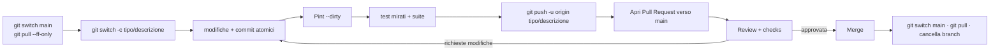

# 03 · Contribuire

Linee guida per contribuire al sito di salento.dev. Il repository è su GitHub: **`salento-dev/website`**, branch di default **`main`**.

> Documenti correlati: prepara l'ambiente con [Ambiente locale](./01_ambiente_locale.md), scrivi i test seguendo [Testing](./02_testing.md), e consulta i punti aperti in [Note e debito tecnico](./04_note_e_debito_tecnico.md).

---

## Workflow Git

Il branch `main` è condiviso e protetto: **non si committa mai direttamente su `main`**. Ogni modifica passa da un branch dedicato e da una **Pull Request**.



### 1. Allineare `main`

```bash
git switch main
git pull origin main
```

### 2. Creare un branch

Convenzione `tipo/descrizione-breve` (kebab-case):

| Tipo | Uso |
|------|-----|
| `feat/` | nuova funzionalità |
| `fix/` | correzione di bug |
| `docs/` | documentazione |
| `refactor/` | refactoring senza cambi di comportamento |
| `chore/` | manutenzione, dipendenze, config |
| `test/` | aggiunta o modifica di test |
| `perf/` | ottimizzazioni di performance |
| `build/` / `ci/` | build, asset, pipeline |

```bash
git switch -c feat/filtro-eventi-per-categoria
```

### 3. Committare

Formato dei messaggi (**Conventional Commits**), coerente con la cronologia esistente del repository (es. `fix(resources): move date to title column in resource row`):

```
<tipo>(<scope opzionale>): <descrizione breve in minuscolo>

<corpo opzionale: cosa e perché>
```

Esempi reali e suggeriti:

- `feat: aggiungi filtro eventi per categoria`
- `fix(events): usa la colonna body al posto di description nella ricerca`
- `fix(stories): rimuovi il filtro sulla colonna author non più esistente`
- `refactor(admin): introduci policy di accesso al pannello`

Preferire **commit atomici** (una modifica logica per commit), così da rendere la review e gli eventuali revert semplici.

> Nota: l'attribuzione automatica dei commit è disabilitata a livello globale; non aggiungere trailer di co-autore se non richiesto.

### 4. Push e Pull Request

```bash
git push -u origin feat/filtro-eventi-per-categoria
gh pr create --base main --fill   # oppure via interfaccia GitHub
```

Nella descrizione della PR includere:

- **Cosa** cambia e **perché**.
- **Come testare** (passi di verifica riproducibili).
- Eventuali **screenshot** per modifiche UI.
- Riferimenti a **issue** correlate (`Closes #123`).

---

## Creare file con Artisan

Seguire la "via Laravel": generare i file con i comandi Artisan, passando sempre `--no-interaction` e le opzioni corrette.

```bash
# Modello + migration + factory + seeder
./vendor/bin/sail artisan make:model NomeModello -mfs --no-interaction

# Componente Livewire (pagina pubblica)
./vendor/bin/sail artisan make:livewire NomePagina

# Risorsa Filament (pannello admin)
./vendor/bin/sail artisan make:filament-resource NomeModello --no-interaction

# Test feature / unit
./vendor/bin/sail artisan make:test --phpunit NomeTest
./vendor/bin/sail artisan make:test --phpunit --unit NomeTest

# Classe PHP generica
./vendor/bin/sail artisan make:class App/Servizi/NomeClasse
```

> Controllare **sempre** modelli e migrazioni esistenti prima di crearne di nuovi: il dominio è già modellato (eventi, risorse, storie, autori, partner, categorie, page view).

---

## Code style

### PHP — Laravel Pint

La formattazione è gestita da **Laravel Pint**. Eseguirlo sui file modificati prima di finalizzare:

```bash
./vendor/bin/sail bin pint --dirty --format agent
```

Non lanciare Pint in modalità `--test` per "fixare": va eseguito direttamente perché applichi le correzioni.

### Regole PHP del progetto

- **Tipizzazione esplicita:** return type e type hint sui parametri (`protected function isAccessible(User $user, ?string $path = null): bool`).
- **Constructor property promotion** nei costruttori; niente `__construct()` vuoti con zero parametri se non privati.
- **Controllo di flusso** sempre con parentesi graffe, anche per corpi a riga singola.
- **Commenti:** preferire PHPDoc; evitare commenti inline salvo logica davvero complessa. Aggiungere array shape nei PHPDoc dove utile.
- **Enum:** chiavi in `TitleCase`.
- **Immutabilità:** preferire la creazione di nuovi oggetti alla mutazione in-place.
- **File piccoli e coesi** (indicativamente < 400 righe, 800 max).
- **Niente `env()` fuori dai file di config:** usare `config('...')`.
- **Eloquent prima di tutto:** relazioni tipizzate, eager loading per evitare N+1, evitare `DB::` a favore di `Model::query()`.

### Convenzioni del progetto

- Le **pagine pubbliche** sono componenti Livewire full-page (non controller+view classici).
- L'**admin** usa Filament Resources con la struttura `Schemas/`, `Tables/`, `Pages/`, `RelationManagers/`.
- Le route per eventi/storie usano lo **slug** (`{event:slug}`, `{story:slug}`); i link usano i **nomi di route** (`route('events.show', $event)`).
- Le animazioni usano **GSAP** (complesse) e **Alpine.js** (micro-interazioni).
- **Design:** border radius default `rounded-xs`; accenti via `text-primary` (cyan); surface scuro di default; testi `text-mist-50`/`text-mist-400`; **non hardcodare colori**. Riferimento: `.claude/design.md` (con le discrepanze note segnalate in [Note e debito tecnico](./04_note_e_debito_tecnico.md)).

---

## Checklist pre-PR

Prima di aprire la Pull Request:

- [ ] Il codice gira in locale (`./vendor/bin/sail up -d`).
- [ ] **Pint** eseguito sui file modificati: `./vendor/bin/sail bin pint --dirty --format agent`.
- [ ] **Test pertinenti** verdi: `./vendor/bin/sail artisan test --compact --filter=...`.
- [ ] **Suite completa** verde (consigliata prima della PR): `./vendor/bin/sail artisan test --compact`.
- [ ] Nessun **segreto/credenziale** committata (chiavi API, password, token).
- [ ] **Input utente validato** ai confini del sistema; query parametrizzate (Eloquent).
- [ ] Per modifiche **frontend**: build verificata (`npm run build` / `npm run dev`), screenshot allegati.
- [ ] La **documentazione** in `docs/` è aggiornata se la modifica cambia comportamento o struttura.
- [ ] Nuovi file creati con i **comandi Artisan** appropriati.
- [ ] Commit **atomici** con messaggi in formato Conventional Commits.

---

## Eseguire le verifiche prima di finalizzare

```bash
# Style
./vendor/bin/sail bin pint --dirty --format agent

# Test mirati
./vendor/bin/sail artisan test --compact --filter=NomeDelTest

# Suite completa
./vendor/bin/sail artisan test --compact
```

---

## Aggiornare la documentazione

La cartella `docs/` è organizzata per aree numerate:

```
docs/
├── 01_analisi_funzionale/   panoramica, funzionalità
├── 02_architettura/         architettura, database, modelli
├── 03_codice/               pagine pubbliche, pannello admin, design system
├── 04_sviluppo_e_qualita/   ambiente locale, testing, contribuire, debito tecnico
└── 05_community_e_strategia/ attività e strategia, analisi competitor
```

Regole:

- Aggiornare i documenti **insieme** alla modifica di codice che ne cambia il comportamento (stessa PR).
- Citare il **codice reale** con `percorso/file:riga` quando si descrive un comportamento, evitando affermazioni non verificabili.
- Mantenere e, dove utile, espandere i **diagrammi Mermaid**.
- Usare **link relativi** tra documenti (es. `../02_architettura/02_database.md`) e nel testo dei link evitare numeri di capitolo obsoleti.
- **Non creare** nuovi file di documentazione se non richiesto: preferire l'aggiornamento di quelli esistenti.

---

## Note operative

- Per debug PHP/DB usare gli strumenti **Laravel Boost** (`tinker`, `database-query`, `database-schema`).
- Prima di scrivere migrazioni, ispezionare lo schema esistente (`database-schema`).
- Quando si modifica una colonna in migrazione, **ripetere tutti gli attributi** già definiti (Laravel li ricrea, altrimenti vengono persi).
- Non rimuovere test esistenti senza accordo: sono parte del codice dell'applicazione.
