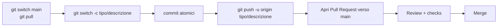

# 11 · Contribuire

Linee guida per contribuire al sito di salento.dev. Il repository è su GitHub: **`salento-dev/website`**, branch di default **`main`**.

---

## Workflow Git

Il branch `main` è condiviso e protetto: **non si committa mai direttamente su `main`**. Ogni modifica passa da un branch dedicato e da una **Pull Request**.



### 1. Allineare `main`

```bash
git switch main
git pull origin main
```

### 2. Creare un branch

Convenzione consigliata `tipo/descrizione-breve` (kebab-case):

| Tipo | Uso |
|------|-----|
| `feat/` | nuova funzionalità |
| `fix/` | correzione di bug |
| `docs/` | documentazione |
| `refactor/` | refactoring senza cambi di comportamento |
| `chore/` | manutenzione, dipendenze, config |

```bash
git switch -c feat/filtro-eventi-per-categoria
```

### 3. Committare

Formato dei messaggi (Conventional Commits):

```
<tipo>: <descrizione breve in minuscolo>

<corpo opzionale: cosa e perché>
```

Esempi: `feat: aggiungi filtro eventi per categoria`, `fix: correggi lazy-load partner in EventDetailPage`.

Preferire **commit atomici** (una modifica logica per commit).

### 4. Push e Pull Request

```bash
git push -u origin feat/filtro-eventi-per-categoria
```

Aprire la PR verso `main` (via interfaccia GitHub o `gh pr create`). Nella descrizione includere:

- **Cosa** cambia e **perché**.
- Eventuali screenshot per modifiche UI.
- **Come testare** (passi di verifica).
- Riferimenti a issue correlate.

---

## Checklist pre-PR

Prima di aprire la Pull Request:

- [ ] Il codice gira in locale (`./vendor/bin/sail up -d`).
- [ ] **Pint** eseguito sui file modificati: `./vendor/bin/sail bin pint --dirty --format agent`.
- [ ] I test pertinenti passano: `./vendor/bin/sail artisan test --compact`.
- [ ] Nessun segreto o credenziale committata.
- [ ] Per modifiche frontend: build verificata (`npm run build` / `npm run dev`).
- [ ] La documentazione in `docs/` è aggiornata se la modifica cambia comportamento o struttura.

---

## Code style

- **PHP:** formattazione con **Laravel Pint** (`./vendor/bin/sail bin pint --dirty --format agent`). Non eseguire Pint in modalità `--test` per "fixare": lanciarlo direttamente.
- **Tipizzazione esplicita:** return type e type hint sui parametri; usare la property promotion nei costruttori.
- **Controllo di flusso:** sempre con parentesi graffe, anche per corpi a riga singola.
- **Commenti:** preferire PHPDoc; evitare commenti inline salvo logica davvero complessa.
- **Immutabilità:** preferire la creazione di nuovi oggetti alla mutazione in-place.
- **File piccoli e coesi** (indicativamente < 400 righe).

### Convenzioni del progetto

- Le **pagine pubbliche** sono componenti Livewire full-page (non controller+view).
- L'**admin** usa Filament Resources con la struttura `Schemas/`, `Tables/`, `Pages/`.
- Le route per eventi/storie usano lo **slug** (`{event:slug}`); i link usano i **nomi di route** (`route('events.show', $event)`).
- Le animazioni usano **GSAP** (complesse) e **Alpine.js** (micro-interazioni).
- Border radius default `rounded-xs`; accenti via `text-primary` (cyan); non hardcodare colori.
- Creare file Laravel con i comandi Artisan (`make:model`, `make:filament-resource`, ...) passando `--no-interaction`.

---

## Eseguire le verifiche prima di finalizzare

```bash
# Style
./vendor/bin/sail bin pint --dirty --format agent

# Test mirati
./vendor/bin/sail artisan test --compact --filter=NomeDelTest

# Suite completa (consigliata prima della PR)
./vendor/bin/sail artisan test --compact
```

---

## Note operative

- Per debug PHP/DB usare gli strumenti Laravel Boost (`tinker`, `database-query`, `database-schema`).
- Controllare sempre modelli e migrazioni esistenti prima di crearne di nuovi.
- Creare file di documentazione solo quando richiesto/necessario; mantenere `docs/` allineata al codice.
- Non rimuovere test esistenti senza accordo: sono parte del codice dell'applicazione.
