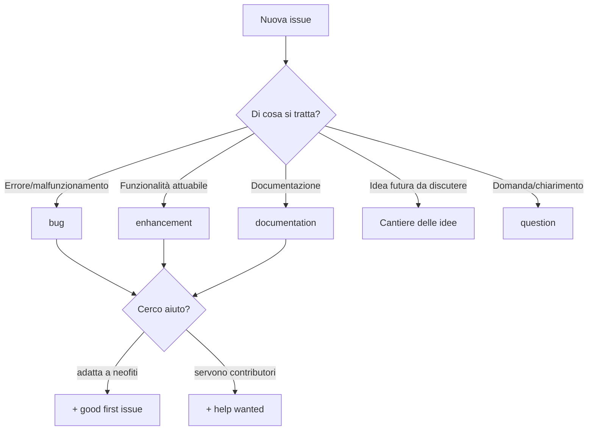
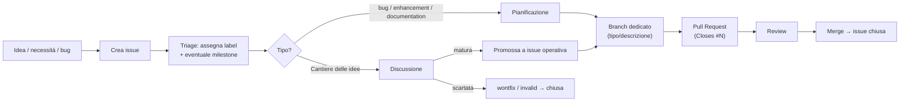
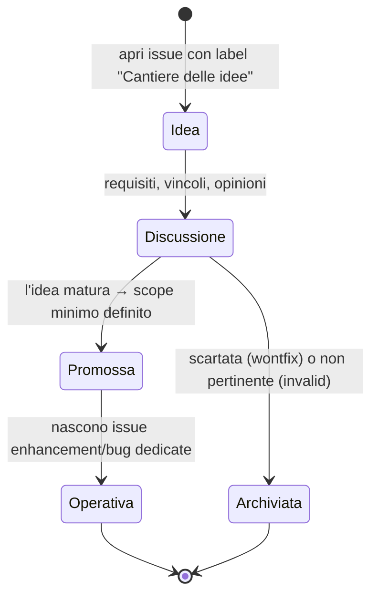

# 05 · Gestione dei task e delle label

Il lavoro su salento.dev è organizzato su **GitHub** (`salento-dev/website`). Questo documento descrive in dettaglio come si **creano e gestiscono i task** (issue) e come si usano le **label**, le **milestone** e il **project board**. È il complemento operativo della guida [Contribuire](03_contribuire.md) ed è allineato alla sezione *"Project Management su GitHub"* del `CLAUDE.md`.

> Tutte le informazioni su issue/label/milestone/project sono **dinamiche**: vanno lette a runtime con la CLI `gh` (già autenticata), non assunte. I comandi sono raccolti in fondo (§7).

---

## 1. Gli strumenti di gestione

| Strumento | A cosa serve | Link |
|-----------|--------------|------|
| **Issues** | Unità di lavoro: bug, miglioramenti, idee, domande | https://github.com/salento-dev/website/issues |
| **Labels** | Classificano e instradano le issue (tipo, stato, priorità) | https://github.com/salento-dev/website/labels |
| **Milestones** | Raggruppano issue verso un obiettivo/release datato | https://github.com/salento-dev/website/milestones |
| **Project (board)** | Vista Kanban per organizzare il flusso delle issue | https://github.com/salento-dev/website/projects |

**Stato attuale del repo**: sono presenti le label di default GitHub più la label custom **"Cantiere delle idee"**; **nessuna milestone** e **nessun project** sono ancora configurati (la creazione del project è soggetta ai permessi dell'organizzazione).

---

## 2. Tassonomia delle label

Le label in uso. **Usa esclusivamente quelle esistenti**; per proporne di nuove vedi §4.

| Label | Colore | Quando usarla |
|-------|--------|---------------|
| `bug` | 🔴 `#d73a4a` | Qualcosa non funziona come dovrebbe (errore, comportamento errato). |
| `enhancement` | 🩵 `#a2eeef` | Nuova funzionalità o miglioramento concreto e attuabile. |
| `documentation` | 🔵 `#0075ca` | Aggiunte o correzioni alla documentazione (`docs/`, `CLAUDE.md`, README). |
| `Cantiere delle idee` | 🟡 `#fbca04` | **Custom.** Idee e proposte di funzionalità **future** da discutere prima di diventare task operativi (vedi §5). |
| `good first issue` | 🟣 `#7057ff` | Task semplice e ben circoscritto, adatto a chi contribuisce per la prima volta. |
| `help wanted` | 🟢 `#008672` | Si cercano contributori per questa issue. |
| `question` | 🟣 `#d876e3` | Richiesta di chiarimento o discussione, non un task. |
| `duplicate` | ⚪ `#cfd3d7` | Doppione di un'altra issue/PR (indicare quale e chiudere). |
| `invalid` | 🟡 `#e4e669` | Non pertinente o non riproducibile. |
| `wontfix` | ⚪ `#ffffff` | Non verrà lavorata (per scelta/scope). |

**Categorie concettuali** (una issue può combinare label di categorie diverse):

- **Tipo** — `bug`, `enhancement`, `documentation`, `Cantiere delle idee`, `question`
- **Reclutamento** — `good first issue`, `help wanted`
- **Esito/chiusura** — `duplicate`, `invalid`, `wontfix`



---

## 3. Ciclo di vita di un task



**Fasi:**

1. **Creazione** — chiunque apre una issue (vedi §6 per cosa contiene una buona issue).
2. **Triage** — si assegnano le **label** (tipo + eventuale reclutamento) e, se pertinente, una **milestone**. Si verifica che non sia un **duplicato**.
3. **Discussione/pianificazione** — si chiariscono requisiti, scope e approccio. Le idee marcate `Cantiere delle idee` restano qui finché non maturano.
4. **Implementazione** — si crea un **branch** dedicato (`tipo/descrizione`, vedi [Contribuire](03_contribuire.md)); i commit referenziano la issue.
5. **Pull Request** — si apre la PR collegata alla issue con `Closes #N` nel corpo, così la issue si chiude automaticamente al merge.
6. **Review & merge** — superata la review e i controlli, si effettua il merge; la issue si chiude.

---

## 4. Regole d'uso delle label

- **Non inventare label.** Usa solo quelle restituite da `gh label list`. La proliferazione di label rende il sistema inutile.
- **Proporre una nuova label**, non crearla d'iniziativa: discutila con il team (o aprila come `question`). Solo dopo accordo va creata, con nome, descrizione e colore coerenti con la tassonomia esistente.
- **Combinare le label con criterio**: tipicamente **una label di tipo** + eventuali label di reclutamento. Le label di esito (`duplicate`/`invalid`/`wontfix`) si applicano in chiusura.
- **Coerenza linguistica**: le label di default sono in inglese (convenzione GitHub); le label **custom** del progetto sono in italiano (es. `Cantiere delle idee`).

Esempio di applicazione/rimozione label via CLI:

```bash
# Aggiungi label a una issue esistente
gh issue edit 1 -R salento-dev/website --add-label "good first issue"
# Rimuovi una label
gh issue edit 1 -R salento-dev/website --remove-label "help wanted"
```

---

## 5. Il flusso "Cantiere delle idee"

La label **`Cantiere delle idee`** identifica le proposte di funzionalità **future**: non sono task pronti, ma spunti da discutere prima di impegnarsi a realizzarli.



**Come si conduce:**

1. Si apre una issue con label `Cantiere delle idee` descrivendo l'idea, lo **stato attuale** da cui si parte, le **domande aperte** e i **possibili approcci** (senza decidere).
2. Nei commenti si raccolgono requisiti, vincoli (privacy, sicurezza, effort) e opinioni.
3. Se l'idea **matura**, si definisce uno **scope minimo** e si aprono issue **operative** (`enhancement`) collegate, lasciando la issue-idea come "ombrello" di discussione.
4. Se viene **scartata**, si chiude con `wontfix`/`invalid` e una nota che spiega il perché.

**Esempio reale**: la issue [#2 — Registrazione utenti e sistema di badge](https://github.com/salento-dev/website/issues/2) è etichettata `Cantiere delle idee` e funge da discussione ombrello; uno dei suoi casi d'uso (proposta di risorse da parte degli utenti) è già richiamato nella issue operativa [#1 — Arricchire la sezione Risorse](https://github.com/salento-dev/website/issues/1) (`enhancement`).

---

## 6. Creare una buona issue

Una issue efficace contiene:

- **Titolo** chiaro e specifico (azione + oggetto): *"Arricchire la sezione Risorse del sito"*, non *"Risorse"*.
- **Contesto** — perché serve, link alla documentazione o al codice pertinente (`docs/...`, `app/...`).
- **Stato attuale** — com'è fatto oggi (per i miglioramenti), o **passi per riprodurre** (per i bug).
- **Proposta / risultato atteso** — cosa si vuole ottenere, possibilmente con una **checklist** (`- [ ]`) di sotto-attività.
- **Dipendenze** — riferimenti ad altre issue (`#N`).
- **Label** appropriate (vedi §2) e, se pertinente, **milestone**.

Creazione via CLI (il corpo lungo conviene passarlo da file o inline):

```bash
# Da file
gh issue create -R salento-dev/website \
  --title "Titolo chiaro" \
  --body-file ./issue.md \
  --label "enhancement"

# Riferire una issue nei commit / PR per la chiusura automatica
git commit -m "feat: aggiungi filtro risorse per tipo

Closes #1"
```

> Le issue di tipo bug dovrebbero indicare: ambiente, passi per riprodurre, comportamento atteso vs osservato, ed eventuali log.

---

## 7. Milestone e Project

### Milestone
Raggruppano issue verso un obiettivo datato (es. una release). Utili per pianificare "cosa entra nella v1".

```bash
# Elenco milestone (con stato e conteggio)
gh api repos/salento-dev/website/milestones --jq '.[] | "#\(.number) \(.title) (\(.state)) — \(.open_issues) aperte"'
# Associare una issue a una milestone
gh issue edit 1 -R salento-dev/website --milestone "v1"
```

### Project (board)
Vista Kanban per seguire il flusso delle issue (es. colonne *Todo / In progress / Done*). Attualmente **non configurato**: la creazione di un project a livello di organizzazione richiede permessi che vanno concessi da un owner di `salento-dev` (o creato dalla UI in `https://github.com/orgs/salento-dev/projects`). Una volta creato, le issue si aggiungono con:

```bash
gh project item-add <numero-project> --owner salento-dev --url <url-issue>
```

---

## 8. Riferimento comandi `gh`

```bash
# ISSUE
gh issue list   -R salento-dev/website --state open          # elenco aperte
gh issue list   -R salento-dev/website --label "Cantiere delle idee"
gh issue view   <n> -R salento-dev/website                   # dettaglio
gh issue create -R salento-dev/website --title "…" --body-file f.md --label "…"
gh issue edit   <n> -R salento-dev/website --add-label "…" --milestone "…"
gh issue close  <n> -R salento-dev/website --comment "motivo"

# LABEL
gh label list   -R salento-dev/website                       # tassonomia corrente
gh label create "Nome" -R salento-dev/website --color "RRGGBB" --description "…"

# MILESTONE
gh api repos/salento-dev/website/milestones --jq '.[] | "\(.number) \(.title)"'

# PROJECT (v2, livello org)
gh project list --owner salento-dev
```

> Le operazioni che **pubblicano contenuti** (creare/chiudere issue, PR, commenti, label) vanno **confermate** prima di eseguirle: producono artefatti pubblici sul repository.

---

## Collegamenti

- Workflow Git, branch e Pull Request → [Contribuire](03_contribuire.md)
- Debito tecnico (fonte di possibili issue) → [Note e debito tecnico](04_note_e_debito_tecnico.md)
