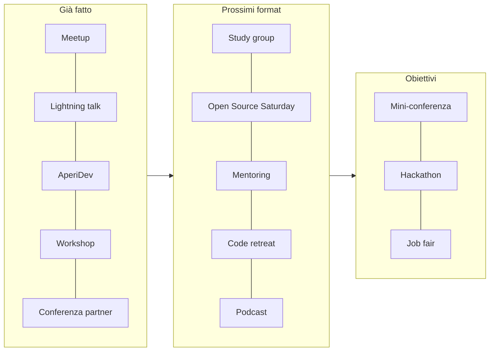
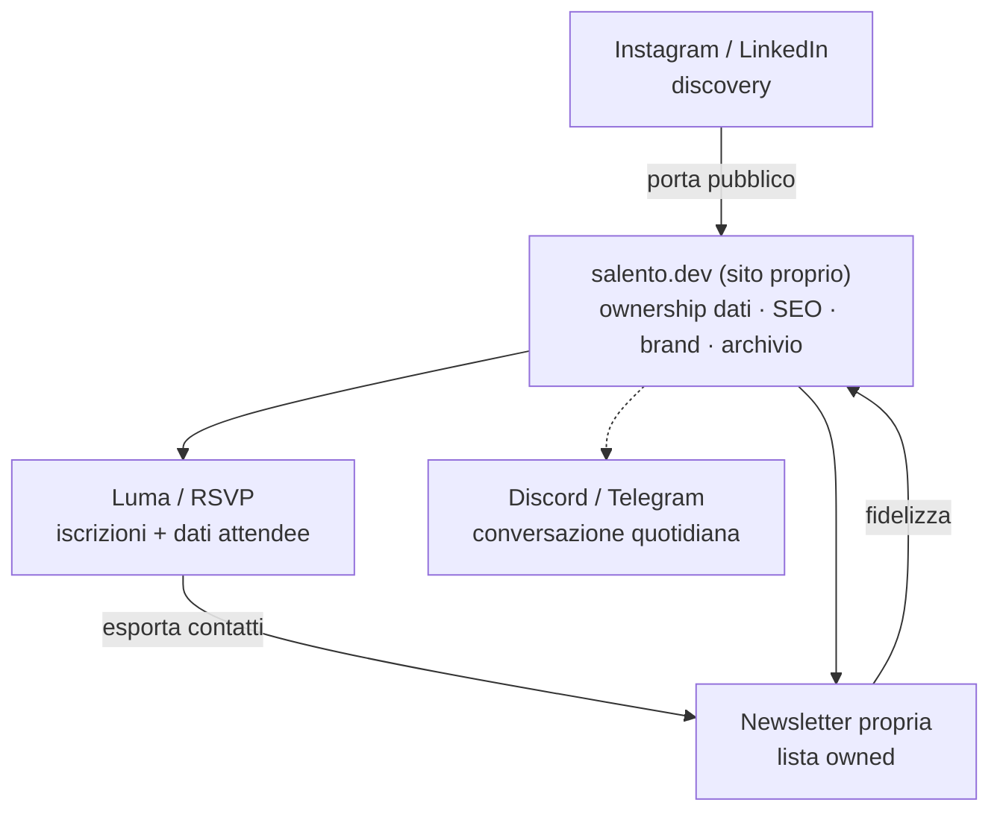
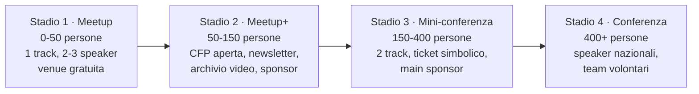

# 01 · Attività della community e strategia di crescita

Questo documento ha taglio **strategico/organizzativo** (non tecnico). Descrive le attività già svolte da salento.dev, come ampliarle, come aprirsi ad altre associazioni e come usare il sito web come strumento di community. Le raccomandazioni derivano da una ricerca su community tech italiane e internazionali; le fonti puntuali sono raccolte in [Analisi dei competitor](./02_analisi_competitor.md).

> Le attività "già svolte" sono ricostruite dai dati reali presenti nei seeder del progetto (`database/seeders/Real*`), che rappresentano gli eventi effettivamente pubblicati sul sito.

---

## 1. Attività già svolte

Dal lancio (rebranding in **Salento.Dev**, autunno 2025) la community ha adottato un modello a **rotazione territoriale**: gli eventi toccano comuni diversi del Salento e del barese, alternando formati tecnici e di networking.

| Data | Evento | Luogo | Formato | Categorie |
|------|--------|-------|---------|-----------|
| 13/11/2025 | **Salento.Dev Meetup #0** | Normal, Taurisano | Meetup di lancio + networking | Meet-up, Networking |
| 29/12/2025 | **Lightning Night @ Ruffano** | Convivya, Ruffano | 6 lightning talk (10-15 min) | Talk, Meet-up |
| 19/02/2026 | **AperiDev @ Galatina** | Madrè, Galatina | Networking informale | Networking |
| 23/03/2026 | **AI & Coding** | Officine Cantelmo, Lecce | Panel con professionisti | Talk |
| 27/03/2026 | **Bowling Meetup** (con Lecce Digital Community) | Bowling Surbo | Social/networking co-organizzato | Networking |
| 30/03/2026 | **GitHub Copilot Dev Days** | Officine Cantelmo, Lecce | Workshop con 2 speaker Microsoft | Workshop, Talk |
| 17/04/2026 | **Global Azure Puglia 2026** | Bari | Conferenza, 2 track, 12+ sessioni | Talk, Workshop |

**Formati già sperimentati con successo:**
- **Lightning talk** (barriera d'ingresso bassa per nuovi speaker) — usati al primo evento "tecnico".
- **AperiDev / social** — networking leggero che fidelizza la base.
- **Workshop pratici** con speaker aziendali (Microsoft).
- **Co-organizzazione** con un'altra realtà locale (Lecce Digital Community).
- **Partecipazione/affiliazione** a eventi più grandi (Global Azure, e come community partner a DevFest Lecce 2025 e DevFest Basilicata 2026).

**Contenuti editoriali prodotti:** la prima *storia* della community ("Il Duomo di Lecce in 3D navigabile con Gaussian Splatting e Reactylon"), con protagonista e autore distinti — un format narrativo che valorizza i progetti dei membri.

**Partner già coinvolti:** Lecce Digital Community, Azure Meetup Puglia, GDG Lecce.

> **Lettura strategica.** In pochi mesi salento.dev ha già coperto l'intero spettro di formati (meetup, lightning talk, social, workshop, conferenza) e ha già attivato collaborazioni. La base operativa è solida: i prossimi passi riguardano **strutturazione** (CFP, newsletter, archivio) e **scala** (nuovi formati, più collaborazioni).

---

## 2. Come fare altre attività

Catalogo di nuovi format, ordinati per costo/complessità organizzativa crescente. Ognuno indica formato consigliato e note operative.

### Bassa complessità (avviabili subito)

- **Study group / reading group** — 8-15 persone leggono insieme un libro tecnico (es. *Designing Data-Intensive Applications*) o seguono un corso. Cadenza settimanale, 1-1,5h, anche online su Discord. Costo ~0. Crea continuità tra un evento e l'altro.
- **Open Source Saturday** — mezza giornata di contribuzione a progetti open source (incluso il sito di salento.dev, che è open source). Format collaudato: chiunque propone un progetto in 3 minuti, ci si auto-organizza in gruppi. Ottimo per onboarding di junior.
- **Workshop pratici hands-on** — 2-3h su un singolo tema (Docker, testing in Laravel, Git avanzato). 15-25 persone, un PC a testa. Mensile, alternato ai meetup. Eventuale ticket simbolico (€20-50) per i workshop avanzati.
- **Podcast** — episodi di 30-45 min con interviste a developer locali e speaker passati. Contenuto evergreen, raggiunge chi non partecipa in presenza. Setup ~€200-500.

### Media complessità

- **Mentoring program strutturato** — matching senior↔junior/studenti, cicli di 3-6 mesi, 1 sessione/mese + canale asincrono. Formalizzabile con l'Università del Salento.
- **Code retreat** — giornata di *deliberate practice* (TDD, pair programming) sul classico esercizio "Game of Life". Non competitivo. Si può agganciare al **Global Day of Coderetreat** (novembre).
- **University tour** — ciclo di talk in aula su temi career-oriented ("la vita da freelance", "come ho trovato lavoro", "open source e portfolio"). È anche una **pipeline di reclutamento** per la community.
- **Hackathon (formato leggero)** — 8-12h in un giorno (non 48h notturne), tema proposto da uno sponsor, team 3-5 persone misti per seniority, mentori che girano tra i tavoli. Registrare al 150% della capienza (no-show ~30%).

### Alta complessità (obiettivi di medio periodo)

- **Mini-conferenza annuale** — 1 giorno, 2 track (es. tech + soft skill), CFP competitiva, main sponsor. È l'evoluzione naturale dei meetup (vedi roadmap §5).
- **Job fair** — matching aziende tech locali/remote ↔ developer. Le aziende pagano per il tavolo (€200-500). Revenue + valore per la community.
- **Iniziative diversity & inclusion** — workshop dedicati a gruppi sottorappresentati, scholarship, venue accessibili, ricerca proattiva di speaker donne/non-binary.

---

## 3. Come aprirsi ad altre associazioni

La community è **già un nodo** di una rete informale pugliese (partner reciproci nei DevFest). Modelli concreti per ampliare le collaborazioni:

### Collaborazioni locali (priorità alta, già a portata)
- **GDG Lecce** — stesso territorio e target tecnico; ha già listato salento.dev tra i partner del DevFest Lecce 2025. **Azione:** co-organizzare almeno un evento congiunto.
- **PugliaTechs** — copre l'intera Puglia ma ha bisogno di referenti locali per gli eventi nel Salento. **Azione:** proporsi come partner locale per i meetup nel Leccese.
- **Azure Meetup Puglia / AWS User Group Bari** — co-organizzare sessioni cloud/DevOps.
- **Lecce Digital Community** — amplificazione per eventi più generalisti (già co-organizzato il Bowling Meetup).

### Modelli di co-organizzazione (da realtà più grandi)
- **Rete federata** (modello GrUSP/PUG): essere il "nodo salentino" di una rete nazionale, condividendo brand e CFP aperto cross-gruppo.
- **Gemellaggio / speaker exchange**: scambio di speaker con community di altre città del Sud (GDG Bari/Basilicata/Napoli) → eventuale "Sud Dev Day" a rotazione.
- **Evento federato**: organizzare la tappa locale di un evento nazionale (es. **Linux Day**, **Global Day of Coderetreat**) → visibilità con costo organizzativo minimo.

### Università e aziende
- **Università del Salento** — workshop in aula, mentoring formalizzato, studenti come volontari (esperienza sul CV), job fair. Modello già usato da GrUSP (scholarship) e Superhero Valley (partnership accademiche).
- **Aziende tech locali** — modello Develer: un'azienda sostiene l'ecosistema community in cambio di brand e talent attraction. Sono i primi sponsor naturali.

### Network e directory nazionali (visibilità a costo ~0)
- **The Communities Bay** — aderire come community membro (accesso a sponsor di rete come JetBrains, OVHcloud).
- **Italia Open-Source** — aprire una PR su `github.com/italia-opensource/awesome-italia-opensource` per essere catalogati.
- **Codemotion community** — listare gli eventi su `community.codemotion.com` (come fa firenze.dev) per intercettare traffico.

### Sponsorship: prospetto a livelli (template)

| Livello | Contributo | Benefit principali |
|---------|-----------|--------------------|
| **Micro-sponsor (locale)** | venue o catering (€50-200) | menzione durante l'evento e sui social |
| **Supporter** | €200-500/anno | logo sul sito, menzione in newsletter e a inizio meetup |
| **Partner** | €500-1.500/evento | + logo sui materiali, slot 5 min al meetup, biglietti riservati |
| **Main Partner** | €2.000+/anno | + talk sponsorizzato (30 min/anno), job post gratuiti, co-branding |

> Presentare la sponsorship come **partnership con ROI** ("raggiungi N developer qualificati del territorio"), non come donazione. Il benefit più forte per le aziende è l'accesso ai talenti.

---

## 4. Come usare il sito web per la community

salento.dev ha un vantaggio raro tra le community pugliesi: un **sito proprietario** (la maggior parte usa solo Meetup, Instagram o community.dev). Il sito va sfruttato come **centro di proprietà di dati, SEO e brand**, mentre le piattaforme esterne restano canali di acquisizione.

### Cosa il sito ha già
Eventi (con slug, categorie, media, partner, risorse collegate), risorse/documenti, storie con autori, pagina partner, analytics interne (PageView + widget admin), pagine legali. Vedi [Funzionalità](../01_analisi_funzionale/02_funzionalita.md).

### Funzionalità ad alto valore da aggiungere

| Funzionalità | Perché | Priorità |
|--------------|--------|----------|
| **Newsletter proprietaria** | La lista email è l'asset più prezioso: non soggetta ad algoritmi, portabile, permission-based. ROI elevatissimo. Cadenza quindicinale/mensile: prossimi eventi + recap + 3-5 risorse + offerte di lavoro. | **Alta** |
| **CFP / "Proponi un talk"** | Pagina con form (titolo, abstract, durata, livello, bio). Segnala serietà e costruisce una pipeline di speaker locali. Indicare esplicitamente che i *first-time speaker* sono benvenuti. | **Alta** |
| **Archivio talk e slide** | Ogni meetup diventa contenuto permanente: embed video YouTube + PDF slide + tag. Genera SEO composto nel tempo ("laravel tutorial italiano", "devops puglia"). | **Alta** |
| **Pagina "Come partecipare"** | Risponde alle domande dei nuovi: come iscriversi, come proporre un talk, come diventare partner, FAQ ("devo essere esperto?", "è gratuito?"). | **Alta** |
| **Codice di condotta** (pagina dedicata) | Standard di settore (Contributor Covenant). Da linkare in ogni comunicazione evento. Vedi §6. | **Alta** |
| **Sponsor/Partner page con CTA** | Già presente la pagina partner: aggiungere livelli e invito esplicito a diventare sponsor con link al prospetto. | Media |
| **Blog / recap eventi** | 2-4 post/mese: recap con foto e takeaway, tutorial dei membri, interviste. Principale leva SEO e thought leadership. La sezione *Storie* è già una base. | Media |
| **Markup Schema.org `Event` + feed iCal** | Structured data per gli eventi (rich result Google) e feed calendario sottoscrivibile. | Media |
| **Directory speaker (opt-in)** | Social proof + risorsa per aziende che cercano speaker. Attenzione GDPR: opt-in esplicito. | Media |
| **Job board localizzata** | Aziende pugliesi/remote pagano per postare (€50-200); i developer tornano sul sito. Rafforza il posizionamento di hub locale. | Bassa (medio periodo) |

### Architettura consigliata dei canali

**Principio guida:** le piattaforme esterne (Meetup, Instagram, Luma) sono **canali di acquisizione**; il sito proprietario e la newsletter sono il luogo di **ritenzione e capitalizzazione**. Ogni email raccolta sul proprio sito appartiene alla community per sempre, indipendentemente dalle policy delle piattaforme.

---

## 5. Roadmap evolutiva degli eventi

**salento.dev è oggi tra lo Stadio 1 e lo Stadio 2.** Indicatore di passaggio: si è pronti allo stadio successivo quando la domanda supera costantemente la capienza dell'evento attuale. Riferimenti regionali: DevFest Lecce (~500 iscritti alla prima edizione), DevFest Bari (~700), DevFest Napoli (1.000+).

---

## 6. Code of Conduct e governance

### Code of Conduct
Standard di settore: **Contributor Covenant** (adottato da GrUSP, Python Italia, PyCon Italia). Struttura consigliata:
- **Pledge** — impegno a un ambiente libero da molestie per tutti.
- **Standards** — comportamenti benvenuti vs inaccettabili.
- **Enforcement a 4 livelli** — Correction → Warning → Temporary Ban → Permanent Ban.
- **Reporting** — email dedicata (es. `conduct@salento.dev`) che raggiunge 2-3 persone, risposta entro 48h, privacy del segnalante garantita.

### Governance (per community < 500 membri)
Core di 3-5 organizzatori con **ruoli specifici** (non generico "aiuto"): Event Lead, Speaker & Program Lead, Community & Communication Lead, Partnership Lead, Finance Lead. Decisioni per consenso sull'ordinario, voto sullo straordinario.

**Forma giuridica consigliata:** **APS** (Associazione di Promozione Sociale), come Schrödinger Hat e Python Italia. Dà personalità giuridica (conto, sponsorizzazioni formali, contratti) e agevolazioni fiscali senza capitale iniziale. Per la trasparenza finanziaria, **Open Collective** (usato da Schrödinger Hat e firenze.dev) è lo standard.

### Sostenibilità degli organizzatori (anti-burnout)
- Assegnare compiti estremamente specifici e documentati in checklist riutilizzabili.
- È accettabile saltare un mese: la **consistenza su 12 mesi** batte il burnout.
- Celebrare pubblicamente i contributi dei volontari; ruotare i ruoli.

---

## 7. Metriche di salute della community

Framework di riferimento: **CHAOSS** (Linux Foundation). KPI prioritari:

| Metrica | Target indicativo |
|---------|-------------------|
| Partecipanti unici per evento | +10% trimestre/trimestre |
| Tasso di ritorno (chi torna a 2+ eventi) | > 30% |
| First-timer per evento | > 20% |
| Iscritti newsletter (crescita) | +5% mese/mese |
| Open rate newsletter | > 30% |
| Talk proposti via CFP | > 4 per evento |
| First-time speaker | > 30% |

Strumenti gratuiti/GDPR-friendly: **Plausible/Fathom** (analytics), **Google Search Console** (SEO), dashboard della piattaforma RSVP, analytics della newsletter. Nota: il sito ha già un sistema di analytics interno (`PageView` + widget admin), una base su cui costruire.

---

## 8. Priorità operative

**Prossimi 3 mesi**
1. Form newsletter sul sito + invio del primo numero (anche breve).
2. Pagina **CFP** permanente ("Proponi un talk").
3. **Archivio talk** (embed video + slide degli eventi passati).
4. **Prospetto sponsorship** (1 pagina) da inviare a 10 aziende locali.
5. Co-organizzare un evento con **GDG Lecce** o **PugliaTechs**.

**3-12 mesi**
6. Newsletter a cadenza fissa.
7. Pagina **Codice di Condotta** + adozione Contributor Covenant.
8. Primo **workshop pratico** e primo **study group**.
9. Misurazione sistematica (Plausible + KPI CHAOSS).
10. Collaborazione formale con l'**Università del Salento**.

**12+ mesi**
11. **Knowledge base** pubblica (migliori talk/risorse).
12. Prima **mini-conferenza** annuale.
13. Valutare **APS** + **Open Collective** per sostenibilità e trasparenza.
14. **Job board** localizzata e **ambassador program**.

> Tutte raccomandazioni: ogni iniziativa va discussa con il team. La ricerca a supporto, con le fonti, è in [Analisi dei competitor](./02_analisi_competitor.md).
