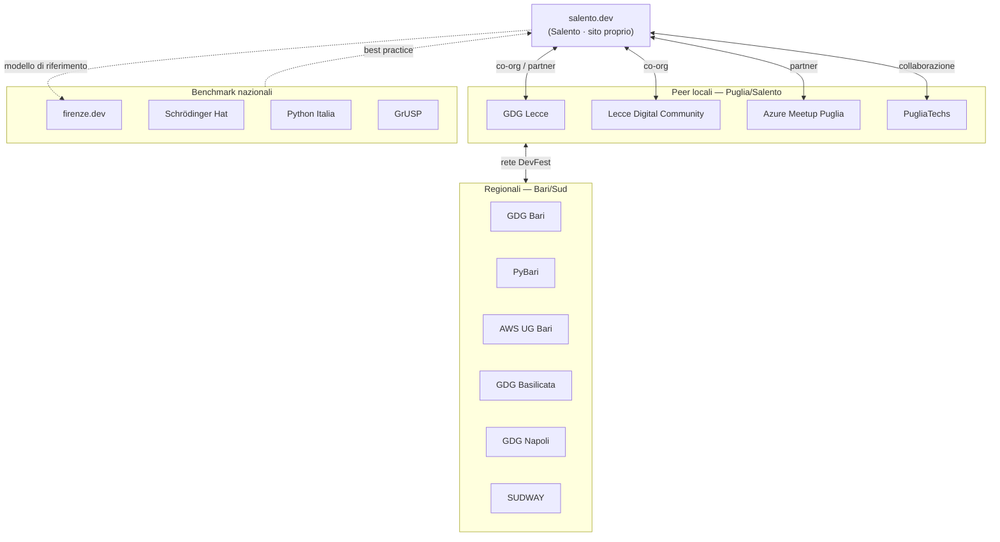

# 14 · Analisi dei competitor e community di riferimento

Analisi dell'ecosistema in cui opera salento.dev: community **peer locali** (Puglia e Sud Italia), **benchmark nazionali** italiani, e confronto tra le **piattaforme** per community. L'obiettivo è inquadrare il posizionamento di salento.dev e le opportunità di collaborazione.

> **Metodologia.** Ricerca web (giugno 2026) con verifica diretta dei siti ufficiali, piattaforme (community.dev, Meetup.com, Luma), GitHub e Open Collective, oltre a directory curate (`awesome-italian-tech-communities`, `italiaopensource.com`, `eventitech.it`). I dati numerici (membri, anni) sono indicati con la fonte; dove non verificabili sono segnalati come stime. Le fonti puntuali sono in fondo al documento.

---

## 1. Mappa dell'ecosistema

salento.dev è **già inserita** in questa rete: community partner del DevFest Lecce 2025 e del DevFest Basilicata 2026, co-organizzatrice del Bowling Meetup con Lecce Digital Community.

---

## 2. Peer locali (Puglia e Sud Italia)

| Community | Area | Membri (fonte) | Piattaforma | Sito proprio | Attività |
|-----------|------|----------------|-------------|--------------|----------|
| **GDG Lecce** | Lecce | 571 (community.dev) | gdg.community.dev | No (solo per DevFest) | Talk, workshop, DevFest |
| **Lecce Digital Community** | Lecce | ~504 (Instagram) | Instagram + Eventbrite | No | Networking, pop-up coworking |
| **Azure Meetup Puglia** | Puglia (itinerante) | 195 (Meetup) | GitHub Pages + Meetup | Parziale (GitHub Pages) | Meetup Azure/Cloud |
| **GDG Bari** | Bari | 2.031 (community.dev) | gdg.community.dev | No (solo DevFest) | Meetup mensili, DevFest |
| **PyBari** | Bari | 704 (Meetup) | Meetup + bari.python.it | Minimale | Talk Python, PyBeer |
| **AWS User Group Bari** | Bari | 515 (Meetup) | Meetup.com | No | Meetup AWS (online) |
| **PugliaTechs** | Puglia (itinerante) | 1.800+ (autodich.) | Sito + Luma | Sì | Meetup mensili dual-track |
| **GDG Basilicata** | Potenza/Matera | 341 (community.dev) | gdg.community.dev | No | Meetup, DevFest |
| **GDG Napoli** | Napoli | 1.753 (community.dev) | gdg.community.dev + gdgnapoli.it | Sì | Hackathon, DevFest (1.000+) |
| **SUDWAY** | Calabria/Sud | ~65 (talent pool) | sudway.it | Sì | Talent pool, eventi IRL |
| **FabLab Poliba** | Bitonto (BA) | n.d. | fablabpoliba.org | Sì | Maker, prototipazione |

### Profili chiave

**GDG Lecce** (fond. 2024) — il competitor più diretto per territorio e target. Forza: brand Google globale, accesso a speaker internazionali, DevFest Lecce 2025 (~519 iscritti, 4 track, hackathon). Debolezza: nessun sito proprietario (identità ospitata su `gdg.community.dev`), radicamento territoriale ancora giovane, nessuna sezione editoriale permanente. **Sinergia: alta** — ha già listato salento.dev tra i partner del proprio DevFest.

**PugliaTechs** (fond. fine 2024) — il benchmark regionale più dinamico. Forza: crescita rapidissima (1.800+ in 6 mesi), formato dual-track Tech+Business, eventi in inglese, partner istituzionali di peso (Aeroporti di Puglia, Poliba, LUM, Impact Hub), struttura APS. Debolezza: target misto (meno profondità tecnica), eventi su Luma (non sito proprio), focus prevalente sul barese. **Sinergia: alta** — copre il Salento ma ha bisogno di referenti locali; differenziazione naturale (loro startup/AI/business, salento.dev developer puri).

**GDG Bari** (attivo dal ~2012) — il più grande e maturo della regione (2.031 membri, DevFest ~700 presenti, Discord permanente). Rappresenta un **modello di crescita** per salento.dev. Stessa vulnerabilità di dipendenza da `community.dev`.

**Lecce Digital Community** — posizionamento più ampio ("digitale" non solo developer) ma attività eventi molto ridotta e nessun sito proprio. Utile come canale di amplificazione per eventi generalisti (già co-organizzato il Bowling Meetup).

**Azure Meetup Puglia / AWS User Group Bari / PyBari** — community verticali (Azure / AWS / Python) di dimensione medio-piccola. Sinergie su sessioni cloud/DevOps/Python specifiche.

**GDG Napoli** — fuori area ma benchmark di maturità: **sito proprio** (`gdgnapoli.it`) oltre alla piattaforma GDG, DevFest con 1.000+ presenti e Startup Challenge con investitori.

**SUDWAY** — non una community classica ma un **talent pool curato** del Sud con modello di recruiting che finanzia la gratuità per i talenti. Sinergia: scouting ai membri senior.

---

## 3. Benchmark nazionali

| Organizzazione | Sede | Anno | Natura | Cosa la rende un riferimento |
|----------------|------|------|--------|------------------------------|
| **firenze.dev** | Firenze | n.d. | No-profit | **Il modello più simile**: dev locali, meetup gratuiti, identità territoriale, Open Collective |
| **Schrödinger Hat** | Firenze | 2020 | APS | Collettivo non gerarchico, OSDay, trasparenza Open Collective, sito conferenza open source |
| **Python Italia / PyCon** | Campi Bisenzio | 2007 | APS | Programma votato dalla community, CFP anonimo, grants D&I, URL per edizione |
| **GrUSP** | Faenza | 2003 | Associazione | Portafoglio di conferenze (phpday, jsday...), scholarship, CoC a 4 livelli, siti open source |
| **Codemotion** | Roma | 2013 | S.r.l. | Piattaforma umbrella per community, magazine, track multiple, modello B2B |
| **Talent Garden** | Brescia | 2011 | S.p.A. | Coworking + formazione + eventi (campus anche al Sud) |
| **Develer** | Campi Bisenzio | 2001 | S.r.l. | Azienda che finanzia l'ecosistema community (RustLab, GoLab, TechLabs) |
| **The Communities Bay** | Online | 2020 | Network | Aggregatore di 20+ community tech italiane |
| **Italia Open-Source** | Online | n.d. | Piattaforma | Directory open delle community/progetti italiani |
| **Superhero Valley** | Pisa | 2020 | No-profit | Community universitaria → mentoring Big Tech, partnership accademiche |
| **CoderDojo Italia** | Multi-città | 2012 | Movimento | Coding gratuito under-17, modello peer learning |

### Lezioni replicabili (le più rilevanti per salento.dev)

- **firenze.dev** — il gemello quasi perfetto: stessa tipologia e filosofia. Da copiare: **Open Collective** per la trasparenza, struttura sito essenziale (Home/Eventi/Community/About/Contatti), partnership con GrUSP e Codemotion per visibilità senza perdere autonomia, **Discord** come hub.
- **Schrödinger Hat** — sito della conferenza **open source su GitHub** (replicabile, dato che salento.dev è già open source), merchandise come sostenibilità secondaria, un progetto open source di punta come "anchor".
- **Python Italia** — **programma votato** da chi acquista il biglietto e **CFP anonimizzato** (si vota il talk, non il nome): contrasta il bias di notorietà; **grants D&I** finanziati da sponsor dedicati.
- **GrUSP** — espansione progressiva "una conferenza per tecnologia", **scholarship program** strutturato, **Code of Conduct a 4 livelli** (gold standard per eventi).
- **Develer** — modello in cui un'**azienda locale** finanzia l'ecosistema in cambio di brand/talent: template per gli sponsor salentini. Format **TechLabs** (serale: teoria + pratica + aperitivo) replicabile.
- **The Communities Bay / Italia Open-Source** — **aderire/farsi catalogare** per visibilità nazionale a costo ~0.

---

## 4. Confronto delle piattaforme

| Piattaforma | Ownership dati | Discovery | Costo | Note |
|-------------|----------------|-----------|-------|------|
| **Sito proprio** | **Totale** | Bassa (serve SEO/social) | Hosting + manutenzione | Brand, archivio, SEO composto, CRM |
| **Meetup.com** | Nulla (no email iscritti) | Alta (per area/topic) | ~$45/mese organizzatore **+ paywall iscritti** (dal 2024) | In declino dopo l'acquisizione Bending Spoons |
| **Luma (lu.ma)** | Alta (email + telefono export) | Bassa fuori dalle grandi città | Gratis (5% su eventi a pagamento) | Migliore per **RSVP + raccolta contatti** |
| **GDG / community.dev** | Bassa (gestita da Bevy/Google) | Media-alta (network globale) | Gratis (per GDG) | Legittimità Google, ma vendor lock-in |
| **Eventbrite** | Media | Alta su eventi a pagamento | Fee ~3,7% + €1,79/biglietto | Solo per eventi ticketed speciali |
| **Discord/Telegram** | Media | Nulla | Gratis | Per la **conversazione**, non per gli eventi |

**Quando conviene il sito proprio?** Sempre come *centro strategico*, in particolare se: hai già un'audience (anche piccola), vuoi possedere i dati, punti alla SEO locale ("developer Salento", "eventi tech Puglia"), vuoi un brand riconoscibile e asset a lungo termine (archivio talk, knowledge base). Le piattaforme esterne sono **canali di acquisizione**; il sito è **ritenzione e capitalizzazione**.

---

## 5. Sito proprietario vs piattaforme terze: il vantaggio di salento.dev

La distinzione è il principale **vantaggio competitivo** di salento.dev nell'ecosistema locale.

**Con sito proprietario completo:** salento.dev, PugliaTechs (ma eventi su Luma), GDG Napoli (oltre a community.dev), FabLab Poliba, SUDWAY.

**Senza sito proprietario (dipendenti da terzi):** GDG Lecce, GDG Bari, GDG Basilicata (tutti su `community.dev`), Lecce Digital Community (Instagram/Eventbrite), AWS UG Bari (Meetup), PyBari (parzialmente).

**Implicazioni a favore di salento.dev:**
1. **Identità digitale sovrana** — possiede storia, contenuti e dati; nessuna dipendenza da decisioni di Google/Meetup.
2. **SEO autonomo** — i contenuti editoriali (risorse, storie, pagine evento archiviate) costruiscono autorità di dominio; le piattaforme aggregano il traffico su sé stesse.
3. **Brand riconoscibile** — design identity propria (dark/cyber-terminal), impossibile su piattaforme terze.
4. **Sezione editoriale** — risorse e storie generano valore permanente e fidelizzazione: **nessun altro peer locale ha un comparto editoriale proprio**.
5. **Dati di prima parte** — raccolta diretta (newsletter, iscrizioni) senza intermediari.

**Contropartite (da gestire):**
1. **Discovery iniziale** più difficile (Meetup/community.dev hanno pubblico pronto) → mitigare con SEO + presenza social + listing su directory.
2. **Costo di manutenzione** del sito (mitigato dall'essere open source e dalla community stessa di sviluppatori).
3. **Nessun effetto-rete della piattaforma** → compensare aderendo a network (The Communities Bay, Codemotion community) e alla rete DevFest.

---

## 6. Posizionamento e raccomandazioni

1. **Hub editoriale dei developer del Salento** — nessun peer locale ha una sezione risorse/storie propria: pubblicare contenuti tecnici di qualità rende salento.dev un punto di riferimento informativo permanente, non solo un aggregatore di eventi.
2. **Profondità tecnica come differenziatore** — mentre PugliaTechs punta a tech+business+startup, salento.dev può presidiare la dimensione tecnica pura (live coding, code review collaborative, pair programming, workshop hands-on).
3. **Radicamento territoriale** — la rotazione degli eventi nei comuni del Salento e i format social (AperiDev) costruiscono una prossimità che le community di Bari o i brand globali non possono replicare.
4. **Coltivare la rete DevFest** — mantenere e ampliare la presenza come community partner (Lecce, Bari, Basilicata) per visibilità verso migliaia di membri GDG.
5. **Affiliazioni leggere a costo ~0** — catalogazione su Italia Open-Source, adesione a The Communities Bay, listing eventi su Codemotion community.

Le azioni operative derivanti sono in [13 · Attività e strategia](./01_attivita_e_strategia.md).

---

## Fonti

### Peer locali
- [GDG Lecce](https://gdg.community.dev/gdg-lecce/) · [DevFest Lecce 2025](https://gdg.community.dev/events/details/google-gdg-lecce-presents-devfest-lecce-2025/)
- [Lecce Digital Community — Instagram](https://www.instagram.com/lecce_digital_community/) · [Eventbrite](https://www.eventbrite.it/o/lecce-digital-community-111842558721)
- [Azure Meetup Puglia](https://azure-meetup-puglia.github.io/) · [Meetup](https://www.meetup.com/azure-meetup-puglia/)
- [GDG Bari](https://gdg.community.dev/gdg-bari/) · [DevFest Bari 2025](https://bari.devfest.it/)
- [PyBari — Meetup](https://www.meetup.com/python-bari/) · [bari.python.it](https://bari.python.it/)
- [AWS User Group Bari](https://www.meetup.com/it-IT/AWS-User-Group-Bari/)
- [PugliaTechs](https://www.pugliatechs.com/) · [StartupBusiness](https://www.startupbusiness.it/en/pugliatechs-the-community-for-technological-and-sustainable-innovation/145300/)
- [GDG Basilicata](https://gdg.community.dev/gdg-basilicata/)
- [GDG Napoli](https://gdg.community.dev/gdg-napoli/) · [Napoli DevFest 2025](https://www.ildenaro.it/napoli-devfest-2025-oltre-mille-partecipanti-alla-citta-della-scienza/)
- [SUDWAY](https://sudway.it/) · [FabLab Poliba](https://www.fablabpoliba.org/) · [LugMap Puglia](https://lugmap.linux.it/puglia/)

### Benchmark nazionali
- [firenze.dev](https://firenze.dev/) · [Schrödinger Hat](https://schroedinger-hat.org/) · [Open Collective](https://opencollective.com/schrodinger-hat)
- [Associazione Python Italia](https://associazione.python.it/) · [PyCon Italia 2026](https://2026.pycon.it/en)
- [GrUSP](https://www.grusp.org/en/) · [GrUSP Code of Conduct](https://www.grusp.org/en/coc/) · [Scholarship](https://www.grusp.org/en/conferences_/scholarships/)
- [Codemotion](https://www.codemotion.com/) · [Talent Garden](https://talentgarden.com/en/) · [Develer](https://www.develer.com/) · [TechLabs/community](https://www.develer.com/blog/develer-e-le-community-tecnologiche/)
- [The Communities Bay](https://thecmmbay.com/) · [Italia Open-Source](https://italiaopensource.com/) · [Superhero Valley](https://superherovalley.fun) · [CoderDojo Italia](https://www.coderdojoitalia.org/)

### Piattaforme e modelli
- [Luma vs Meetup](https://help.luma.com/p/luma-vs-meetup) · [Meetup alternatives](https://happenow.app/blog/meetup-alternatives)
- [Contributor Covenant](https://www.contributor-covenant.org/) · [CHAOSS](https://chaoss.community/) · [devopsdays](https://devopsdays.org/) · [Coderetreat](https://www.coderetreat.org/)
- [awesome-italian-tech-communities](https://github.com/GuidoPenta/awesome-italian-tech-communities) · [awesome-italy-events](https://github.com/ildoc/awesome-italy-events)

> Alcune date di fondazione e cifre di membership non sono verificabili da fonti ufficiali e sono indicate come stime al momento della ricerca (giugno 2026).
