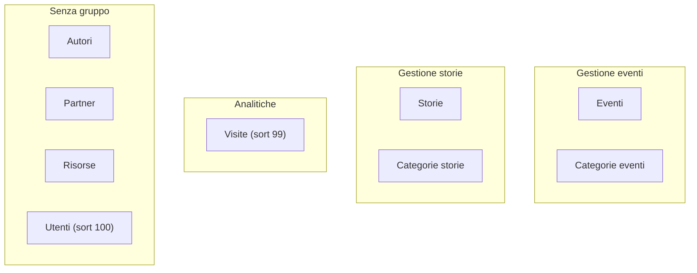

# 07 · Pannello admin (Filament)

Il pannello è costruito con **Filament 5** e montato su `/admin`. La configurazione è in `app/Providers/Filament/AdminPanelProvider.php`.

---

## Configurazione del Panel

| Aspetto | Valore |
|---------|--------|
| Panel di default | sì (`->default()`) |
| ID | `admin` |
| Path URL | `/admin` |
| Login | abilitato (`->login()`) |
| Reset password | abilitato (`->passwordReset()`) |
| Colore primario | `Color::Amber` |
| Discovery Resources | `app/Filament/Resources` |
| Discovery Pages | `app/Filament/Pages` (+ `Dashboard`) |
| Discovery Widgets | `app/Filament/Widgets` |
| Brand/logo/favicon/dark mode | non impostati (default Filament) |
| Plugin | nessuno |

I middleware web standard di Filament sono registrati nel provider, con `Authenticate` come auth middleware.

---

## Autenticazione e accesso

- Il modello `User` implementa `FilamentUser`; **`canAccessPanel()` ritorna sempre `true`**: ogni utente autenticato accede all'intero pannello. **Non esistono ruoli, policy o gate.**
- Guard: `web` (default Laravel). Login e reset password forniti da Filament.
- Password: cast `hashed`.

**Creare un utente admin**

```bash
./vendor/bin/sail artisan make:filament-user
```

Oppure via seeder (`admin@salento.dev` / `password123`), oppure dalla risorsa **Utenti** nel pannello.

> ⚠️ L'assenza di autorizzazione granulare è un punto di attenzione: vedi [12 · Note e debito tecnico](12-note-e-debito-tecnico.md).

---

## Convenzione delle risorse

Ogni risorsa segue lo stesso schema di file:

```
app/Filament/Resources/<Nome>/
├── <Nome>Resource.php        # modello, icona, navigation, slug
├── Schemas/<Nome>Form.php    # definizione del form
├── Tables/<Nome>Table.php    # definizione della tabella
├── Pages/                    # List / Create / Edit
└── RelationManagers/         # (solo Events e Resources)
```

Comportamenti comuni: le pagine **Create** estendono `CreateRecord`; le pagine **List** hanno header `CreateAction`; le pagine **Edit** hanno header `DeleteAction`. **Nessuna** risorsa ha pagina **View**.

---

## Risorse

### Eventi (`Events`)
- Modello `Event`, gruppo **Gestione eventi**, icona `OutlinedRectangleStack`.
- **Form:** `title`, `slug` (unique), `location`, `address`; `starts_at`/`ends_at` (`DateTimePicker`, tz `Europe/Rome`, `ends_at` ≥ `starts_at`); `excerpt` (`Textarea`), `body` (`MarkdownEditor`); `image_path` (`FileUpload` immagine, disk public dir `events`); toggle `is_published`/`work_in_progress`/`is_community_event`; `Select categories` (multiple, solo categorie attive) e `Select partners` (multiple); **`Repeater media`** (relazione `media`, riordinabile, clonabile) con sotto-campi `media_type`, `source_type` (live), `file_path`/`external_url` condizionali, `caption`.
- **Tabella:** immagine, `title`, `location`, categorie (badge), `starts_at`/`ends_at`; icone booleane `is_published`, `work_in_progress` (wrench/check), `is_community_event` (star/user-group); filtri ternari su pubblicazione/WIP/community + filtro categorie. Default sort `starts_at` desc.
- **RelationManager `Resources`:** gestisce l'associazione molti-a-molti Eventi↔Risorse con `AttachAction`/`DetachAction`.

### Categorie eventi (`EventCategories`)
- Modello `EventCategory`, gruppo **Gestione eventi**, icona `OutlinedTag`.
- **Form:** `name`, `slug` (unique), `sort_order`, `is_active`, `description`.
- **Tabella:** `name`, `slug`, `is_active` (icona), `events_count` (badge). Default sort `sort_order`, **drag&drop** (`reorderable`).

### Storie (`Stories`)
- Modello `Story`, gruppo **Gestione storie**, icona `OutlinedBookOpen`.
- **Form:** `title`, `slug` (unique); `Select story_category_id` (categorie attive); `Select authors` e `Select protagonists` (multiple); `excerpt` e `body` (`MarkdownEditor`); `image_path` (`FileUpload`); `is_published` (live); `published_at` (`DateTimePicker`, **visibile solo se `is_published`**).
- **Tabella:** immagine, `title`, avatar autori (stacked), categoria (badge), `read_time_minutes` (suffisso ` min`), `is_published`, `published_at`. Filtri: pubblicazione + categoria. Default sort `published_at` desc.

### Categorie storie (`StoryCategories`)
- Modello `StoryCategory`, gruppo **Gestione storie**, icona `OutlinedTag`.
- **Form:** `name`, `slug` (unique), `sort_order`, `is_active`.
- **Tabella:** `name`, `slug`, `is_active`, `stories_count` (badge). Default sort `sort_order`, riordinabile.

### Risorse (`Resources`)
- Modello `Resource` (aliasato `ResourceModel`), icona `OutlinedRectangleStack`, senza gruppo.
- **Form:** `title`, `description`; `is_published`; `Select source_type` (`link`/`file`, live); `external_url` (visibile/required se `link`); `file_path` (`FileUpload` con ampia lista di tipi: PDF, documenti Office/Open, archivi — visibile/required se `file`); `Select authors` (multiple).
- **Tabella:** `title`, avatar autori (stacked), `source_type` (badge File/Link), `is_published`. Filtro su pubblicazione. Default sort `updated_at` desc.
- **RelationManager `Events`:** lato inverso dell'associazione Eventi↔Risorse.

### Partner (`Partners`)
- Modello `Partner`, icona `OutlinedBuildingStorefront`, senza gruppo.
- **Form:** `name`, `description`, `logo_path` (`FileUpload` immagine, dir `partners/logos`), `website_url`, `is_published`.
- **Tabella:** logo, `name`, `is_published`. **Solo `EditAction`** inline (niente delete inline; delete via bulk).

### Autori (`Authors`)
- Modello `Author`, icona `OutlinedUserGroup`, senza gruppo.
- **Form:** 3 sezioni — *Identità* (`name`, `role`, `bio` con helperText dinamici dal profilo GitHub), *Avatar* (`FileUpload` dir `authors` + anteprima live con fallback ui-avatars), *Profili Social* (`github_username` con prefix e live debounce, `linkedin_url`, `twitter_url`, `website_url`).
- **Tabella:** avatar (circolare), `name`, `role`, `github_username` (link), `stories_count` e `resources_count` (badge), `updated_at`.

### Visite (`PageViews`) — analytics, sola lettura
- Modello `PageView`, gruppo **Analitiche**, `navigationSort` 99, icona `OutlinedChartBar`.
- **`canCreate()` ritorna `false`**: solo pagina `index` (`ListPageViews`), nessun form.
- **Tabella:** `path`, `referrer`, `user_agent` (limit 50), `created_at` (tz `Europe/Rome`). Filtri custom `today`/`this_week`/`this_month`. Default sort `created_at` desc; paginazione `[25,50,100]`.

### Utenti (`Users`)
- Modello `User`, icona `OutlinedUsers`, `navigationSort` 100 (in fondo).
- **Form:** `name`, `email` (unique); `password` **required solo in create**, `hiddenOn('edit')`, `dehydrated` solo se valorizzato (in modifica non si cambia da qui).
- **Tabella:** `name`, `email`, `email_verified_at` (placeholder "Non verificata"). **Solo `EditAction`** inline; delete via bulk.

---

## Widget della dashboard

Tutti in `app/Filament/Widgets/`, polling 60s.

| Widget | Tipo | Contenuto |
|--------|------|-----------|
| `PageViewStatsWidget` | StatsOverview | 4 statistiche `PageView`: Oggi, Questa settimana, Questo mese, Totale. |
| `PageViewsChartWidget` | Chart (line) | Visite per giorno negli ultimi 30 giorni (colonna piena). |
| `TopEventsWidget` | Table | Top 5 eventi per `pageViews` (`withCount`). |
| `TopStoriesWidget` | Table | Top 5 storie per `pageViews`. |
| `TopReferrersWidget` | Table | Top 10 sorgenti di traffico (referrer esterni, escluso host interno). |
| `AccountWidget` | nativo Filament | Info account loggato. |

> `FilamentInfoWidget` è importato nel provider ma **non** registrato.

---

## Navigazione admin (gruppi)



Nessuna risorsa definisce `navigationBadge` o `slug` personalizzato; gli slug sono generati da Filament (`events`, `event-categories`, `stories`, `page-views`, ...).

---

## Config che NON influenzano l'admin

`config/community.php` e `config/navigation.php` servono al **frontend pubblico** (menu, dati community/social), non al pannello: nessuna risorsa/widget admin vi fa riferimento.
